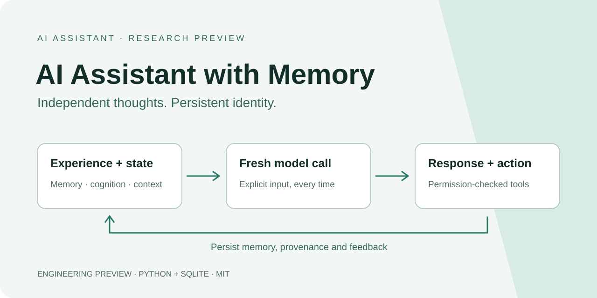
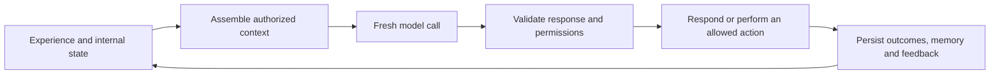

# AI Assistant with Memory · 有记忆的 AI 助手

**Independent thoughts. Persistent identity.**

An experimental digital-life system with persistent identity, memory, cognition, and independent LLM calls.

[简体中文](README.zh-CN.md) · [First run](docs/operations/public-first-run.md) · [Demo guide](docs/operations/public-demo.md) · [中文教材](docs/book/README.md) · [Contributing](CONTRIBUTING.md) · [MIT](LICENSE)



## What makes it different?

Each thought starts with a fresh model call. The system explicitly assembles the current task, authorized memories, conversation context and internal features; identity and history persist outside the model session.

- **Persistent memory and cognition:** source-linked recall, candidate beliefs and corrections, without treating a model interpretation as verified fact.
- **Inspectable activity:** a management panel shows public responses, recorded model inputs/outputs, feature context, call status and timing—not hidden chain of thought.
- **Controlled change:** bounded project-file tools, private Git history, update proposals, deployment checks and failure recovery. Deployment and wake remain CLI operations.

This is the **00 engineering preview**, software version **0.5.0**, intended primarily for one local root controller. It does not establish consciousness or subjective experience.

## Try the panel without a model

Use a source checkout with Python 3.9+ and SQLite 3.37+ with JSON and FTS5 support. Check the SQLite bundled with your Python:

```sh
python3 -c 'import sqlite3; print(sqlite3.sqlite_version)'
```

From the project root, using a fresh demo path:

```sh
python3 -m digital_life --data work/public-preview prepare
python3 scripts/development/install_accounts.py --data work/public-preview --install
python3 -m digital_life --data work/public-preview serve --port 18766
```

Open **http://127.0.0.1:18766/** and set the initial root password. This creates a separate, locked instance and starts only the panel: no model download, inference or wake. Empty activity history is expected. Stop the panel with Ctrl+C.

For a configured conversation, follow the [first-run guide](docs/operations/public-first-run.md). Do not run the existing-instance shortcut as your first setup step: `start-chat.command` defaults to a previously prepared personal instance.

## How continuity works



Thinking is inference, planning and generation performed inside cognition by an LLM or another reasoner. Personality influences cognition and action probabilities; memory and cognition influence each other. Identity is not reduced to a personality vector.

## Current scope

| Available engineering capabilities | Still limited or unverified |
| --- | --- |
| Chat, explicit context, source-linked memory and cognitive candidates | Long-term digital-life criteria and scientific learning effectiveness |
| Accounts, memory domains and root permissions | Ordinary accounts interacting with all global life modules |
| Project-file tools, version records and deployment recovery | Portable Docker/OCI candidate isolation; current native protection is platform-specific |
| Habit candidate collection with confirmation | Autonomous personality growth and continuously enabled exploration |

These capabilities require their respective configuration; a fresh panel preview does not enable them all. Model services, credentials, weights and personal instance data are not included. Full operation expects a Unix-style environment; platform-dependent checks are not universal compatibility claims.

## Development and validation

The runtime uses the Python standard library and SQLite. Node.js 22+ is used for UI component checks; model providers and packaging tools have separate requirements.

```sh
PYTHONDONTWRITEBYTECODE=1 python3 -m unittest tests.test_architecture tests.test_chat tests.test_codex_post_usage
node scripts/verification/verify_thought_inspection_ui.mjs
```

The latest directory-refactor validation covered **2,035 discovered cases: 2,032 passed and 3 explicit local-model tests skipped**, using segmented runs and targeted retests after fixes. It was not one uninterrupted all-green run, and it does not establish real-model or long-horizon acceptance. See the [validation record](docs/maintenance/directory-refactor-fixes-2026-11-15.md).

## Explore and contribute

- [Documentation](docs/README.md) and [source layout](docs/architecture/project-structure.md)
- [Operational definition of life](docs/research/digital-life-definition.md) and [first-phase research](docs/research/phase-1-complete-report.md)
- [Model configuration](docs/operations/llm-configuration.md)
- [Contribution guide](CONTRIBUTING.md) and [security reporting](SECURITY.md)

Near-term work: account-scoped global modules, a reproducible new-user experience, portable candidate isolation, and bounded long-term evaluation. Small documentation fixes and synthetic bug reproductions are welcome.

Licensed under [MIT](LICENSE). Model providers and third-party tools retain their own terms.

The project name is AI Assistant with Memory; historical instance labels and the `primordial00` compatibility import are not the project brand. The distribution name is `ai-assistant-with-memory`; Python imports remain `digital_life`.
