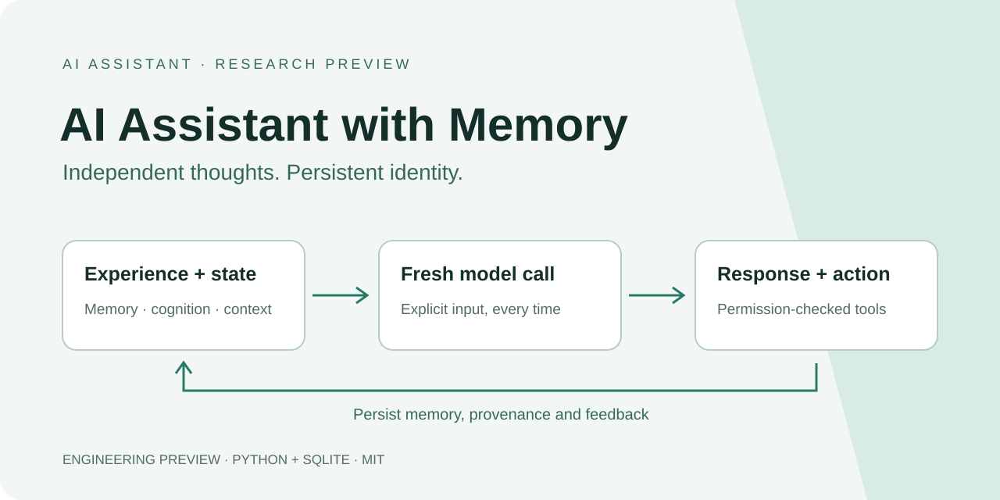

# 有记忆的 AI 助手 · AI Assistant with Memory

**每次独立思考，让身份与经历持续存在。**

一个探索持续身份、记忆与认知的数字生命工程原型。每次思考使用完整、干净的 LLM 调用，连续性由系统持久化的经历和状态承接。

[English](README.md) · [首次运行](docs/operations/public-first-run.md) · [演示流程](docs/operations/public-demo.md) · [从零学习教材](docs/book/README.md) · [参与贡献](CONTRIBUTING.md) · [MIT 许可证](LICENSE)



## 它有什么特点？

- **记忆与认知有来源。** 明确组织召回记忆、候选认识和更正，保留历史；模型的解释不自动成为事实。
- **每次思考可以核对。** 面板展示当时提供的输入、公开输出、特征、调用状态及耗时，不展示或声称获得模型隐藏推理。
- **修改与部署有边界。** 指定目录的文件工具、私有 Git、更新提案、部署验证及失败恢复；唤醒和部署由 CLI 控制。

当前为 **00 工程预览版**，软件版本 **0.5.0**，主要面向本机 root 单人使用。工程原型不代表意识或主观体验已经证实。

## 不接模型，先看面板

需要 Python 3.9+，以及 Python 自带的 SQLite 3.37+、JSON 和 FTS5。先确认实际 SQLite 版本：

```sh
python3 -c 'import sqlite3; print(sqlite3.sqlite_version)'
```

在源码目录执行，使用尚未存在的演示目录：

```sh
python3 -m digital_life --data work/public-preview prepare
python3 scripts/development/install_accounts.py --data work/public-preview --install
python3 -m digital_life --data work/public-preview serve --port 18766
```

打开 **http://127.0.0.1:18766/**，首次设置 root 密码。这里只创建独立的锁定实例并打开面板，不下载模型、不调用推理、不唤醒。没有活动记录是正常的；Ctrl+C 关闭面板。

想接入模型交流，请继续阅读[首次运行指南](docs/operations/public-first-run.md)。`start-chat.command` 面向已有个人实例，不是新用户的初始化入口。

## 一次活动如何连续？


思考是认知内部由推理器承担的推断、规划和生成能力。人格影响认知与行为概率，记忆和认知双向影响；身份独特性不等同于一组人格参数。

## 当前能力与边界

| 已有工程能力 | 仍有限制或待验证 |
| --- | --- |
| 聊天、显式上下文、记忆召回与认知候选 | 长期生命判据与学习效果的科学评测 |
| 账户、记忆域与 root 权限 | 普通账户和全部全局生命模块的适配 |
| 项目文件工具、版本记录与部署恢复 | 通用 Docker/OCI 验证隔离；当前原生保护有平台限制 |
| 习惯候选积累与确认机制 | 自动人格成长与持续启用的自主探索 |

各模块需要相应配置，空白预览实例不会自动启用全部能力。仓库不提供模型权重、服务额度、凭据或个人实例数据。完整运行依赖 Unix 风格环境；平台相关测试不代表跨平台全部验证通过。

## 开发与验证

运行代码使用 Python 标准库及 SQLite。界面组件检查使用 Node.js 22+，模型服务与打包工具另行准备。

```sh
PYTHONDONTWRITEBYTECODE=1 python3 -m unittest tests.test_architecture tests.test_chat tests.test_codex_post_usage
node scripts/verification/verify_thought_inspection_ui.mjs
```

最近目录重构验证发现 **2,035 项：2,032 项通过，3 项需显式启用本地模型的测试跳过**。结果来自分段运行与失败补充复验，并非一次未中断的全绿运行，也不代替真实模型及长期验收。详见[验证记录](docs/maintenance/directory-refactor-fixes-2026-11-15.md)。

## 继续了解

- [文档导航](docs/README.md)与[工程结构](docs/architecture/project-structure.md)
- [生命定义](docs/research/digital-life-definition.md)与[第一阶段研究报告](docs/research/phase-1-complete-report.md)
- [模型配置](docs/operations/llm-configuration.md)
- [参与贡献](CONTRIBUTING.md)与[安全问题反馈](SECURITY.md)

近期重点为账户域适配、新用户体验、通用候选隔离和有边界的长期评测。欢迎从文档修正、最小问题复现和独立小功能开始参与。

代码采用 [MIT](LICENSE) 许可证；模型供应商及外部工具遵守各自条款。

项目名为“有记忆的 AI 助手”；历史实例名称及 `primordial00` 兼容导入不作为项目品牌。分发包名为 `ai-assistant-with-memory`，主 Python 导入仍为 `digital_life`。
