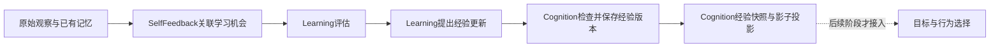

# 认知—经验归属与第一阶段调整 V0.2

当前量化实现见[经验测量V0.1](experience-measurement-v0.1.md)：所有权不变，认知经验v0.3可接纳带封存对照报告的数值；下文保留V0.2阶段“仅unknown”的实现及验证历史。

日期：2026-11-08。作者：Codex 主 agent（/root），无委派。
任务：将影子统计纳入“认知—经验”，学习负责评估与提出更新，认知负责保存经验版本；同步生命工程和系统工程设计，实际选择暂不接入，正式实例保持锁定。

本文件是当前归属说明，取代[原闭环设计 V0.1](self-feedback-loop-design-v0.1.md)中“兴趣模型拥有统计、学习直接提交兴趣版本”的部分。人格、意图、成本、来源及预算原则仍沿用原设计。[机器约定 V0.2](self-feedback-loop-contract-v0.2.json)对应本轮实现与后续设计边界。

## 1 用简单话说明

记忆保存“发生过什么”；认知中的经验保存“这些经历说明什么、在什么情况下适用”；学习根据新结果评估并提出修正。目标和行为将来读取认知经验，不直接从学习模块拿另一套分数。

例如，原始记录可以说明某次读取失败；认知经验可以逐渐形成对某种方法在某类情境下效果的判断。当前第一阶段只有可追溯的影子统计，尚不能自动形成或验证完整的自然语言经验概括；缺测量的收益继续为unknown。

“经验”是认知持有的一类可修正内容，不是新的人格、独立兴趣生命模块，也不增加一套与既有六环节认知过程竞争的循环。形成与修正经验仍通过已有的解释、信念更新、预测评价和元认知完成。

## 2 生命工程与系统工程的对应

| 生命工程概念 | 业务所有者 | 系统实现及记录 | 本阶段边界 |
| --- | --- | --- | --- |
| 经历、原始观察和来源 | 原始记录／记忆及观察生产者 | 既有action_results、evidence、Memory和不可变事件；SelfFeedback只挂接引用 | 不复制成新证据，不改历史回执 |
| 经验判断与方法效果估计 | **认知—经验 M03** | Cognition门面＋cognition_experience.py；cognition.experience_saved版本及只读投影 | shadow-not-world-fact，不提升为权威世界事实 |
| 新结果是否支持修正 | **学习 M14** | Learning.assess_experience；learning.experience_assessed | 当前无独立测量，gain=null |
| 应更新哪份经验、从哪个版本更新 | 学习提出，认知检查 | Learning.propose_experience／invalidation → Cognition.save_experience | 比较预期版本，一次保存，冲突不能覆盖 |
| 对经验的使用 | 目标／行为读取认知输出 | 未来通过Cognition.experience_snapshot，而非直读学习事件 | 本阶段不接模型输入、排序或选择 |
| 存储、事务和可观测性 | M17提供机制，不拥有业务含义 | SQLite runtime_events＋不可变artifacts＋重放 | 同一物理库不等于共同业务写入权 |
| 探索流程装配 | 应用协调器 | SelfFeedback连接既有观察、学习、认知接口 | 不是经验所有者，不生成自己的收益分数 |

人格仍通过既有认知／目标／行为路径起作用；不能在读取经验时再重复加一遍人格分。实际人格和行为策略的其他并发实现保持，本轮不改变其配置和选择。

## 3 实际调用链与写入边界

在经验这条链路中，Learning只新增评估和提案，不能直接写cognition.experience_saved。Cognition只接受同实例、正确类型和约定的学习提案，核对机会／单元／评估关系；当前拒绝任何伪装为已测量的非空gain。单纯调用Learning.propose_experience，不会产生经验版本。

Cognition门面是业务入口；cognition_experience.py是认知内部的版本与投影实现。旧interest_model.py只保留兼容别名，实际计算已移至ExperienceProjection，没有第二份持久统计或独立“兴趣所有者”。SelfFeedback.shadow_interest及旧CLI projection仍可调用，但委托认知并标owner=cognition.experience。

## 4 记录、版本与事务

| 记录 | event source／type | 主要内容 |
| --- | --- | --- |
| 原学习机会 | self-feedback／self_feedback.opportunity | 原result、evidence、预期、暴露键、来源及单元 |
| 学习评估 | learning-experience／learning.experience_assessed | 机会、gain/status、原因、来源、目标所有者 |
| 经验更新提案 | learning-experience／learning.experience_proposed | assessment_ref、owner、cell、expected_revision、变更种类 |
| 认知经验版本 | cognition-experience／cognition.experience_saved | experience_ref、revision、previous_revision_ref、proposal_ref、assessment_ref、影子状态 |

提案事件的生产者由source=learning-experience标识；payload.owner指拟更新的状态所有者cognition.experience，两者不是双重写入权。

当前经验单元沿用“意图类别／观察方法／情境桶／测量版本”，experience_ref由单元稳定生成，revision从1递增。一个版本挂接一条合格格式的评估或失效提案；多个来源可按同一单元积累，旧版本不覆盖。单元目前仍标unclassified／unmeasured，不冒称已学会语义分类。

Learning提案明确expected_revision；Cognition在写事务内检查当前版本。一致才追加新版本，随后版本保留前任引用。原提案重放返回原保存记录；同一评估换提案再提交不会增加新版本或收益。冲突需明确基于新版本重提，旧提案留存。失效提案同样支持冲突后重提。

观察接纳、评估、提案和经验保存目前处于同一个观察事务内；失败整体回滚，已由Executor提交的工具回执仍可由既有恢复路径复用，不二次派发。读取快照本身不产生经验版本。

## 5 经验视图、来源和旧记录

认知快照读取已保存版本，沿assessment引用重建投影。来源不可读或机会已失效时，当前视图排除其贡献；历史版本仍保留来源关系，隐私删除继续交给既有流程。snapshot_revision还反映当前来源可读性，所以权限改变可改变视图而不伪造新历史版本。

controller提出失效要求后，Learning写失效提案，Cognition保存新的失效版本；重复相同要求不重复增加版本。这里是影子审计维护，不是实时兴趣提交或世界事实确认。

旧self_feedback.assessment／invalidation事件保持不变。认知提供带legacy_unadopted_count的只读兼容视图，旧数据不会因被查看就获得新的所有权版本或测量资格。

需要显式承接旧机会时，controller使用reconcile_experiences；该操作要求影子记录开关已启用。Learning重新依据原机会和真实结果形成unknown评估及提案，Cognition保存版本；已经承接的机会不会再计一遍。旧评估不被改写，新版本与旧机会可追溯。旧记录中的自报数值不会被兼容读取提升为合格收益。

## 6 当前已实现的接口

| 所有者／接口 | 输入 | 输出 |
| --- | --- | --- |
| Learning.assess_experience | opportunity_ref | 学习评估事件ID；当前只产生unknown |
| Learning.propose_experience | assessment_ref、expected_revision | 目标owner为cognition.experience的提案ID |
| Learning.propose_experience_invalidation | opportunity_ref、reason、expected_revision、actor | controller授权的失效提案ID |
| Cognition.experience_revision | cell | 当前经验修订号 |
| Cognition.save_experience | proposal_ref、expected_revision | 认知经验版本事件ID，具有幂等和版本检查 |
| Cognition.experience_snapshot | actor | owner、experience_versions、snapshot_revision、影子统计及兼容标记 |
| SelfFeedback.reconcile_experiences | actor | 通过学习→认知链路显式承接旧机会；不直接保存经验 |

SelfFeedback原记录、预期和观察链保留。CLI新增experience及reconcile-experience，旧projection仍为兼容入口。配置不解锁、不启动模型；未知不作为零收益；数值投影的正负零情况仍只由合成单测验证。

## 7 工程修改范围

- 新增application/cognition_experience.py，作为认知的经验子实现，含ExperienceProjection和版本仓储逻辑。
- 在services/cognition.py新增经验门面，在services/learning.py新增评估与提案接口。
- self_feedback.py改为跨模块装配；interest_model.py降为兼容导出；CLI增补语义明确的经验入口。
- 更新原影子测试，新增认知经验所有权／版本／兼容测试；隔离运行器增加“学习只评估、认知只保存”断言。
- 同步认知研究、记忆研究、模块所有权、模块接口、系统目录说明、闭环设计和机器约定，以及研究／实现报告和交接。

本轮不改SQL、不迁移正式数据库，不改模型schema、模型提示、实际排序、人格／价值参数或授权事实确认流程。新经验版本不进入cognition_beliefs，也不通过CognitiveUpdates的held／accepted通道冒充事实。

## 8 验证与交接边界

专项包括：完整所有权链、提案不等于保存、拒绝错误所有者和伪数值、CAS冲突与重提、重复保存、失效与来源权限、重启重建、旧记录只读／显式承接、跨实例拒绝及不进入模型输入。

原125个G1场景作为离线回归探针，各运行影子关闭和开启两分支；保留源代码、材料、原轨迹和摘要。比较动作、请求字段／指令、调用次数、活动／问题状态和目标数量，不宣称不同临时实例请求逐字节相同，也不称新的正式G1/G2通过。

### 最终结果

主run：`sf-stage1-20261108T124512Z-193b9415`，协议SF-COGNITIVE-EXPERIENCE-0.2。125/125组成对场景通过，共250次临时实例运行，语义行为签名一致；非法引用、重复接受、停止后新派发、重复只读派发及预算越界均0。

启用分支共79个学习机会：79份Learning评估、79份Cognition经验版本，旧journal新增评估为0。架构写点检查也确认cognition.experience_saved只有认知内部实现一个写点。这验证了实际归属链，而不只是文件改名。

专项41/41通过；完整回归359项中356通过、3个真实模型项依既有开关跳过，耗时76.667秒。全部使用脚本模型或临时实例，真实模型调用0；unknown继续为null，不能据79份经验版本宣称已学会79项知识。

[结果指针](../../outputs/acceptance/cognitive-experience-stage1-latest.json)、[成对汇总](../../outputs/acceptance/cognitive-experience-stage1/sf-stage1-20261108T124512Z-193b9415/aggregate.json)、[完整回归](../../outputs/acceptance/cognitive-experience-stage1/sf-stage1-20261108T124512Z-193b9415/regression.json)、[完整性检查](../../outputs/acceptance/cognitive-experience-stage1/sf-stage1-20261108T124512Z-193b9415/integrity.json)、[架构检查](../../outputs/acceptance/cognitive-experience-stage1/sf-stage1-20261108T124512Z-193b9415/architecture-review.json)均保留。旧G1/G2证据树及原第一阶段三次封存运行的actor证据已核对，无改写；旧基线和SQL不变。

完整回归后，另一个任务修改了personality_growth.py，该变化保留，未归作本轮代码。完整结果对应封存源码；漂移后在当前工作区再跑41项专项，全部通过，仅作兼容检查，不能称整个后续工作区已完整验证。

正式实例六文件摘要与任务开始时完全相同，WAKE_DISABLED保持；没有打开正式数据库、部署、解锁或调用模型。下一阶段仍需独立收益测量与经验对实际选择的受控接入。
