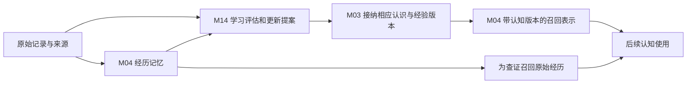

# Q01裁决：原始记录、学到的内容与认知经验

日期：2026-11-08。执行者：主agent（/root），无委派。

状态：**Q01概念与保存归属已裁决，待Q12整体一致性冻结；未编码、未冻结接口。**

后续进展：Q02操作职责与接受责任已单独裁决，见[Q02文档](tool-observation-learning-q02-decision-v0.1.md)。下文保留Q01裁决时的后续项说明；当前顺序以[TODO](../plan/tool-observation-learning-loop-todo-v0.1.md)为准。

任务来源：[设计TODO](../plan/tool-observation-learning-loop-todo-v0.1.md)。本轮按“提出问题→查研究与本地依据→比较方案→裁决→接口影响→验收条件→交接”完成Q01。正式实例保持锁定，不开展真实模型实验，不修改实际选择。

## 1 先说明研究支持什么

研究支持区分事件记忆、知识及其形成／整合过程，但没有一个公认的“原始记录→学习模块→认知模块→数据库”的软件标准。**本项目的模块归属属于工程裁决，不能称为科学界规定。**“认知经验”也不是一个边界统一、可直接对应数据库表的标准科学术语。

### 已核查的研究依据

| 来源／实际阅读范围 | 可用于本题的结论 | 接受程度与限制 |
| --- | --- | --- |
| Tulving，2002，*Episodic Memory: From Mind to Brain*；作者论文全文相关章节。[全文](https://www.hss.caltech.edu/~steve/files/tulving.pdf) | 对具体过去事件的记忆，与关于世界的知识具有可区分的功能 | 经典且广泛使用的区分，有神经心理与成像证据；不应据此宣称软件日志具有人的主观回忆体验 |
| Squire，2004，*Memory systems of the brain*；论文全文。[全文](https://home.csulb.edu/~cwallis/382/readings/482/squire.pdf) | 多类记忆具有不同作用，不能把记忆缩成一种存储；记忆研究不支持按输入是文字还是工具来划分系统 | 证据汇总形成的重要框架；不是为本项目定义M03/M04边界的工程标准 |
| McClelland等，1995，互补学习系统；摘要。[论文记录](https://pubmed.ncbi.nlm.nih.gov/7624455/)；McClelland等，2020，*Integration of new information in memory*；全文相关章节。[全文](https://stanford.edu/~jlmcc/papers/McCMcNaughtonLampinen20IntegrNewInfoCLS.pdf) | 新经历的快速获得，与整合已有知识、避免干扰，是相互补充的任务；2020研究讨论了新信息与旧知识一致时可以快速整合的情况 | 有影响力的解释框架与计算研究，具体机制仍在发展；不能规定每次观察必须等待多轮或多天才可用 |
| Dudai、Karni、Born，2015，*The Consolidation and Transformation of Memory*；作者论文摘要。[论文记录](https://pubmed.ncbi.nlm.nih.gov/26447570/) | 巩固涉及经验相关表征随时间改变并与已有知识整合 | 同行评议综述支持整合视角；本轮不把摘要当作全文细节依据，也不把巩固机械等同于“生成摘要” |
| Johnson、Hashtroudi、Lindsay，1993，*Source Monitoring*；论文摘要及作者机构公开首段。[论文记录](https://pubmed.ncbi.nlm.nih.gov/8346328/)、[作者机构副本](https://memlab.yale.edu/sites/default/files/files/1993_Johnson_Hashtroudi_Lindsay_PsychBull.pdf) | 记忆与知识的来源判断涉及加工，可能出错；内容熟悉或被记住不等于来源及真实性正确 | 有长期研究积累的框架；工程保留显式来源是本项目借鉴，并非声称人脑采用不可变ID |
| De Houwer、Barnes-Holmes、Moors，2013，*What is learning?*；全文相关章节。[全文](https://www.ppw.kuleuven.be/okp/_pdf/DeHouwer2013WILOT.pdf) | 区分学习的过程／机制与依据后续表现判断学习，不能因产生一条记录就声称学会 | 这是一种有影响的功能性定义论证，不是学习定义的唯一共识；本项目不把单次答对或必须正收益当成所有学习的定义 |

检索日期为2026-11-08。只采用论文、作者大学副本和论文摘要，不依赖新闻、百科或搜索排名证明共识；未做系统综述或研究质量元分析，不给“科学界接受百分比”。部分PMC／出版页读取失败，使用上表可访问的作者全文或明确标注的摘要，不将失败页面称为已阅读全文。

### 本题应采用的科学边界

1. **文字和工具是信息来源／格式，不是两种天然不同的记忆。** 两者都可以被编码成事件记录，也都可以支持后续知识更新。这个项目判断由记忆类型和来源研究推导，不是论文直接提出的工具接口结论。
2. 原始事件的记住本身也涉及学习和记忆加工。项目里另设M14“学习”服务，是业务分工，不能说M14之前绝无任何科学意义上的学习。
3. 形成知识不保证知识正确；读数、解释、概括、来源与后续效果应分别核对。
4. 研究支持保留事件及整合知识两种功能；不支持把它们强制设计成互斥存储，也不要求所有学习产物都是语言规则。

## 2 本地依据与问题定位

[原模块架构](../research/phase-2-modular-architecture.md)及[记忆研究](../research/memory-quantification.md)已经允许记忆保存原始经历和认知结果的记忆表示。[认知—经验归属](cognitive-experience-ownership-v0.2.md)要求M14评估／提案、M03保存经验版本；M17是持久化机制。

[真实召回检查](memory-recall-probe-v0.1.md)说明：已有文字正文可以被召回使用；工具原回执有读数，自动记忆主要是结果引用。这定位了内容链缺口，但不能推出工具原始记录本身毫无用途，或文字来源无需学习与可靠性检查。

现有experience_snapshot主要是方法效果的影子统计，不能代表所有学到的知识，也不能将新的语义内容硬装进现有统计单元。

## 3 方案比较及裁决理由

| 方案 | 好处 | 问题 | 裁决 |
| --- | --- | --- | --- |
| 所有工具／文字原文直接作为已学知识 | 简单，容易召回 | 混淆发生、解释和事实资格；一个工具成功回执无法证明所有外部事实 | 不采用 |
| 学习处理后才允许保存任何记录 | 表面上流程统一 | 丢失原始证据与失败经历，妨碍核对和重处理；也不符合快速记住事件的功能区分 | 不采用 |
| 保留原始证据与经历，学习提出更新，认知接纳相应内容，记忆提供可召回表示 | 兼顾追溯、修正与使用；可复用现有所有权 | 必须在Q02及后项补齐写入、投影和失效协议 | 采用；只作Q01概念裁决 |

理由：所选方案保留研究支持的功能区分，并遵循已有模块所有权；它不声称复制人脑结构，也不新增一个独立“经验数据库所有者”。

## 4 对象定义及保存归属

下面是概念分类，不是新表、新事件名或已存在的API。**“学到的内容”是产物统称，“认知经验”是其中由认知持有的一类有范围判断，两者不是前后互斥的两个容器。**

| 对象 | 它回答什么／例子 | 业务归属与保存 | 不能据此声称 |
| --- | --- | --- | --- |
| 原始记录／证据 | 这个来源实际返回了什么？如某时刻文件字节中value=10、工具状态与回执 | M01/M13负责产生及原观察语义；M17保存原工件与完整性；其他模块引用，不改写原回执 | 文件内容必然等于现实库存；工具成功必然等于任务成功 |
| 经历记忆 | 我何时、因何活动、从哪个来源获得了什么？如“该次活动读过这个文件，结果指向该回执” | M04拥有经历的记忆表示及版本，引用原记录；不另造一份独立证据 | 已推导出规律，或已学会一种能力 |
| 学习产物／更新提案 | 新观察支持怎样改变认识？如建议将某份记录的已知读数从旧7更新为在t时观察到10 | M14拥有评估、理由和提案记录；尚未接纳时不成为认知当前权威内容 | 提出即通过；模型解析即事实核验；产生提案即已测得收益 |
| 认知接纳的具体内容 | 当前有条件持有什么认识？如“依据来源S在t时的记录，其读数为10”，附范围与不确定性 | M03按内容类型拥有当前信念／经验的接纳状态及版本；事实型认识与方法经验不强塞为同一统计对象 | 世界永远为10；来源后来变化也不影响资格 |
| 认知经验 | 从经历得到的情境解释、判断或方法认识，在什么条件下适用？如某类观察怎样用于修正旧认识，以及方法有效性的有证据估计 | M03拥有经验内容、适用范围和版本；M14提出修正。可依赖具体认识，但不重复拥有同一事实的第二份权威版本 | 每次读到一个值都生成通用规律；经验必须是一个分数 |
| 可召回的内容表示 | 后续如何找到、呈现这些经历或已接纳内容？ | M04拥有可检索表示及索引，关联M03内容身份和版本；内容资格沿M03及来源判断，物理可在M17同库保存 | 被检索到就是真；投影文本变成第二份认知真值 |
| 学习效果报告与经验效果统计 | 用这种更新／方法之后，预测或任务表现改变多少？ | M14拥有测量／评估报告，M03拥有据此接纳的经验效果版本与投影；M04若召回，只呈现带出处表示 | 有新内容必然有正收益；unknown等于零；一份回执可计成多次独立收获 |

原始记录的不可改写指正常审计和修订；显式隐私擦除仍遵循已有清除协议。本文不承诺永久保留用户要求删除的内容。

### 四条保存原则

- **原始证据先可保存。** 学习失败仍保留发生记录与失败原因，允许有依据地重处理。
- **学习评估并提案，目标内容所有者接纳。** 对本闭环的认知经验是M03；不把已有M04原始文字或合法记忆修订全部迁为M03。
- **认知负责“当前持有什么认识”，记忆负责“如何保留并找回”。** 一个业务内容可有多种召回表示，表示不产生第二份业务权威。M03/M04的详细操作职责仍交Q02。
- **内容接纳与效果评价分开。** 可持有范围明确但效果未测的内容；也可测得更新无改善。二者不是同一个状态，具体接纳门槛由Q05—Q06裁决。

## 5 库存案例：本次裁决怎样应用

概念关系如下；箭头不规定同步事务、数据库表或具体API：

效果报告及经验效果统计有自己的来源链，不是上图每个内容更新必须先取得的正收益凭证。

1. 旧记录在t0报告7。保存它的原始来源及历史，不先断言它错误。
2. t1工具读到文件中10。立即保存回执；经历记忆可记录本次读取及出处。这时能支持“文件在t1报告10”，尚不能支持所有现实库存结论。
3. 学习比较对象、记录时间、来源及旧认识，形成有范围的修正提案。7→10可能是状态变化，也可能是矛盾、错误、不同对象；不能单靠数值不同判错。
4. 经接纳后，认知持有相应范围的新版本，并保留旧版本及变化关系。认知经验需要方法／情境认识时另有清楚含义，不为一个新数值强造“方法一定有效”。
5. 记忆可以召回“t1来源S报告10”的已接纳表示并给出版本，也可以为查证召回原始经历。两种返回须标明性质，详细输入结构交Q08。
6. 回答出10只是该次记忆使用表现。方法是否可靠、能否迁移到新问题，以及学习改善多少，仍需单独评测；目前gain可为unknown。

反例：工具失败没有读数时，只有失败经历，不能补一个10；两个来源同一时刻分别报告7和10时，先保留冲突；仅重复打开同一回执时，不增加独立学习样本；用户文字“库存是10”首先是来源陈述，并不天然比工具证据更真。

## 6 Q01裁决记录

| 编号 | 裁决 | 依据性质 |
| --- | --- | --- |
| D01 | 按内容功能、资格及来源分类，文字／工具均可形成经历与知识，不按输入介质划成天然不同记忆 | 研究启发的项目推论，S1/S2/S5 |
| D02 | 原始记录、经历、解释与可复用认识保持可区分；学习前可保存原始证据 | S1/S3/S4支持功能区分；具体保存协议是工程选择 |
| D03 | “学到的内容”是产物统称，未经接纳的提案与认知当前内容分开；认知经验不是所有产物的唯一容器 | 项目概念裁决，兼容现有信念／记忆／经验分工 |
| D04 | M14评估与提案，M03保存认知经验版本，M04拥有记忆表示，M17承载持久化；不建立第二份经验权威 | 本项目已有架构约束，不是神经科学结论 |
| D05 | 来源记录、内容资格、当前版本、方法效果分开；学习后内容也可不确定或被修正 | S5/S6启发，具体状态与门槛待后项 |
| D06 | 原始经历可作查证材料召回；经处理的知识可作有范围认识使用。任何召回都不自动提升为真 | 研究启发＋工程选择，读取策略交Q08 |
| D07 | 有知识更新与有可测正收益分开；缺少数值效果不伪造为零，也不单凭它否定内容 | 项目评测边界，受S6对过程／表现的区分启发 |

文献编号：S1=Tulving2002；S2=Squire2004；S3=McClelland1995/2020；S4=Dudai2015；S5=Johnson1993；S6=DeHouwer2013。以上是本轮设计裁决，不代表已实现或通过经验效果实验。

## 7 接口影响：只定语义，不定字段

- 执行到学习必须能引用原内容及来源，不能只交“成功”布尔量。
- 学习到认知必须区分提案与被接纳版本，效果报告不能代替内容。
- 认知到记忆必须能追溯同一认知内容及版本，不能把派生副本当新证据。
- 召回必须能区分原始经历、来源陈述、认知接纳内容及效果统计；不能只输出无类型的一段自述。
- 来源变化须能影响其派生内容的使用资格；更新、失效、删除细则交Q09。

本轮不扩展现有experience_saved的载荷，不修改API、表或模型提示。Q02明确操作所有者，Q05—Q08确定具体契约，Q12再统一冻结。

## 8 Q01完成核对

| 检查项 | 本轮结果 |
| --- | --- |
| 有论文来源、接受边界及实际阅读范围 | 已列明；不声称系统综述或唯一科学标准 |
| 原始记录、经历、提案、认知内容、经验、召回表示和统计可区分 | 已定义，说明交叠关系而非互斥容器 |
| 同一库存案例贯穿各层，含失败／冲突／重复／文字来源反例 | 已提供 |
| 内容、版本及物理保存所有权不混同 | 已作概念裁决，具体操作矩阵交Q02 |
| 不把保存、召回、答对、正收益混为同一件事 | 已分别说明 |
| 不突破既有M03/M04/M14归属，不提前冻结后续接口 | 已核对 |

这是文档级一致性核对，不是运行验收。Q01标记“设计已解决”，Q02—Q12仍待处理。下一步只推进Q02的详细责任／操作矩阵；业务实现继续暂停，正式实例继续锁定。
