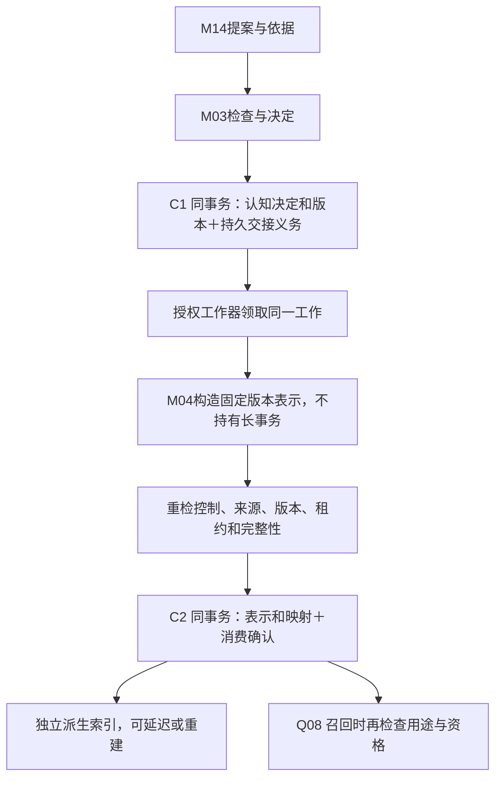

# Q07裁决：认知版本到可召回记忆的保存、交接与恢复

日期：2026-11-09（Asia/Shanghai）。执行者：主agent（/root），无委派。

状态：**Q07保存与恢复协议设计已裁决，下一项Q08；精确schema、接口枚举和全链契约待Q12冻结，未编码。**

后续进展（2026-11-09）：[Q08召回用途与输入](tool-observation-learning-q08-decision-v0.1.md)已完成设计裁决，当前下一项为Q09。下文保留Q07完成时的历史边界与待办表述，原证据快照不改写。

依据：[Q01对象](tool-observation-learning-q01-decision-v0.1.md)、[Q02职责](tool-observation-learning-q02-decision-v0.1.md)、[Q03触发与重复](tool-observation-learning-q03-decision-v0.1.md)、[Q05产物与字段](tool-observation-learning-q05-decision-v0.1.md)、[Q06接纳与版本](tool-observation-learning-q06-decision-v0.1.md)及[TODO](../plan/tool-observation-learning-loop-todo-v0.1.md)。用户要求本轮只解决设计、记录裁决和交接；正式实例保持锁定，不改变实际选择，不运行模型或新业务测试。

## 1 要解决的问题

认知已经保存一份经验，不等于记忆已经有可检索、可理解的内容；记忆表示保存成功，也不等于检索命中、当前有权使用或模型能答对。本题确定从认知版本到记忆表示的可靠交接，不提前宣称Q08召回或Q10—Q11质量评测通过。

贯穿例子：来源S在t1报告库存10，M03按适用规则接纳这条有限报告为版本C2。M04应保存“来源S在t1、对对象X报告库存10”的可读表示及结构化限制，并关联C2和原证据，不能只保存工具回执编号，也不能改成“现实库存始终为10”。旧t0报告7可以保留；它是否仍适合当前用途由版本、范围及查询资格决定。

## 2 研究依据及边界

| 来源与实际阅读范围 | 原描述 | 项目借鉴及限制 |
| --- | --- | --- |
| Dudai、Karni、Born，2015，*The Consolidation and Transformation of Memory*；读取[作者实验室所列摘要](https://www.weizmann.ac.il/brain-sciences/labs/dudai/publications)，2015条目 | 神经科学中的记忆巩固涉及经验相关内部表示随时间转化，并与已有知识整合 | 形成认识、保存表示与后续提取应分别检查。它不规定本项目模块、事务或重试机制；本轮未读该论文全文，不从摘要推导生物与软件一一对应 |
| [W3C PROV-DM](https://www.w3.org/TR/prov-dm/)，实体、派生与修订章节 | 派生关系可指明原实体、加工活动和结果；修订是具有新实体的派生关系 | 派生表示固定引用认知版本，修订关系显式保留。来源关系不证明主张为真，不要求本项目采用RDF |
| [SQLite原子提交说明](https://www.sqlite.org/atomiccommit.html)，单文件提交及底层假设 | 事务提交依赖数据库日志、同步和文件系统等假设 | 只对纳入同一受支持事务的记录声明原子性；不把外部blob、独立索引库或控制库包含在一次runtime.sqlite事务内 |
| [AWS事务交接记录模式](https://docs.aws.amazon.com/prescriptive-guidance/latest/cloud-design-patterns/transactional-outbox.html)，问题、同事务记录、重复消费部分 | 业务更新与后续通知分别写入会留下缺口；可同事务保存待交接记录，消费者仍需处理重复 | 借鉴持久交接义务及幂等消费，不引入云服务、消息中间件或分布式部署，不借用文中队列的特性声称本系统已获恰好一次保证 |
| [AWS Builders’ Library：安全重试](https://aws.amazon.com/builders-library/making-retries-safe-with-idempotent-APIs/)，等价重试、晚到请求、同ID不同意图部分 | 请求身份和初始参数共同用于幂等校验；同ID不同参数应报不匹配，晚到及保留时间需明确 | 重复交接复用同一业务结果，不能只按正文hash去重；过期或已失效请求不能因此重新取得许可 |

检索／核查日期：2026-11-09。神经科学材料是作者摘要中的综合描述，PROV和SQLite是规范／实现方技术说明，AWS是工程经验与模式指导；不是数字生命闭环有效性的实验。本轮大学PDF地址返回404，PubMed页面只返回空壳，未将其当作已读全文。研究支持功能区别及工程问题的分析，以下具体协议是项目裁决，未作系统综述或科学界共识调查。

## 3 现有能力与缺口

只读核查以下源码，未打开正式实例数据库：

- `digital_life/application/cognition_experience.py`：M03已有预期版本、提案幂等和追加经验事件，但当前是shadow统计，明确不影响选择；不是本题通用内容版本／表示链已实现。
- `digital_life/infrastructure/persistence/sqlite_store.py`：`Store.tx`使用同连接事务及嵌套SAVEPOINT。`Store.insert`是通用技术入口，没有自动实现模块写入权隔离。`Store.artifact`已对文件flush及fsync、读取时核对hash；文件仍在SQLite事务之外，不能据此声称文件目录发布与数据库全局原子提交。
- `digital_life/application/scheduling.py`：已有持久jobs、租约token／generation／期限、条件完成，以及同事务consumer receipt。可复用局部机制，但没有本题认知版本—表示身份及资格校验；`receipt`本身不证明当前授权。
- `digital_life/application/memory_quality.py`：已有记忆修订、来源依赖、独立派生索引及版本检查；索引与主库是不同连接／文件。现有文字记忆和合法修订职责保留，不自动扩大为工具学习经验接纳权。
- `digital_life/application/recovery.py`及`digital_life/infrastructure/processes/dispatch_gate.py`：保守恢复、未知外部动作不重放、停止与派发协调可借用。当前恢复会结束原租约，不能假设重启即自动续跑新协议。

生命工程中，M14学习负责评估／提案，M03认知负责持有经验版本，M04记忆负责表示和提取，M17提供存储。系统工程采用同库短事务、持久工作及派生索引落实这些职责；物理事务可跨业务模块，业务所有权不因此转移给协调器或M17。

## 4 方案比较与选择

| 方案 | 优点／问题 | 裁决 |
| --- | --- | --- |
| 接纳、生成表示、写外部文件和建索引都放进一次“大事务” | 看似一步成功；独立文件／索引不受同一事务控制，耗时加工会长占锁，表示失败还会丢弃合法认知结果 | 不采用 |
| 先存认知，再仅在进程内调用记忆 | 简单；两步间崩溃会丢失交接义务，无法区分完成、未开始和回执丢失 | 不采用 |
| 同主库保存认知与交接义务，再同主库发布表示与消费确认；索引独立派生 | 保留真实进度，重复可核对，失败只补对应阶段；需要明确身份、资格和恢复检查 | 采用 |
| 新建独立服务、消息系统和跨库分布式事务 | 引入当前单实例设计不需要的运维／协调成本，仍须处理幂等及外部文件 | 本版不引入 |

采用两个持久提交边界C1、C2，均落在同一实例的runtime.sqlite；并非跨数据库的“两阶段提交”协议。持久交接义务可由经核查的已有事件／工作机制承载；具体表、约束和调用签名到Q12统一，不能挪用外部动作outbox的sent／unknown语义冒充记忆任务。无论映射到哪种表，都必须满足以下原子性，不能以“以后有定时扫描”替代。

## 5 表示保存什么

M03是已接纳内容及经验版本的唯一权威。M04表示可包含正文副本，但这是固定版本的派生副本，不能另成事实主库，不能独立升级候选资格或改内容。原始观察仍由原链保存，表示不是它的替代件。

| 信息组 | 必须可追溯的语义 | 约束 |
| --- | --- | --- |
| 身份／版本 | 实例、认知内容身份与精确修订、M03决定引用、表示身份／格式版本／用途、交接工作引用 | 不用含糊的“latest”代替来源版本；不同实例隔离 |
| 可理解内容 | 有限主张或经验内容、对象／属性／时间／条件／单位、来源报告／推断等性质 | 优先确定性模板＋结构化字段；正文不只包含ID或“工具成功” |
| 限制与未知 | 实际接受范围、候选／冲突／更正等必要标记、Q05 ValueSlot及局限、收益是否已测 | unknown不能变0、false或无限范围；正文不得省略改变含义的限制 |
| 来源链 | Q05原证据定位与摘要、提案／接纳版本、转换方法和版本、依赖关系 | 引用链必须能回到原观察；当前无权时不能靠副本绕过权限 |
| 权限／有效性 | 用途、读取限制、认知资格／依赖检查所用修订、替代／撤回关系 | 保存时检查不替代使用时检查；合并依赖不放宽可读范围 |
| 完整性／结果 | 正文／结构载荷摘要、保存时点、表示发布回执、当前可用性与索引进度 | 摘要只证明字节绑定；表示、索引、实际命中及效果分别记录 |

这些是接口所需信息组，字段名／枚举尚未冻结；不要求复制每份原证据全文。正文与结构载荷必须一起绑定、一起返回，不能因切片或长度限制只留下无条件“库存10”；不能安全保留限制的片段不可用于事实回答。Q08再规定具体召回包装。

本版派生仅允许已授权、可核对且不增添语义的模板／格式转换。表示需要添加解释、概括、因果或新范围时，退出本次纯表示工作，按Q03—Q06形成关联候选／提案；不在表示重试中偷偷调用模型加工新认识。不同格式可以产生不同表示，不能重复产生“新学到一条”的计数。

候选、冲突及历史版本只有在明确的分析／审计用途和授权下才可制作对应表示，并保持原资格；不能与当前接纳内容混在一条无标记正文中。现有shadow经验不能通过生成表示取得影响实际选择的资格。

## 6 两个提交边界与交接职责

### C1：认知保存与持久交接义务一起落盘

1. M03依Q06完成语义决定；准备、解析等耗时工作在事务外，提交前在与停止一致的短协调边界内重检基线、权限、控制和依赖，覆盖本次C1提交，不能仅在事务开始前读一次停止标志。
2. 在一个主库事务中，由各所有者写入M03决定／认知版本及其必要关系，并保存针对这些版本的持久交接义务。交接义务只证明需要处理，不证明M04已经完成。协调器组织事务，不代写业务结论。
3. 成功提交后返回真实的“认知已保存，表示待交接”；失败回滚不能留下有效认知新版本或可消费通知。任何对进程内工作器的唤醒只发生在提交后，丢失唤醒仍可从持久义务核对。
4. Q06互相依赖的接纳项／关系及对应交接义务必须在同一C1提交；独立项可分别提交并报告逐项结果。不能把中途部分成功报成整体完成。

### 生成阶段：短租约、固定输入、事务外构造

领取工作时绑定同一交接身份、租约拥有者／token／代次／期限以及当前运行归属。M04读取指定认知版本，核对当前用途和依赖，构造表示并验证正文／字段一致性。禁止持有SQLite写事务或停止协调锁跨越长I/O、模型或外部工具调用。

如需要外部blob，先形成可校验、可持久读取的内容，再发布主库引用。文件完整发布、并发写入、目录持久性、崩溃后校验须作为后续工程验收条件；现有文件fsync不能被夸大成跨文件原子性。主库回滚后可能残留孤立blob，不能把它当已发布记忆；只按授权的引用核对／清理规则处理，不删除共享或有效引用文件。

### C2：记忆发布与交接确认一起落盘

1. 先取得与停止操作一致的协调门禁，再开启runtime事务；在短临界区内重新检查当前控制／授权、源依赖、认知资格／修订、工作租约及期望表示基线。C1也遵守此锁序，不能持有runtime写锁后反向等待门禁；Q12核对实际调用图。控制库／锁文件不属于runtime.sqlite事务，不能只依靠读一次标志消除竞态。
2. 同一主库事务内，由M04保存表示正文或已验证引用、认知版本映射、完整性／依赖及所需“当前可选”映射；由相应工作所有者保存消费确认／完成结果。失效租约不得发布。任一环节失败均不能留下成功发布却未确认的局部主库状态。
3. 当前资格必须锚定M03的指定范围和版本。若认知已推进，只能明确结束旧工作为已过时，或在另有审计授权时保存历史表示；不能把当前映射退回旧版。不能仅按版本数字全局排序，误删不同范围的并存认识。
4. M04确认表示已保存后，协调器可记录交接完成，M14只关联结果，不再生成一次接纳或收益。C2提交后响应丢失，重复请求核对持久结果即可；不得再造一份表示。

对互依赖的一组认知项，C2可以预制各表示，但只有整组必需表示及组完成标记一起提交后，才能声明该组当前表示就绪；读者必须核对组标记。独立项可分别就绪。C1完成到C2完成之间，旧版本若已不再适用，不能因为新表示缺失就默默继续用于当前判断；应明确当前表示缺口。允许何种有界直读／回退交Q08决定，本题不默认开放新路径。

## 7 交接记录和状态的最小要求

| 交接 | 发起／接受所有者 | 输入与前置条件 | 输出／失败语义 |
| --- | --- | --- | --- |
| M14→M03 | M14提交，M03按Q06决定 | 固定提案与来源、目标／基线、实际许可 | 决定／版本或拒绝／暂缓等；C1不成功不能报认知保存 |
| M03→M04 | M03指定版本／表示需求，M04接受构造 | C1已提交的交接身份、固定内容及范围、类型／用途、方法和权限依赖 | 领取／等待／拒绝／过时等可核对结果；领取不等于表示已保存 |
| M04→协调器／M03 | M04发布表示，工作所有者确认 | 同一工作身份、当前租约、固定版本／指纹、C2重检通过 | 表示与映射／完成回执；失败保留C1和具体未完成阶段 |
| 主库→派生索引 | M04组织索引，M17持久化 | 已提交表示及修订、水位／依赖 | 索引进度或错误；失败不撤销已保存内容，不代报召回成功 |
| 中断→恢复核对 | 既有授权恢复入口＋各业务所有者 | 运行归属已核对，读持久进度，不凭内存猜测 | 确认完成、可恢复、阻断、损坏或待人工核对；不自动恢复许可 |

工作状态至少能区分待处理、持租约构造、已发布、可重试失败、需条件／权限解除、永久失败、已过时；需记录原因、尝试、同一总预算／期限、解除条件及完成引用。以上是语义要求，不是已注册的枚举。表示就绪、当前使用资格、索引状态是独立维度；“已发布但已撤权”不能被单一success隐藏。

失败、重试和进度写入也须核对当前工作代次，旧工作器不能把新工作器的结果改成失败。既有Recovery结束租约并将job标失败后，由授权恢复流程先核对本题持久义务／完成结果；需要续处理时恢复原业务身份及预算，以新有效租约执行。不能假设现有Queue会自动领取failed工作，也不能靠新建业务身份绕过去重。

持久关联至少可从“提案／决定→认知版本→交接义务→表示→消费确认”双向核对，并标明无需表示／已过时等合法终点。拒绝、候选、无变更不会自动创建当前事实表示；已有相同版本可复用表示，仍须按当前权限返回。恢复扫描必须有实例、类型、范围及水位，不遍历后顺手接纳历史候选。

## 8 重复、并发和晚到结果

1. **业务身份**：表示身份至少绑定实例、认知内容身份与精确修订、用途／表示种类、格式／方法版本及影响含义的语言／参数。纯传输尝试ID、时间戳、租约和重试次数不制造新的业务表示。精确规范化及唯一约束在Q12冻结；语义身份不只取正文hash。
2. **请求指纹**：同一业务键、相同规范化输入，复用已发布结果或关联原未完成工作；同键却改变版本、范围、内容、方法等实质参数，返回不匹配／损坏，不能覆盖或当重复成功。方法有意升级须受控创建新的表示身份，不新接纳认知。
3. **并发工作**：领取及发布均以当前租约token、代次和期限条件保护。仅给job标完成不够；写表示和完成确认必须在同一个受保护C2内。旧工作器晚到失败，不能覆盖较新结果；租约过期须重新核对／领取，不能沿用原写权。
4. **进程／恢复边界**：旧运行归属失效后，核对或提升工作代次，隔离晚到进程；备份恢复后的库不得接受旧进程结果。不能只凭墙钟或旧job状态认定持有写权。
5. **计数**：重复交付、重新领取、表示修复、索引重建可记录实际尝试／资源用量，但学习观察、独立证据、认知接纳及gain不得增加。超时的未知用量不当作零，预算沿原工作核算。
6. **晚到／保留**：工作身份、结果及必要去重记录至少覆盖授权的重试／有效期和可能晚到窗口，具体时限由Q12与存储政策统一。清理后不能把过期老请求当新工作；应拒绝／要求显式核对。显式隐私擦除优先，不以永久保留正文实现幂等；可否保留最小墓碑也须服从删除政策。

字节相同而对象／时点不同不是同一认识；相同认识的多份格式不是多份独立证据。重复接口也必须核对当前读取主体及权限，不能返回当年有权、现在无权的正文或敏感存在性。

## 9 中断、失败与恢复表

| 中断／失败点 | 持久事实 | 恢复规则 |
| --- | --- | --- |
| C1前或事务回滚 | 没有已提交的新认知／交接 | 查原提案身份确定结果；只有许可仍有效才重新申请同一处理，不宣称已接纳 |
| C1提交响应不明 | 可能已有认知及交接 | 先读原键、指纹、决定／版本与交接结果；库不可用则等待／停止，不换ID重做 |
| C1后、尚未领取 | 认知已存，交接待处理 | 保留认知；在允许继续时领取原工作，无须重学或重接纳 |
| 构造中进程退出／租约过期 | C1在；C2未完成 | 先核对是否已发布、控制及租约归属；授权下重领同工作，隔离旧工作器 |
| blob已写，C2未提交 | 存在暂存／孤立文件，未发布表示 | 核对内容再复用或重建；不能由文件存在推定成功，也不直接清空blob目录 |
| C2主库任一写失败 | 表示、映射及确认整体回滚 | C1保留；记录失败阶段，满足重试条件再尝试同工作 |
| C2已提交，响应／进程内通知丢失 | 表示与完成确认已在主库 | 查原键返回同一结果，零新增接纳／gain；不重新发布 |
| 索引更新失败／丢失 | 表示可能完整，索引落后 | 单独记录水位和错误，在许可预算内重建；不得假装内容未存或改用失效旧认识 |
| 已发布blob丢失／摘要不符 | 映射存在但内容不可用 | 阻断该表示，按源版本授权重建或报损坏；不得凭索引／模型补造原文 |
| 构造期间认知推进／被更正 | 旧版本不再适合当前映射 | 拒绝回退当前版本，原工作明确过时；历史保存须另有适用用途 |
| 来源撤权／删除／依赖失效 | 既有内容的当前资格变化 | 提交与读取立即重检并阻断；不借重试恢复权限，完整传播及清理交Q09 |
| 用户停止／正式实例锁定／期限或预算耗尽 | 已提交阶段保留，后续工作无许可 | 不派发、不发布新的业务结果；恢复仅核对并按既有控制流程记录，不自动清锁或续跑 |
| 库暂时不可达，提交状态未知 | 无法可靠确定完成 | 标为结果未知／待核对，有限等待；不能报失败后换键，或报成功后省略核对 |
| 原工具动作或模型请求是否完成不明 | 可能已发生外部效果／费用 | 沿既有动作回执及恢复流程核对；本协议不重放原动作或重新调模型 |
| 备份恢复，主库／blob／索引不一致 | 不能推定恢复点完整 | 保持恢复门禁，核对实例／运行归属、各引用／摘要、水位及外部效果；索引可重建，缺源内容报缺失 |

**重试只处理适用的内部瞬时错误**，如短时占用／I/O故障；须同时有有效许可、明确解除条件、剩余尝试／期限／预算。同一工作有限退避，耗尽转显式失败／阻断；不通过新ID刷新额度。结构不合格、同键不同内容、无权、未知原始动作、损坏来源不盲目重试。已停止时可进行既有授权的只读核对／审计整理，但不得借“恢复”继续生成新表示或改变认知。

C2提交后停止不抹掉真实历史；提交前停止必须阻断发布，并通过与停止一致的短协调机制确定先后。普通故障恢复与用户显式恢复执行是不同授权。对旧版本只有认知记录却没有交接的历史数据，后续须有受控迁移／核对计划；检查、启动或索引重建不得自动补接纳或接入当前选择。

## 10 索引、修复和语义补偿的边界

主库保存表示及权威映射，索引是可丢弃、可重建的派生候选目录。索引命中后仍从主库核对表示修订、完整性、M03版本／范围及依赖资格；不能把旧索引中的正文直接当当前事实。索引就绪不是C2成功的必要条件，但若查询无法安全取得合格内容，就必须报告未召回／缺口，不能承诺当前链路可用。

表示正文与认知版本不一致，是M04表示修复，不是把M03改成与错误正文一致。认知内容本身有误，由M14／M03按Q04—Q06形成更正／撤回版本；M04不得自行修正事实。表示失败不撤销合法认知决定；真正需要撤回的业务内容以新决定及关系补偿，不删除旧记录伪装没发生。

本题约束失效期间不继续使用，但不替Q09定义全链通知、缓存清理、已准备模型输入及隐私擦除的完整规则。未完成这些后项前，不能据Q07将新链投入正式使用。

## 11 未来验收题面

以下28项是供Q10—Q11落成隔离实验的题面，**未执行**。每题需检查主库决定／版本、交接、表示、确认、权限与计数；不能只看接口返回success。

| 编号 | 条件 | 必须观察到的结果 |
| --- | --- | --- |
| A01 | 合格有限报告完成C1、C2 | 正文有实际内容、来源、范围、认知版本及完成确认，不仅回执编号 |
| A02 | 表示模板遗漏时间／把来源报告改为绝对事实 | 不发布，认知结果保留，指出表示不忠实 |
| A03 | unknown收益或范围字段经过表示 | 未知及原因保留，不转0、false或无限范围 |
| A04 | C1写决定成功、写交接义务失败 | 整个C1回滚，不留可见新接纳或可消费交接 |
| A05 | C1成功后立刻进程退出 | 可查认知及待交接义务，不重新学习／接纳 |
| A06 | C1提交响应丢失／状态未知 | 按原键核对；数据库不可用时不换ID重做 |
| A07 | 同一交接重复，第一次仍在构造 | 关联原工作，不启动第二份独立业务处理或刷新预算 |
| A08 | C2成功后同键同输入重交 | 同一表示／确认，无新增版本、独立证据或gain |
| A09 | 同键改变认知版本／范围／实质参数 | 明确不匹配，不覆盖，也不当幂等成功 |
| A10 | 相同字节分别属于不同对象／时点 | 不误并认识；各自范围及来源可追溯 |
| A11 | 授权升级表示格式／语言参数 | 新表示身份，关联同一认知版本，不新增学习收获 |
| A12 | 生成式加工提出原版本没有的新结论 | 不作为纯表示发布，进入关联候选／提案门控 |
| A13 | 两工作器争领同工作／旧租约晚到 | 至多一个当前有效租约可发布，旧token／代次／过期写被拒绝 |
| A14 | 构造时认知同范围推进到新版 | 旧工作不回退当前映射，明确过时或授权历史用途 |
| A15 | 同对象不同范围认识并存 | 不以全局最新数字误删合法的另一个范围 |
| A16 | blob写好后C2回滚或进程退出 | 孤立文件不当已发布；核对后复用／清理不伤有效引用 |
| A17 | C2保存表示后、保存消费确认前故障 | 同事务回滚表示和映射，不留半成功主库状态 |
| A18 | C2已提交但响应丢失 | 恢复发现同一完成结果，不重新发布或计gain |
| A19 | 外部索引丢失／更新失败 | 表示保存与索引失败分别可见，授权重建不改变认知 |
| A20 | 索引仍命中已替代旧版 | 主库／认知资格复检阻断旧版当前使用，不默默兜底 |
| A21 | 已发布blob损坏或缺失 | 不使用损坏正文，报告缺口并仅按合法固定源重建 |
| A22 | 构造中撤权／源删除／限制加严 | C2重检阻断；重复查询也不能返回此前私密结果 |
| A23 | 停止发生于C1后、C2前及与发布竞争 | C1保留；协调确定先后，停止先到则阻断C2，不解锁 |
| A24 | 停止发生于有效C2之后 | 已提交历史真实保留，后续派发仍停止 |
| A25 | 瞬时故障重试达到期限／尝试／总预算 | 退出并记录原因；不换ID续命，未知用量不算0 |
| A26 | 多项提案含互依赖组与独立项 | C1组原子；C2组未全部就绪不能报组可用，独立项逐项报告 |
| A27 | 备份恢复后旧工作器晚到／原外部动作未知 | 维持恢复门禁，隔离旧归属；不重放动作或模型调用 |
| A28 | 旧数据无交接、幂等记录过期或显式擦除 | 不因检查自动接纳／发布；旧请求不当新请求，删除政策不被永久留正文规避 |

## 12 裁决与后续落点

| 编号 | 裁决 |
| --- | --- |
| Q07-D01 | M03权威版本、M04可召回派生表示、M17技术保存分开；协调器不取得内容写权 |
| Q07-D02 | 表示固定绑定版本、决定、原证据、范围／未知及限制，正文有实际内容而非仅ID |
| Q07-D03 | 纯表示采用有界、可核对且不增添语义的转换；新判断另走学习／认知门控 |
| Q07-D04 | C1同事务保存认知决定／版本及持久交接义务，提交前不派发，不依赖进程内通知 |
| Q07-D05 | C2同事务发布表示／映射与消费确认；认知成功而表示失败只报交接未完成 |
| Q07-D06 | blob和独立索引不在主库原子边界；先保证引用内容可用，索引派生，损坏阻断 |
| Q07-D07 | 同业务身份／输入幂等复用，同键不同含义拒绝；不同格式不新增认知或学习收益 |
| Q07-D08 | 租约、代次、运行归属和预期版本共同保护发布；迟到工作不能回退当前映射 |
| Q07-D09 | 互依赖接纳组C1原子；表示组只有整组完成才报就绪，独立项可分别交接 |
| Q07-D10 | 提交结果不明先核对持久事实；失败只恢复未完成阶段，不重放原工具／模型 |
| Q07-D11 | 重试有同一工作期限／预算／次数；停止、撤权和恢复门禁优先，不自动解锁 |
| Q07-D12 | 认知语义补偿归M03，表示修复归M04；当前使用、索引、召回命中和效果分开，不借恢复推广历史／shadow资格 |

接口影响已明确所有者、信息组、前置条件、两次提交、幂等／并发、失败与权限／预算；具体表与唯一约束、锁序、规范化、期限数值及兼容迁移由Q12统一核对和冻结。本题不创建schema、API、任务类型或新授权，不将设计中的事务写成当前代码已经具备的完整保证。

文档级验收：有研究阅读边界及方案比较；身份与正文约束明确；C1／C2及文件／索引边界明确；覆盖重复、崩溃、停止、未知、恢复及组提交；与Q01—Q06归属／资格／收益一致；保留Q08—Q12依赖。12条裁决和28项未来题面仅证明设计题目有可判定预期，不证明运行实现通过。

Q07标设计已解决，Q08—Q12仍待处理。下一项Q08解决何时召回原始经历／学到的经验、返回给谁、如何包装来源／版本／范围／缺失及失效检查。业务实现继续暂停，正式实例继续锁定，旧证据保持原样。

本轮[文档核对记录](../../outputs/acceptance/q07-design-review-20261109T120222Z/review.json)及[证据索引](../../outputs/acceptance/q07-design-review-20261109T120222Z/evidence-index.json)保存文档快照、研究来源和摘要。任务开始至结束，`digital_life`下`.py/.sql/.json`摘要未变；正式实例6个文件摘要一致、`WAKE_DISABLED`仍在，未打开其数据库。此记录不覆盖共享工作区其他功能的运行验证。
