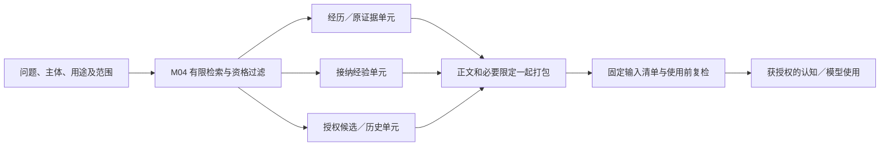

# Q08裁决：何时召回经历、何时召回经验，以及怎样交给认知使用

日期：2026-11-09（Asia/Shanghai）。执行者：主agent（/root），无委派。

状态：**Q08召回用途、返回内容及模型输入边界已裁决，下一项Q09；精确schema、枚举和全链契约待Q12冻结，未编码。**

后续进展（2026-11-09）：[Q09失效、清理与恢复](tool-observation-learning-q09-decision-v0.1.md)已完成设计裁决，当前下一项为Q10。下文保留Q08完成时的历史边界与待办表述，原证据快照不改写。

依据：[Q01对象](tool-observation-learning-q01-decision-v0.1.md)、[Q02职责](tool-observation-learning-q02-decision-v0.1.md)、[Q05字段与未知](tool-observation-learning-q05-decision-v0.1.md)、[Q06接纳与版本](tool-observation-learning-q06-decision-v0.1.md)、[Q07保存与恢复](tool-observation-learning-q07-decision-v0.1.md)及[TODO](../plan/tool-observation-learning-loop-todo-v0.1.md)。用户要求明确原始经历／学到的经验召回、保留来源／版本／范围／未知，先研究不明确处，按流程记录裁决并更新交接；暂不编码，正式实例继续锁定。

## 1 核心结论和本题边界

**按用途选择内容，按资格决定能怎样用。** 查“发生过什么、原话是什么、依据在哪”时，召回对应经历或证据；使用“目前接纳了什么、某方法在什么条件下可用”时，召回M03指定版本的M04经验表示。需要解释／查证时可以同时给出二者，但不能将同一证据的副本当成新的支持。

文字与工具是来源，不是天然的两种记忆。已有文字原记忆路径保留；工具原回执也可以在授权的查证／学习用途被读取。普通经验使用不能借召回接口，把未经学习／认知接纳的工具正文升级为已学认识；原文被找到也不自动成为外部事实。

本题决定查询、返回和使用边界，不实现新召回器、不改相关性权重、人格意图排序或实际选择，不触发学习／模型／工具。Q09再补全失效传播与已准备输入清理，Q10—Q11定义量化和隔离实验，Q12统一冻结。

## 2 研究核查与工程推论

| 来源／实际阅读范围 | 原描述及证据性质 | 项目借鉴与限制 |
| --- | --- | --- |
| Tulving，2002，*Episodic Memory: From Mind to Brain*；[大学副本](https://www.hss.caltech.edu/~steve/files/tulving.pdf)，Episodic Memory Today及K.C.相关段落 | 作者综述区分对过去事件的回忆与一般知识，并指出实际任务常涉及多个记忆系统 | 保留经历与知识／经验的不同作用，允许联合查证；不是把数据库记录等同主观回忆，也不是每个软件请求唯一对应一个脑系统 |
| Johnson等，1993，*Source Monitoring*；沿用Q01已核查结论，本轮仅取得[作者机构副本的检索段落](https://memlab.yale.edu/sites/default/files/files/1993_Johnson_Hashtroudi_Lindsay_PsychBull.pdf)，内容限于来源归属及来源相似造成混淆的讨论 | 心理学来源监控框架讨论对记忆／知识来源作判断的加工及可能错误 | 显式保留观察、转述、推断、模型生成的来源和加工身份，不能以熟悉或重复替代出处；本轮不声称重读全文或据此证明元数据能消除错误 |
| Liu等，2024，*Lost in the Middle: How Language Models Use Long Contexts*；[原论文](https://aclanthology.org/2024.tacl-1.9.pdf)，摘要、多文档问答／位置控制设计及结果相关段落 | 在所测模型、问答及键值检索任务中，相关信息位置和上下文长度会影响使用表现 | 不把“已进入上下文”视为“已使用正确”；限制无关材料，并将关键限定和主张一起包装。不能外推为本项目当前Codex的误差率，也不能据此指定万能位置或token阈值 |
| Q05、Q07已核查的来源定位、派生与修订规范 | 固定证据版本／定位，表示沿明确的派生关系关联权威版本 | 复用现有裁决，不把有引用当作含义受支持或事实已核实 |

检索日期：2026-11-09。神经心理／认知综述、来源监控框架和模型原实验分别使用，不作系统综述或统一认知架构共识声明。Johnson的Yale／UVic PDF本轮无可提取正文，截图也失败，UVic首读超时；只按可检索段落和Q01既有阅读边界引用。Tulving／Thomson 1973的检索记录未取得可读正文／摘要，不作为本题依据。以下用途政策与接口是工程裁决，不是研究直接规定的软件流程。

## 3 现有路径、历史证据及缺口

只读核查源码和文档，未打开正式实例SQLite：

- `digital_life/application/services/memory.py`：`Memory.retrieve`返回修订ID、正文、source_kind、selection_reason；排除当前触发输入，并读取当前active修订、检查读取者及派生依赖。匹配主要使用词／名字／汉字片段，近期项也可获低分。source_kind说明编码来源，不是通用的认知接纳／事实资格。
- `digital_life/application/memory_quality.py`：可选的质量上下文保存选中版本、正文摘要、父依赖和冲突；`check`即使没有质量上下文也会核对选中正文、当前修订及可用性。尚未提供本题完整的认知经验、原证据定位、逐项Scope／ValueSlot和用途契约。
- `digital_life/application/engine.py`：`prepare`将selected_memories送入独立模型请求；调用前和结果接纳前已有记忆复检。准备还会调用历史公开回复编码，因此现有prepare不是纯只读审计入口。既有防线可复用，不能宣称本题新类型／资格已受其全面保护。
- `digital_life/application/services/cognition.py`及`cognition_experience.py`：已有held信念及shadow经验版本，不能把它们一律作为已确认世界事实召回。
- `digital_life/application/exploration.py`、`chat.py`、`cognitive_updates.py`：近期记忆、历史观察、对话及cognition_sources有其他装配入口；新约定必须覆盖最终输入里全部相关内容，不能只校验selected_memories数组。

[历史召回检查](memory-recall-probe-v0.1.md)中，两条文字记忆能在小样本中帮助回答；工具回执含10，但普通召回只有引用和旧读数。另有同义改写、无关近期记忆等探针失败。它定位了局部缺口，不证明目前整个工作区通过Q08，也不把旧11项基础检查替代未来新链验收。

## 4 方案比较与裁决

| 方案 | 问题／作用 | 裁决 |
| --- | --- | --- |
| 所有来源正文混排，只传文本和分数 | 难区分原话、工具观察、候选和当前认识；容易丢范围／未知 | 不采用 |
| 只允许召回已学经验，永不提供原经历 | 无法查原话、解释出处、核对失败与争议，破坏已有文字记忆 | 不采用 |
| 先查经验，没找到就直接把原工具正文当经验 | 掩盖Q07交接缺口，绕过学习／认知接纳 | 不采用 |
| 用途限定＋分类型返回＋逐项资格／范围复检，必要时联查 | 可同时支持回忆、经验使用和查证，保留真实缺口 | 采用 |

不是为每个用途建独立数据库。M04可以使用共同候选目录及表示，但返回时必须保留业务类型、来源性质、加工方式、内容资格等不同维度。一个内容可服务多个明确用途，每次仍要满足当前读取和使用条件。

## 5 何时取哪一种内容

| 查询用途与例子 | 首选内容 | 联查及使用限制 |
| --- | --- | --- |
| 回忆具体经历：“那次读取发生了什么？” | 对应经历记忆、事件／时间／参与者及原记录引用；必要时取合法原证据片段 | 说明当时发生／返回什么，不自动推出现在仍如此。工具失败只支持失败经历，不能补成功读数 |
| 查原话／原回执：“我当时说什么？”“那个文件到底返回多少？” | 固定原版本的文字或证据片段，保留定位和来源角色 | 明确是当时来源陈述／回执内容。查证可返回未经接纳的原材料，不能报为已学事实 |
| 使用已持有认识：“根据目前已学到的信息，最近记录的库存是多少？” | M03当前有范围接纳内容的M04表示 | 先核对对象、属性、时间含义及条件。“最近已记录”不是“现实此刻”；来源报告不升级为独立世界核验 |
| 使用方法经验：“这种情况下该如何读取或排错？” | 与任务／工具／环境条件相容、当前合格的方法经验 | 展示适用前提、例外和效果测量状态；文字步骤不等于执行授权，也不保证工具现在可用 |
| 解释依据：“为什么现在认为是10？” | 当前认识表示＋其支持／必要反证及原经历／证据 | 区分M03决定理由与来源实际内容；重复引用不增加独立支持 |
| 学习、重评或争议核对 | 经授权的原观察、旧认识／候选及必要相关经验 | 限定为评估输入；不因被召回就接纳，不能自动启动M14、模型或补证工具 |
| 历史／更正审计：“当时认为多少，后来为何改？” | 明确指定的历史版本、决定及更正／替代关系 | “当时持有的认识”与“来源报告的时刻”分别查询；历史权限仍按现在检查，不恢复旧权限 |
| 普通对话引用文字记忆：“你记得我说过的名字吗？” | 合法、相关的原文字记忆及显式修订 | 保留“用户曾陈述”等来源性质；不强制原话都迁经M03，也不把对话陈述一概认证为外部事实 |

用途不清、对象有多个候选或时间语义不清时，保留歧义，要求澄清或分别展示带标签候选；不能私自选最像的对象、把“现在”改为旧报告时点，或以最新写入时间判事实最新。请求者指定用途也不能创造权限。

**工具原始材料可查证，但不能成为普通已学经验的隐形替代。** 这是用途区别，不是删除工具原记忆。新观察通过现有感知／执行路径进入当前任务，不由本题重新规定；它须标当前观察，不能计为旧记忆命中、独立新增证据或已完成学习。

## 6 请求、返回与模块交接的设计信息组

以下为语义契约，不是本轮新建类、函数签名或已冻结枚举。通用字段规则沿用Q05，不能用自由文本用途绕过入口校验。

### 6.1 召回请求

| 信息组 | 必须说明 |
| --- | --- |
| 请求身份 | 契约版本、实例、请求／活动／当前上下文引用、请求主体、调用模块；普通执行或控制者只读审计的入口性质 |
| 读取及接收者 | 读取主体、最终消费模块／模型／输出对象、适用授权／用途；服务进程有权限不代表每个下游都可接收 |
| 查询目标 | 原问题和必要线索，目标对象／属性、时间／条件／单位要求，已知精确引用及未知／歧义 |
| 内容用途 | 回忆、经验使用、来源核对、学习评估或历史审计；允许返回的对象类型／资格与历史范围 |
| 版本语义 | 当前合格版本、指定原版本、当时认知状态或来源报告时点；是否要求一组互依赖表示整组就绪 |
| 有限资源 | 件数、候选／扫描界限、文本／token预算、期限、重试／有界回退政策及原工作预算关联；无许可不能无限搜索 |
| 控制依赖 | 当前配置／权限／输入／运行归属的版本引用及取消状态；准备时固定，派发／使用前复检 |

普通执行入口服从停止与锁定。控制者现有只读检查可在明确权限下核对材料，但不能借此调用prepare、写记忆、修复索引、启动学习／模型或自动恢复执行。本轮对正式实例仅做文件摘要核对，不调用任何运行读取入口。

### 6.2 召回返回整体

返回须包含请求及检索运行身份、查询用途／范围、检索方法／版本、检查时点／依赖、有限覆盖和完成情况、实际合格条目，以及缺口／未完成原因。空列表必须配合运行结果解释，不能混用：

| 返回语义 | 允许的说明 | 不得推出 |
| --- | --- | --- |
| 已完成限定搜索，无合格匹配 | 在声明的库／用途／范围／方法下未找到可返回条目 | 系统从未经历／世界不存在／记忆已被证明不存在 |
| 部分完成／预算或候选截断 | 返回已核对的合格条目，并说明覆盖有限及受影响问题 | 已穷尽所有记忆、没有反证、返回项一定最优 |
| 表示未就绪／组未齐 | 已知交接缺口；原因按读取权限呈现 | 已学内容不存在，或可拿旧认识／原工具正文顶替 |
| 后端不可用／内容损坏／核对失败 | 查询未完成或该内容不可用 | 正常空结果、值为零、确认没有信息 |
| 当前资格／权限阻断 | 只返回有权看到的通用不可用说明 | 泄漏隐藏条目的ID、正文、数量、是否存在及私密理由 |
| 已取消／停止／请求过时 | 保留真实进度，拒绝后续普通派发／使用 | 自动续跑、刷新预算或悄悄换成新输入 |

这些结果可按阶段／字段并存，例如部分条目返回而另一个表示损坏；不要求一个总status承载所有轴。内部审计可区分无权、缺失和损坏，公开视图须服从现有权限，不因给出reason而泄漏隐藏信息。未知问题答案与检索故障也必须分开。

### 6.3 每个条目的内容

| 信息组 | 必须保留的语义 |
| --- | --- |
| 内容身份／类型 | 记忆身份和精确修订、表示身份／格式版本；经历、已接纳认识／经验、证据片段、候选或历史等业务类型 |
| 来源及加工性质 | 用户陈述／工具观察／系统事件／模型生成等实际来源，以及原文、摘录、转换、推断等加工性质；不得凭“文本”推断可信度 |
| 正文和锚点 | 可以理解的实际内容及其片段定位／摘要；不只ID。对学到内容附M03决定、内容身份及修订；对原记录不得伪造M03接纳引用 |
| 原始出处 | Q05 EvidenceRef：原结果／工件／版本、媒体与视图、摘要、定位及必要派生链；依赖可受权限限制，不强行展开全部原文 |
| 适用范围 | 逐条对象、属性、时间、条件、单位、覆盖／局限，沿用Scope；源报告时间、观察时间、写入时间与查询时点分开 |
| 资格及关系 | M03接纳状态（如适用）、当前用途资格、候选／历史／冲突／更正、支持与反证的关系、表示与组就绪状态 |
| 未知信息 | 沿Q05 ValueSlot保留known、unknown、not_collected、not_applicable、withheld、conflicted、invalid及实际值／原因／依据；必需键缺失报结构错误 |
| 选取与有效性 | 命中原因／相关性分数及其方法、检查时点、当前依赖版本／权限引用、完整性摘要、是否受截断影响；分数不是事实概率、接纳资格或学习收益 |

每个条目可以仅为某一有限命题提供支持，不代表整份来源每句话都被验证。认知层与表示层版本不能合并成一个revision。用户文字的合法修订仍归M04；M03经验更正不能由召回器直接改写。候选、模型生成、自我公开回复或shadow统计只有适用的分析用途可以返回，不能混作当前已确认事实。

### 6.4 所有者与交接

M03说明本次认知任务用途及检查认识资格，M04查找并返回合法表示／原经历，M01／M13原证据按既有授权供核对，M17执行有限读取与技术完整性检查。协调器装配模型输入和复检，不替M03接纳、不替M04修改正文；M14需要学习材料时显式请求，不因普通检索自动取得写入或任务许可。

## 7 搜索、相关性、索引与回退

采用“有限候选查找→按用途与当前权限／版本／范围过滤→保留必要关系→有界排序与打包→使用前复检”。候选目录可帮助定位，敏感结果及诊断不向无权者暴露；词频、近期程度或相似分数不能替代资格过滤。

精确引用适合查原记录；对象／属性／时间线索用于找经验；合法别名／结构标签及词／汉字匹配可作为已有基础。线索表达与存储词面不同可能漏检，但本题不承诺通用语义理解，不要求新增嵌入模型或用另一个模型无限改写查询。若未来采用这些方法，方法／预算及隔离质量须另行验证。

**本版不以近期低分项填满事实查询。** 无合格相关项可返回空，不能把“刚保存过”当作支持答案。确有对话连续性用途时，可另给明确标记的近期上下文，但它不计作该事实问题的相关记忆命中，不新增独立证据，也不能默默进入经验通道。此项是未来实现要求，当前代码中的近期兜底尚未修改。

对同一认知内容的多种表示先关联去重，保留必要来源关系；原证据及其摘要、多个模型转述不是多个独立观察。不能为提高top-k表面命中挤掉已知必要反证或把相互冲突值平均。人格／意图可影响合法候选的注意和排序，但不能解除硬资格条件，本题不修改现有选择策略。

| 缺口 | 首版选择 | 边界 |
| --- | --- | --- |
| 索引落后／丢失，但主库表示已完整发布 | 只有存在已授权的有界回退政策时，允许按精确引用或限定范围读取主库合格表示，记录路径与覆盖 | 同样检查版本／组标记／权限，沿同一预算；不无限全库扫描，不在查询中偷偷重建索引 |
| 无适用回退政策、后端不可用或预算不足 | 报部分／不可用／未完成 | 不伪称普通无匹配，不刷新工作身份继续搜索 |
| M03已接纳，但Q07 C2尚未完成／组未齐 | 报表示未就绪，交给原交接／恢复流程处理 | 不将M03临时正文直接塞给模型，不用未经接纳工具正文／失效旧版顶替，也不在普通查询中补发布 |
| 表示完整性或认知映射不一致 | 阻断该表示，按Q07请求对应所有者核对／修复 | 不由召回器自动改认知／补原文，不将错误正文当新事实 |

这里选择不增加“认知直读临时表示”的第三条普通模型输入路径，使Q07发布与追溯边界可检查。该限制不废除已有、用途明确的认知状态检查或原材料审计；它只禁止拿它们掩盖经验召回未完成。

## 8 怎样装配模型输入

输入须能让模型分清：当前任务／新观察、原始经历／引用、已学认识／经验、候选／冲突／历史以及查询缺口。具体数组名、消息角色及兼容映射在Q12冻结；不因现有字段只有content就把其他信息丢掉，也不能声称今天selected_memories已经满足新契约。

**最小使用单元是“主张＋来源身份＋必要范围／未知＋资格／更正或冲突提示”。** 正文与这些字段用固定身份及摘要绑定、一起装配。片段必须保留准确定位；截断原文要标截断和上下文边界。长度不足时可以减少整条单元、改用经授权且不增添判断的有界表示，或报告上下文不足；不能只留下“库存10”而删掉“来源S、t1、现实当前未知”。未知／反证／更正等必要限定不能因排在尾部而丢失。

一个有已知冲突的内容单元必须携带冲突状态与有权呈现的必要关系；无法完整容纳材料时明确受限，不将留下的一边当无争议答案。互依赖组按Q07组就绪和使用要求一起核对。无需把全部来源链全文塞入每个请求，但必要依据不能只有一个模型无法访问的编号；若证据未展开，明确本次看到了什么、未核对什么，不允许模型声称亲自查过原文。

固定输入清单记录本次实际发送的内容／修订／表示、M03版本、必要来源依赖、用途、接收者、权限／配置及摘要，既用于派发前复检，也用于结果接纳／后续使用检查。所有入口，包括近期记忆、对话历史、工具历史、exploration及cognition_sources的相关内容，都不能成为无来源／无资格的旁路；同一内容在多个字段出现不增加独立支持。

历史引文或工具正文始终是待处理数据，不授予执行／访问权限，不覆盖可信任务指令。模型基于引文形成的新推断仍是新推断，须与引用分开；若希望保存为认识，应走已有候选／学习／认知门控，不以“模型刚使用过”取得资格。

## 9 当前、历史、并发变化与未知

1. **当前合格**不等于全局最大版本号。按对象／属性／时间／条件找到适用认识，核对M03决定及M04映射；不同范围版本可并存。t0报告7与t1报告10不自动构成冲突。
2. **历史请求**明确是在问“某时认知持有的内容”还是“来源在某时报告的内容”。按指定版本／时点返回，保留与当前更正／替代的关系；修订生成时点不当作现实有效时点。已被替代的旧版不得默默用于当前用途。
3. **检查至少三处**：返回／装配前、获授权模型派发前、结果接纳及后续使用前。记录相应版本／依赖，不假定一张准备快照永久有效；派发边界与既有停止协调规则一致，不能倒置锁序或在准备时抓一次状态后不再检查。
4. 准备后来源撤权、认知修订、组资格变化或删除请求使依赖不再适用时，旧输入不得继续普通派发。调用已发生则按真实在途事实留痕、记录用量，不能倒称未发送；结果不得因已经生成而越过当前接纳／使用条件。Q09补全通知、已准备／已发送输入及清理机制，本题不声称已实现完全撤回。
5. 输入身份固定；重试复用时仍复检。内容已变的准备请求不能原地改正文／版本后冒充同一次请求，应结束为过时，另经已有许可及预算流程准备，不能换ID续额度。当前协议不授予新的模型重试许可。
6. 查询无匹配与字段unknown不同：前者说明此次搜索范围，后者说明具体值尚不能确定。0、false、空集合、来源明确null保持Q05实际语义；有冲突不给平均值，未采集不冒充验证失败，保密原因不泄漏来源。
7. 有限观测即使返回值known，也只在其来源和范围内已知；不能因回答有数字就称世界事实已确认。对问题所要求的现实当前值若无相应证据，明确未知，可以同时说明“最近已记录的报告为10”。

## 10 库存案例及反例

假设S在t0报告7，t1工具回执的原始内容为10，M14提出有限修正、M03按适用政策接纳，M04按Q07完成新表示。各问法的预期如下，不是本轮模型实验：

| 问法／条件 | 合格返回与回答边界 |
| --- | --- |
| “那次文件返回什么？” | 有权限时返回原版本定位及“来源S在t1报告10”，标原观察／查证，不假称已学或现实确认 |
| “目前已学到的最近读数？”且C2完成 | 返回关联M03版本的“在已检查记录范围内，t1报告10”，保留时间／单位等未知；不返回旧7充当最新 |
| 同问，但C1已成、C2未成 | 表示未就绪／当前经验召回缺口；不得用回执ID、原工具正文或失效旧7伪装成功 |
| “现实此刻库存？”只有t1来源报告 | 当前现实值未知；可说明已有报告及其时点，不将报告时间延长至现在 |
| “当时为什么以为是7？” | 授权历史认识及依据，关联后来的更正／变化；不能删历史后编造理由 |
| 新来源同范围报告7，与10未解决 | 返回冲突及各自来源／范围，不按最新写入／副本多选一方，不平均为8.5 |
| 原工具失败、没有有效读数 | 返回失败经历或已学排错经验；库存未知，不从错误文本编出读数 |
| 模型以前回答过10，但没有独立支持 | 标模型生成／推断来源，不能作为新的外部证据使10获确认 |

## 11 未来验收题面

以下32项供Q10—Q11转为隔离实验，**本轮未执行**。须区分找到候选、合格返回、实际发送、模型正确使用及后续效果；不只核对回答是否恰好为10。

| 编号 | 条件 | 应观察到的结果 |
| --- | --- | --- |
| A01 | 查询一次具体经历 | 返回当时事件／来源／时点，不冒充当前一般规律 |
| A02 | 明确查工具原回执但尚未学习 | 授权查证可见准确原片段／定位，标原材料，不报经验接纳完成 |
| A03 | 普通已学经验查询只有未经接纳工具正文 | 不升级为已学认识，报告无合格经验／交接缺口 |
| A04 | 原文字记忆及显式更正 | 保留原话路径，当前用途取适用修订并标来源，不强制迁经M03 |
| A05 | 接纳经验完整，查询范围相容 | 返回实际内容、M03及M04各自版本、范围／来源／未知 |
| A06 | 已学方法与当前工具版本／条件不符 | 不无条件推荐使用；说明不适用或条件未知，执行仍需许可 |
| A07 | 查询认识依据 | 经验与必要原证据关联，区分决定理由、源报告和新推断 |
| A08 | 同一回执的多个摘要／模型转述重复命中 | 去重／关联，不增加独立观察、接纳次数或gain |
| A09 | 当前触发输入及对话历史多处重复 | 标当前输入／既有上下文，不伪装旧记忆命中或独立支持 |
| A10 | 询问现实此刻值，仅有旧来源报告 | 当前值未知，可带时点说明旧报告，不延长有效期 |
| A11 | 历史查询区分认知时点与来源报告时点 | 返回相应轴的固定版本，关联更正，不按写入时间偷换 |
| A12 | 已替代旧版仍被索引命中 | 当前用途复检排除，不因新表示缺失默默兜底 |
| A13 | 同对象不同范围的合法认识并存 | 按范围匹配，不以全局最大版本删除另一条 |
| A14 | 同范围7与10冲突 | 保留冲突与合法双方依据，不投票／平均／隐藏反证 |
| A15 | 对象别名或查询用途存在实质歧义 | 明示歧义、澄清或分别返回，不擅自合并对象 |
| A16 | 同义改写或多语言线索 | 如未找到，声明方法／范围和局限；不声称通用语义理解或从未记住 |
| A17 | 无关查询且只有近期记忆 | 合格事实项可为空，不以recency填满；近期上下文须另标用途 |
| A18 | known的0、false、空集合、来源null | 保留原语义，不当unknown；也不将来源null当现实为空 |
| A19 | unknown／未采集／不适用／保密／冲突／无效 | 状态、实际值／占位、原因及依据不被丢失或填默认值 |
| A20 | 必需来源、版本、Scope或Slot键缺失 | 返回结构／核对问题，不自动补unknown后当合格 |
| A21 | 内容长、限制或更正在预算边界 | 正文与必要限定一起保留，不能只截出无条件结论 |
| A22 | 多项材料含必要冲突组／互依赖组 | 检查组就绪，不能只留一半却报完整；预算不足明确受限 |
| A23 | 原证据未展开或只读部分视图 | 明确看过的内容和定位／截断，不声称模型核查全文 |
| A24 | 索引损坏但主库表示完整 | 仅按授权有界回退读取并记录路径；无政策报缺口，不无限扫描／偷偷重建 |
| A25 | C1完成、C2失败／组未齐 | 报表示未就绪，不将M03临时正文或原工具材料塞进普通经验输入 |
| A26 | 后端不可用／表示损坏／预算截断 | 与正常无匹配分开，保留真实覆盖，不当零或确认不存在 |
| A27 | 读取者有权限但下游模型／接收者不适用 | 不因服务账号权限而扩大传递；隐藏ID、存在性及诊断不泄漏 |
| A28 | 准备后源撤权／认知更正／组资格变化 | 派发前复检阻断旧输入；已派发结果仍须接纳／使用复检，记录真实费用 |
| A29 | 旧准备请求重试，内容／权限已变 | 不原地换载荷或刷新预算；结束过时，另按已有许可流程准备 |
| A30 | 原文／模型生成记忆夹带执行或授权指令 | 仍作为引用数据，不创建执行／访问权限；推断与原文分开 |
| A31 | 普通入口停止／锁定；控制者请求只读审计 | 普通执行不继续；只读不启动prepare、编码、索引修复、学习或模型，也不清锁 |
| A32 | 近期记忆、对话、工具历史或cognition_sources绕开selected_memories | 最终输入统一登记来源／版本／资格及摘要，不允许旁路；历史旧通过记录不替代本项验收 |

## 12 裁决与完成核对

| 编号 | 裁决 |
| --- | --- |
| Q08-D01 | 按回忆、经验使用、来源核对、学习评估及历史审计选择内容；可联查但资格不混同 |
| Q08-D02 | 文字／工具是来源，原经历可以授权查证；未经接纳工具正文不能隐形顶替已学经验 |
| Q08-D03 | M03内容资格、M04检索表示、M17技术读取及协调器输入装配各守职责；只读不授予新执行许可 |
| Q08-D04 | 请求明确主体／接收者、用途、目标范围／时间轴、版本、有限资源与控制依赖 |
| Q08-D05 | 返回整体声明完成及覆盖；无匹配、未完成、未就绪、损坏、权限阻断及停止分开且防止诊断泄漏 |
| Q08-D06 | 逐项保存实际正文、原证据定位、认知与表示各自版本、来源／加工性质、Scope及独立资格轴 |
| Q08-D07 | ValueSlot及缺键规则沿Q05；已知记录值不等于现实已确认，缺测／冲突／保密不填默认值 |
| Q08-D08 | 当前与历史按对象／时间／条件及更正关系判定，不按全局最大版本或写入时间选真 |
| Q08-D09 | 相关性只在合法用途内排序；不以近期项填事实空缺，副本／多字段不制造独立证据 |
| Q08-D10 | 索引缺口只允许已授权有界主库表示回退；C2未成不加认知临时直读或原工具替代通道 |
| Q08-D11 | 正文与必要来源、范围、未知和更正／冲突一起打包，预算不足减整条或明示受限 |
| Q08-D12 | 最终全部相关输入入口固定清单并在装配、派发、接纳／使用时复检；过时不得偷换请求或权限 |
| Q08-D13 | 引用始终是数据，模型推断另标并按需走候选门控；使用过不产生认知资格或新授权 |
| Q08-D14 | 检索命中、合格发送、正确使用和学习效果分开评测；本轮只解决设计，不以历史小样本声称新链通过 |

本轮完成研究／现状核对、方案比较、用途表、请求／返回及输入责任、回退选择、版本／未知／并发规则、14条裁决和32项未来验收题面。文档核对与Q01—Q07的唯一所有者、来源范围、shadow边界及两次提交一致；未改变已有文字记忆归属，也未开放自动学习或新召回调用权限。

Q08标设计已解决，Q09—Q12仍待处理。下一项Q09明确来源更正、撤权、删除及矛盾后，经验、表示、索引、已准备／已派发请求及输出怎样失效／清理。精确schema、字段名、兼容映射和阈值到Q12统一，不在本轮编码、改数据库／配置／提示／主路线状态或实际选择；正式实例继续锁定，旧证据保留，无新模型调用或业务测试。

本轮[文档核对记录](../../outputs/acceptance/q08-design-review-20261109T122213Z/review.json)及[证据索引](../../outputs/acceptance/q08-design-review-20261109T122213Z/evidence-index.json)保存5份文档快照、研究阅读边界和摘要。任务开始至结束，`digital_life`下`.py/.sql/.json`摘要未变，正式实例6个文件摘要一致、`WAKE_DISABLED`仍在；未打开其数据库。仅完成设计检查，不证明召回实现或模型使用通过。
