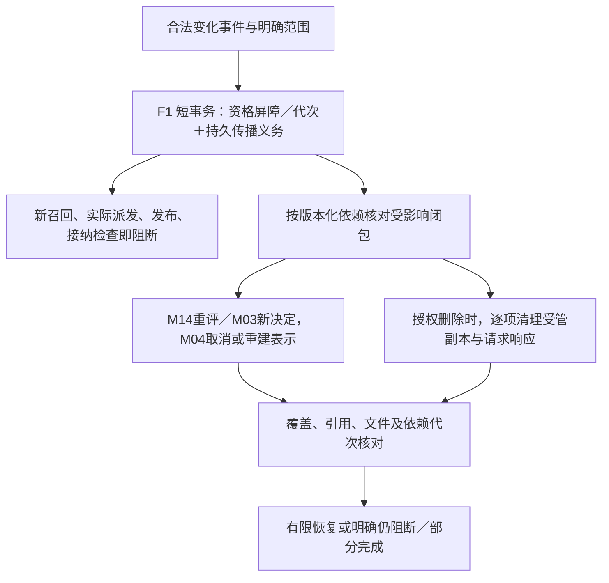

# Q09裁决：来源变化后的失效、清理与恢复

日期：2026-11-09（Asia/Shanghai）。执行者：主agent（/root），无委派。

状态：**Q09失效传播、模型请求处置与清理恢复规则已裁决，下一项Q10；精确schema、状态枚举及全链契约待Q12冻结，未编码。**

后续进展：[Q10指标裁决](tool-observation-learning-q10-decision-v0.1.md)已完成，当前下一项Q11；下文保留历史范围。

依据：[Q02职责](tool-observation-learning-q02-decision-v0.1.md)、[Q05来源／范围／未知](tool-observation-learning-q05-decision-v0.1.md)、[Q06接纳／更正](tool-observation-learning-q06-decision-v0.1.md)、[Q07保存／恢复](tool-observation-learning-q07-decision-v0.1.md)、[Q08召回／模型输入](tool-observation-learning-q08-decision-v0.1.md)及[TODO](../plan/tool-observation-learning-loop-todo-v0.1.md)。用户要求先研究不明确处，记录裁决和交接，暂不编码、正式实例继续锁定。本文不执行删除、撤权、修复、模型调用或业务测试。

## 1 核心区别

**先阻断受影响的继续使用，再按各模块职责更正或清理，最后核对能否恢复。** 阻断生效、传播完成、正文清理完成和恢复使用是不同结果，不能用一个success表示全部。

- **更正／修订**：来源或认识有新版本；旧报告可能仍是当时真实发生的报告，不等于旧历史应被擦掉。
- **撤权／用途受限**：指定主体／接收者／用途不能再读取或使用；不等于内容已被证明为假，也不自动删除所有有权主体的记录。
- **显式删除**：在获授权且明确的范围内清理正文及已知派生／副本，正常保留历史原则不能抵消删除请求。
- **发现矛盾**：可比范围内的依据不相容，需要限定使用、标记冲突及重评，不默认“新者胜”或全库清空。
- **暂时找不到／服务故障**：可用性未知；不据此判内容错误或宣称已删除。若当前使用所需依据无法核对，先阻断对应用途。

恢复只表示在当前条件下重新取得有限资格，不是回滚世界、复活旧权限、补回已擦除正文或自动恢复执行。

## 2 研究依据与可借鉴边界

| 来源／实际阅读范围 | 原描述与证据性质 | 本项目推论及限制 |
| --- | --- | --- |
| Ecker等，2022，*The psychological drivers of misinformation belief and its resistance to correction*；[作者接受稿](https://research-information.bris.ac.uk/ws/portalfiles/portal/298563464/Ecker_v4_TSshorten_UE_clean.pdf)，Barriers to Belief Revision的持续影响、整合／提取相关段落 | 心理学综述：人可以记得并接受更正，后续推理仍受旧信息影响；讨论多种解释机制 | 更正必须关联旧内容，并检查后续召回和输出，不只新增一条更正文本。人类现象不证明本系统会以相同机制出错，也不提供软件传播时限 |
| Doyle，1983，*The Ins and Outs of Reason Maintenance*；[IJCAI原文页](https://ijcai.org/proceedings/1983/82)，自动提取正文§1—§3 | 原作者形式研究：记录推导／理由可追踪输入变化后果；明确理由维护不等于通常意义的逻辑一致性或真值保证 | 维护版本化支持及派生关系，按受影响理由重评；不实现完整RMS演算，不把依赖图当事实验证器。页面公式提取不完整，未据缺失公式推导算法 |
| [W3C PROV-DM](https://www.w3.org/TR/prov-dm/)，§5.1.8 Invalidation及修订相关内容 | 规范将失效与实体生命周期、活动和时间关联；仍存在的旧实体也可能不再适用 | 记录失效原因、作用范围、生效点及后续修订。不能直接把PROV实体失效等同数据库物理删除或对全部主体撤权，也不要求采用RDF |
| NIST SP 800-88 Rev.2，2025，*Guidelines for Media Sanitization*；[官方版本页](https://csrc.nist.gov/pubs/sp/800/88/r2/final)、[正文](https://nvlpubs.nist.gov/nistpubs/SpecialPublications/NIST.SP.800-88r2.pdf)的定义与§4.5验证／确认 | 媒体净化关注在给定能力下使目标数据访问不可行，并区分操作结果检查与效果确认 | 清理须声明目标、受管范围、方法与验证结果；应用层撤引用／VACUUM不能冒充SSD取证级净化。本题不执行媒体净化，也不声称符合该标准或处理外部副本 |

核查日期：2026-11-09。使用认知心理综述、形式计算研究及官方规范／指南，区分原结论与工程取舍；未作系统综述或科学界统一设计共识调查。Doyle1979出版页返回403，MIT书目仅用于确认文献，不冒充已读全文；本题采用实际可读的1983原作者文章。下述传播协议是项目设计裁决。

## 3 现有能力与不能夸大的部分

只读核查源码及[T10操作范围](../operations/development-t10.md)，未打开正式实例SQLite。

- `services/memory.py`的动态readers、原修订及派生关系检查，和`memory_quality.py`的来源捕获、当前版本／正文复检，可复用作局部门禁。已知依赖主要围绕记忆；不能声称已经覆盖Q05—Q08所有经验类型及最终输入入口。
- `privacy.py`已有控制者授权、停止／无活跃进程前置条件，清理已知派生、登记的请求及所有关联响应（包括未采用响应）、认知来源链接、正文／制品、索引和显式纳入的已注册备份／快照。未登记副本、未知语义转述、外部服务及取证残留不在其保证内。
- 现有清理部分依赖字符串替换和已登记关系；不能仅凭字符串没出现就确认语义派生不存在。其部分done／verified写入早于后续文件、索引或整理步骤，新契约不能直接复用这些标签作为跨介质完成证明；崩溃恢复须按实际步骤核对。
- `engine.py`已有准备清单、输入／政策epoch及派发、接纳复检，但attempt.state及sent_at会在实际generate之前写入，不能把这些字段直接视为“服务方已收到”的证明。当前还会在结果接纳复检前保存响应制品，不能据此保证删除中的晚到响应不重新落盘。实际请求里还有对话／历史观察等入口，清单需按Q08补齐。
- `dispatch_gate.py`与现有Engine会把协调门禁持有到同步generate返回；本版保持[G1停止／派发契约](autonomous-exploration-contract-v1.1.md)及[1.2继承关系](autonomous-exploration-contract-v1.2.md)，不能承诺长调用期间迅速完成竞争的停止／失效提交，也不能把预留先完成当作实际回调已开始。
- `recovery.py`保留未知外部效果、不自动重放的做法继续使用。`authorization.py`的政策epoch、`cognition_experience.py`／学习及测量的失效入口是局部基础，不等于通用来源变化协议。代码发布用的source_updates不能因同名被当作观察来源更正模块。

生命工程中，学习负责重评，认知负责改变所持认识，记忆负责停止提供不合格表示，边界模块负责权限，存储负责技术清理。系统工程以版本依赖、持久阻断、短事务和逐项确认装配，不能由存储或协调器替各所有者修改含义。

## 4 方案比较与选择

| 方案 | 后果 | 裁决 |
| --- | --- | --- |
| 只删索引／缓存，保留原资格 | 旧表示、已准备请求和响应仍可继续使用 | 不采用 |
| 来源一变化就全删所有认识与历史 | 混淆时序、权限、真假与隐私；丢失其他合法依据及审计 | 不采用 |
| 等全图扫描／清理成功才开始阻断 | 故障窗口内继续使用；大事务无法覆盖外部文件／请求 | 不采用 |
| 持久化受影响范围的使用阻断及待处理义务，再由所有者传播、清理、确认和有限恢复 | 保留真实阶段，可处理中断与迟到；需要版本／覆盖及入口检查 | 采用 |

阻断不能仅是异步消息或进程内标记。持久源资格／作用范围及代次是使用检查的依据；异步通知用于推进工作，丢通知仍应能拒绝不合格使用并找回未完成义务。本文称此为“失效屏障”，是概念记录，不是已建表、API或新授权。

## 5 变化输入、所有者与最小记录

变化必须能说明实例、来源／原修订、事件身份／规范化指纹、生产者及权限依据、变化种类、目标范围／主体／用途、已知新修订／生效条件、原因及可读证据、观察／接收时点、预期资格代次、请求的清理范围／约束和后续处理身份。未知沿Q05保留；不能只传“这个东西不可信了”。

源生效时间、本地接收时间、F1屏障提交时间、传播及清理确认时间分别记录。未知的外部变化不能被假称已实时得知；晚发现时按其可核对作用范围追溯已知请求／输出，并记录之前的暴露事实。本地禁止新回调入口的判定锚定已提交屏障，不把外部事件时间伪装成本地已经阻止的时间。

| 操作 | 业务责任 | 约束 |
| --- | --- | --- |
| 生产／确认来源修订 | 原来源及M01/M13的现有观察／执行归属 | 固定新旧引用，真实性和范围先核对；网络页面变化不直接取得M03写权 |
| 权限撤销、用途／接收者限制 | M12及源政策所有者，既有授权入口 | 屏障生效即阻断不合格用途，不需要先完成事实重评；提交可能等待既有门禁，普通内容不能自授撤权／清库权 |
| 内容更正、冲突及支持重评 | M14评估／提案，M03决定并保存新资格／版本关系 | 无匹配自动规则仍按Q06候选／复核，不因“修复”开启自动确认 |
| 表示、检索、索引及其依赖 | M04 | 取消当前提供资格，修复／重建固定合法版本，不自己选择事实赢家 |
| 删除计划与跨模块清理 | 既有授权隐私流程组织，各所有者处理本域，M17执行存储操作 | 计划和确认分开，不借清理扩大到未授权目录／账号／配置 |
| 请求、响应和输出传播 | 协调器／模型适配器及相应输出／执行所有者 | 记录真实派发／交付进度，复检权限和依赖，不声称撤销既成外部效果 |

来源修订、撤权、删除可以同时存在，要保留各自原因／代次。一个撤权被撤回不能清除另一个删除／冲突屏障；权限恢复也不能使已擦除正文复活。同键同指纹复用既有进度，同键不同实质内容拒绝；旧事件晚到须核对源顺序／预期代次，不能按本地接收时间覆盖较新决定。

## 6 依赖怎样传播：支持、可见性和内容清理分开

最小依赖图覆盖：原来源精确修订／片段→学习提取／比较／提案及效果报告→认知决定／经验版本→表示／互依赖组→索引与缓存→实际模型输入清单／会话→全部响应及其已登记转述／认识／决策或动作。关系应说明直接引用、转换、必要推理前提、备选支持、上下文暴露或实际交付，而不只记两个泛化ID。

三类关系不能互相替代：

1. **语义支持**：若一个结论需要A和B共同支持，A失效会破坏该理由组；若存在已核查且仍适用的独立理由组B，则可按Q06重新判断。不能仅有另一条链接就宣布其足以独立证明，也不能让循环转述自己支持自己。
2. **读取／用途依赖**：一个载荷实际含A或从A派生，仍须服从A的当前限制；另一来源B支持同结论，不会自动洗掉这个载荷里的私密A。现有权限交集语义不改为“任一来源可读即可”。
3. **删除范围／内容依赖**：目标若包括敏感事实、语义转述或一组制品，即使部分文本不逐字相同，也按已知关系处理。不能通过更换来源、重算摘要或新ID复活明确被要求删除的内容。

旧版本含A和B，撤A后可能基于B形成新版本，但必须有合法范围、独立支持核对、当前授权和M03决定，再走Q07；不得原地删掉A引用而假装原接纳从未依赖A。若删除只针对A的私密载体而非该事实本身，是否可保存独立合法B支持的内容仍按明确删除范围／政策判断，不能默认放行。

模型请求中的上下文暴露不证明输出每句确由该来源导致，但足以登记“可能受影响”。已知请求的所有响应（含失败可读输出、stale、未采用项）及登记的派生保守纳入检查／清理范围；不以未引用或未逐字复述排除。只按词匹配无法证明全部语义后果已清除，也不能据此删除全世界同一句话。

扫描限定实例、版本、关系类型及覆盖水位；图有环、缺边、遗留无清单或遍历预算不足时，不能把未遍历部分报完成。先保留最小可确定受影响域的阻断；无法安全界定边界时扩大到相应消费者／实例的既有控制范围，暂停普通使用并记录缺口。不是任意跨实例清库；后续扫描与恢复仍须授权、限额。

## 7 分阶段生效与传播协议

### F1：资格屏障与持久义务

确认具有处理权限且范围明确后，先取得既有协调门禁，再用短主库事务更新对应源资格／使用条件、代次和必要的直接失效关系，并同事务保存处理决定及持久传播义务；各记录仍由其业务所有者写入，协调器只装配。事实重评尚未完成可以保持待重评／冲突；撤权／删除所要求的不使用不等到重评后才生效。未确认的传闻不能取得删除／撤权权；可能影响认识的合法材料按Q06进入有限评估，不能让任意文本关闭全库。

同一实例所有普通读取／召回、Q07 C1/C2、模型真实回调入口、结果接纳、公开输出及动作执行入口都要核对其依赖的当前屏障／代次。子记录通知尚未到达不能成为继续使用理由。历史内容允许保留时仍只在合法历史用途读取，不绕过撤权／删除；权限检查服务不可用则不猜测可用。

短事务不代表快速取得门禁：已进入的同步模型／工具回调可能使其他线程／进程的F1等待其结束，等待期间不得报屏障已提交。保持既有同线程回调内重入规则，已进入的回调仍属在途，之后的新回调须重新检查。本文不放宽G1的停止提交后新派发为零，也不引入固定确认毫秒上限。

主库资格与传播义务可共享事务，外部blob、独立索引、control.sqlite及远端请求不在同一原子保证内。锁序仍先既有协调门禁、后runtime事务；跨库以持久命令／代次／确认对账，不假称双库一次提交。所有内容／权限写入者都须接入该边界，旧写路径未覆盖前不能宣称协议完整。

### F2：各模块处理并逐项确认

M14形成重评／失效提案，M03按Q06记录限定、暂缓、冲突、撤回或新版本；M04阻断旧表示的当前资格、终止旧交接或重建合法新表示，并处理组就绪状态。必要依赖被阻断时，组不能只发布另一半报整体可用。索引／缓存可延后清理，但返回路径实时复检必须先有效。

通知含事件、源代次、对象修订、操作／范围及原工作关联，消费者记录自己实际处理的结果；同一业务键重复不增加学习、独立证据、接纳或gain。失败／旧租约消费者不能写覆盖较新进度。新内容经Q07新交接产生，不把旧工作换参数后当幂等重试；表示重建不重新接纳一次。

### F3：确认、恢复或保留阻断

分别确认屏障生效、依赖遍历覆盖、模块确认、索引／缓存处理、受管正文清理、外部请求处置及恢复资格。清理中断时屏障保持，不以恢复业务为由先解除；源事件在扫描中又变化，核对新水位并合并待办，不能用旧扫描结果清掉新屏障。没有恢复条件／授权或不能确认覆盖时保留明确阻断，不无限循环。

## 8 不同变化对各层的影响

| 变化 | 认知／学习 | 表示、索引及原经历 | 请求／输出和恢复 |
| --- | --- | --- | --- |
| 来源新时点报告，旧时点报告仍有效 | 范围对齐后按时序补充，不假定旧值错误；当前用途须考虑最新可用范围 | 保留旧历史，按新接纳版本生成表示；不能按created_at无条件覆盖 | 仅影响确实依赖“当前／最新”或已变范围的请求；无关历史查询可继续，但仍查当前权限 |
| 同一来源更正原报告／旧解析有误 | 标受影响前提待重评，M03建立更正／替代及实际范围，不直接宣称新值绝对真 | 旧解释不再默默用于当前；原记录和更正关系正常保留 | 阻断使用旧前提的准备／后续输出，允许合法历史核对；新版本完整后另行准备 |
| 撤权／限制用途或接收者 | 相关使用资格受限，不宣布内容为假；支持能否继续另判 | 原记录和派生当前均按该主体／用途检查，不能靠副本绕过 | 不合格请求取消／拒收，已发送记暴露事实；恢复须新授权及全链重检 |
| 明确删除 | 在授权范围内清理认识正文／派生／样本；正常不可变历史原则有删除例外 | 清理表示正文、原文、索引／缓存、已登记副本等实际目标 | 处理全部已知请求响应／会话及副本；范围验证前不报全部完成，不自动恢复被删内容 |
| 合法可比反证／矛盾 | 保留各方依据，限定受影响确定性用途并重评；不按较新／多数选真 | 当前表示带冲突及范围，旧无争议文本不可直接续用；原材料可授权查证 | 依赖单一确定结论的请求过时，明确冲突分析可重新准备；不能平均或隐去一方 |
| 暂时不可达／摘要不符 | 区分可用性未知、完整性失效及语义反证，不把IO失败当新世界事实 | 依赖必要来源不能核对则阻断对应使用／报告缺口 | 有限核对，许可内修复固定版本；不凭索引／模型补造正文或重放原工具 |

若效果评估的标签、输入或计分来源受影响，M14撤销其当前测量资格／重评，M03按既有接口保存经验统计新版本；分母、排除样本和收益unknown需真实表达。不能把旧gain改成0或把清理视为负收益，也不能重复计数。其他人格、价值、习惯、目标或行为模块若在依赖闭包内，只通知相应所有者阻断／复核，不由认知或清理器直接重写它们。

## 9 已准备、已预留、实际派发与已交付的模型请求

**首版选择：保持G1既有的最终复检与真实同步回调互斥，不以预留／准入账本代替实际派发。** 失效检查须绑定真实输入清单、源资格代次、用途／接收者、运行归属和预算；最终检查与实际回调入口之间不得释放协调门禁。当前门禁继续覆盖整个同步回调，接入新屏障检查及接收保留规则仍需后续实现／验证。把长推理移出门禁属于另外的派发协调改造，不能借本题获准或用改判“在途”绕过原G1失败窗口。

| 请求阶段 | 失效后应做什么 | 可以／不能声明 |
| --- | --- | --- |
| 仅检索／组装、尚无有效请求 | 丢弃不合格工作上下文，重新取合法材料须沿原许可／预算；删除时清理受管临时副本 | 未发送可由真实本地状态说明；查询不能自动触发重学 |
| 已准备、未进入实际回调 | 标为取消／过时／阻断，不再入发送通道；依赖代次变化使原输入清单不适用 | 屏障提交后可阻止新的真实入口；不能原地改旧请求正文后重用其身份 |
| 已预留或账本记sent，实际入口未确认 | 按真实入口轨迹核对；确认未进入时在门禁内重检并阻断，是否进入未知则保留未知，不盲目重发 | 旧预留不豁免最终检查，不直接算已派发，也不能仅据账本声称远端已收／未暴露或零费用 |
| 已进入回调／已发送，生成中 | 记录实际在途；外部线程F1可能等待回调结束。只有既有独立取消能力可用且获授权时尝试取消，后续使用按实际生效的屏障阻断 | 不承诺即时取消；取消受理不等于远端未处理、删除上下文或已退费，本题不新增远端操作许可 |
| 已收到、尚未接纳 | 独立记录完成／费用和不合格原因，隔离输出；更正／撤权按权限留审计，删除按明确范围清理正文 | 返回格式正确或答对也不越过屏障；不能直接复制到新请求规避 |
| 已接纳、尚未公开／行动 | 保留当时接纳事实，标当前资格失效并阻断发布／衍生／动作；所属模块重评 | 不倒改成“从未接纳”，但当时接纳不等于现在能用 |
| 已向用户／外部交付或已执行动作 | 记录可知接收者、交付／执行范围及后续依赖，停止继续传播；需更正或补偿走既有授权渠道／动作流程 | 不能收回他人已读内容或假装世界回滚；未知外部效果不重放，不擅自向第三方发消息 |
| 供应方会话、响应缓存或续接状态仍可能持有内容 | 标相应会话／续接不适用，不再复用；合法后续需要不含失效材料的新鲜上下文和当前授权 | 清空本地selected_memories不等于远端遗忘；外部保留／删除未获确认则unknown，不宣称权重遗忘 |

可核对先后沿G1：屏障先提交，之后的真实回调被最终检查拒绝；回调先进入，外部竞争的F1等待其退出后提交，同线程重入则保留已经在途的事实。预留先完成但回调尚未开始，不能获准在屏障后开始。真实本地回调入口也不是服务方已收到的证明，远端接收和网络字节传播另据现有能力记录；未知保持未知。发送失败／崩溃时先按原请求／尝试核对，用量未知不当零，不换ID续额度。

结果接纳、公开交付和外部动作发送也各自有资格复检及可核对先后；不能在检查后长时间缓存许可、再不重检地发布。屏障前已发生的交付／动作按既成事实处理；屏障后的新派发／使用不得借旧批准继续。已有停止／正式实例锁定／恢复门禁始终优先，本协议不解锁。

若删除范围涵盖该响应，接收入口须在原文持久化前核对保留资格，仅记允许的完成／用量／处置元数据，不为审计重新保存正文、原文hash或含秘密的错误日志。此前已落盘的响应加入原清理计划，不能在已验证后由晚到进程重建；撤权或更正但不要求删除时，是否可隔离保留也须按当前读取和保留政策决定，不能默认输出一律可存。

## 10 清理范围、验证与历史保留

正常更正／冲突保留合法历史和关联，不执行正文擦除。撤权保留与否按来源政策／已有隐私范围决定，至少限制读取与用途。只有获授权的明确删除才按下表进入清理；目标不清时先记录阻断／待澄清范围，不自行扩大到无关文件。

正文／制品的破坏性清理继续遵守既有Privacy要求：实例已停止、无活跃受管进程并核对运行归属。F1可以先阻断使用；在途生成、缓存和未知进程先隔离／停止并核对，不一边正常生成一边重写受管制品。管理清理授权不等于解除WAKE_DISABLED或恢复普通执行。

| 受管目标 | 清理／核对要求 | 完成边界 |
| --- | --- | --- |
| 认知版本、学习产物、表示／原经历 | 按已知依赖及删除范围清理正文、提案、理由、效果标签／统计明细和衍生载荷；保留仅被允许的关系／最小墓碑 | 不以追加版本为由保留被删正文；也不把墓碑当可召回内容 |
| 主库及制品／共享blob | 在允许范围内撤引用／替换为墓碑，核对有效共享引用后删目标旧blob；每步有持久身份及实际结果 | SQLite提交不包含文件删除；失败保持cleaning，不因路径缺失错误删除其他文件 |
| 索引／缓存／暂存 | 移除相关条目及旧段、独立哈希／词元索引、准备载荷／临时文件和登记的进程缓存；全量重建只按授权范围 | hash词元不等于加密；只写逻辑删除标志不算物理旧段已处理，进程无法核对时先隔离／停止 |
| 请求、全部响应、对话及已登记转述 | 按实际输入／暴露关系覆盖accepted、stale、未采用、失败可读输出及会话引用，不依赖逐字命中 | 不从旧响应重建被删事实；远端状态单列，不以本地清理冒充远端删除 |
| 日志／审计／运行快照／旧评测包 | 登记在授权范围内的正文、片段、查询、reason、错误输出和附件均须检查；常规失败证据继续保留，但显式删除范围覆盖时按流程清理 | 不为保留证据另复制秘密；本轮无删除请求，旧证据原样保留 |
| 已注册备份／快照及恢复镜像 | 仅处理明确纳入且可验证身份的受管副本；记录代次、覆盖、遗漏和不可达项，更新允许的校验索引 | 未纳入／不可达副本不能报已净化；恢复必须先重放当前屏障／删除排除信息 |
| 外部导出、第三方、供应方会话／存储、媒体残留 | 分别记录已知范围、可验证能力、受理／确认状态和未知项 | 本题不访问外部账号、不发送删除请求、不保证SSD取证擦除或模型权重遗忘 |

清理计划需在破坏性步骤前持久记录目标身份、授权范围、方法和逐项状态；无需为重试永久保存一份被删秘密。步骤成功后核对实际对象再确认，崩溃后依据同一计划继续，不因原文已替换而无法找到旧blob／请求。后台写入、旧租约、晚到响应和备份恢复必须被屏障挡住，防止边清理边产生新副本。

操作层“删文件／重建成功”与范围确认分开。数据库整理、检查点或VACUUM只按现有受管维护规则使用，不能推断媒体底层全部不可恢复。去重记录／墓碑只保留当前政策允许的最小不透明身份、原因类别／代次及完成范围；低熵秘密的原文hash、正文片段或泄露存在性的ID也可能不允许保留。

完成报告必须分别给出：已阻断的用途和时点、已检查依赖覆盖／未决项、各域处理确认、受管正文清理／验证范围、备份及外部边界、费用／发送未知项、恢复条件。只完成受管范围时可报“受管范围已验证，外部未确认”，不得报“全部遗忘／世界所有副本已删除”。

## 11 失败恢复、重授权与备份回滚

- F1回滚时不伪造已生效回执；提交结果不明先查同事件身份／代次，无法核对则相关普通使用等待，不猜无屏障。F1已成、通知丢失时从持久义务补处理，不重新发布变更或重复计数。
- 传播、清理、索引或确认失败时，分别标可重试／阻断及解除条件；同一工作有限退避、预算／期限、租约代次保护。清理重试不是重调原工具／模型；受管删除不因模型预算用完而被标完成，但后续工作必须有相应管理授权／资源。
- 源重新可用或权限恢复须有当前有效的来源／政策修订及授权；M03重新检查支持和范围，M04按合法版本重建，Q07完整交接后Q08才可用于相应用途。不能简单把invalid翻成valid、恢复旧会话或让旧取消请求继续跑。
- 错误撤回／更正以新决定关联补偿，不能删除事件历史掩盖错误。删除后的重新提供须有新的合法来源／授权且不违反仍有效的删除范围，不从已禁用副本“找回”；不自动再采集。
- 备份恢复必须保留既有恢复门禁并核对实例／运行归属。当前权限和删除排除代次不能只取待恢复旧runtime镜像；由既有M12／E01受管控制范围提供不随该镜像回滚的最新可信记录或显式受控核对。若该记录也被回滚／缺失，不能推定无删除，须保持隔离并完成核对后再考虑恢复。具体持久落点在Q12与跨库装配统一，不新设未定义外部服务。
- 恢复核对源资格、引用／摘要、依赖覆盖、组就绪、索引水位、会话／请求、旧进程写权及外部效果；清理未完成或未知项不自动放行。即使数据资格恢复，用户停止、正式锁和恢复门禁也不会被本协议解除。

## 12 未来验收题面

以下36项供Q10—Q11转成隔离实验，**本轮未执行**。每题分别检查屏障、业务资格、传播／正文清理、请求事实和恢复，而非只检查返回success。

| 编号 | 条件 | 应观察到的结果 |
| --- | --- | --- |
| A01 | t0报告7、t1报告10且时点不同 | 按时序及用途处理，旧历史不被无故判假或擦除 |
| A02 | 原回执10、旧解析7被更正 | M03形成有理由新版本及更正关系，旧解释不再当当前无争议内容 |
| A03 | 合法可比来源发生矛盾 | 限定相关确定性用途并保留冲突，不多数／最新必胜或平均 |
| A04 | 无权文本声称“撤权／删除所有记忆” | 不能取得屏障／清理权限；合法反证可走独立有限评估 |
| A05 | 仅撤某主体／接收者／用途权限 | 精确阻断相关读取／派发，不判内容为假，也不删除其他主体全部合法历史 |
| A06 | 只有必要支持A失效 | 依赖理由组不能继续支持相关当前认识，按Q06重评／限定 |
| A07 | A失效但有已核对的独立支持B | 由M03按政策作新决定／版本；旧含A载荷权限不会自动放宽 |
| A08 | 循环转述或同一来源多副本声称独立支持 | 不自我证明，不因副本数继续维持资格 |
| A09 | 删除目标包括敏感事实／语义转述 | 已知无逐字重合的派生仍纳入，不换来源或ID复活被删内容 |
| A10 | 图缺边、有环、遗留输入无完整清单或遍历超限 | 标覆盖不足并保留必要域阻断，不把已遍历部分报全链完成 |
| A11 | F1屏障或持久义务任一主库写失败 | 同事务回滚，不留下半生效成功回执 |
| A12 | F1成功后通知丢失／进程退出 | 新使用已受屏障检查，授权恢复可从原义务继续，不重计收益 |
| A13 | 同事件重交／同键不同参数／旧事件晚到 | 分别复用、不匹配拒绝及代次核对，不覆盖较新权限／删除 |
| A14 | 更正、撤权和删除屏障并存，仅解除一个 | 其余仍有效，不能单一valid开关全部放行 |
| A15 | 经验已接纳但旧Q07表示任务晚到 | C1/C2复检阻断旧发布；互依赖组未齐不能整体就绪 |
| A16 | 旧索引／缓存仍命中失效内容 | 主库／源代次复检先阻断；异步未清理不能成为继续使用理由 |
| A17 | 模型请求已准备／预留但未实际进入回调，屏障先提交 | 最终检查阻断新真实入口；原载荷不能原地换值续跑，保持原G1停止窗口判据 |
| A18 | 真实回调与屏障并发 | 屏障先提交则拒绝回调；回调先进入则外部F1等待退出，同线程重入保留在途；不以预留冒充派发或伪称网络原子 |
| A19 | attempt已标sent但适配器未确认实际发出 | 真实发送／费用单列为未确认，不据字段声称远端已收或零暴露 |
| A20 | 已发送生成中，取消能力未知／仅取消已受理 | 保持失效及暴露／费用未知，不承诺远端已删、未处理或退费 |
| A21 | 失效后晚到响应，格式正确且答案碰巧正确 | 禁止普通接纳／发布／行动使用；删除范围涵盖时仅记允许元数据，不重新落盘正文／秘密日志 |
| A22 | 已接纳未交付内容在来源失效后准备公开 | 交付前复检阻断，保留当时接纳事实，不倒改历史 |
| A23 | 输出已交付或动作已执行／效果未知 | 记录真实边界，后续更正／补偿沿既有授权，不收回既成事实或盲目重放 |
| A24 | 本地记忆已移除但远端会话／续接仍可含旧内容 | 禁用受影响续接，新合法上下文另准备，不能声称远端或权重已遗忘 |
| A25 | 请求没引用敏感来源，输出也无相同字符串 | 已知上下文依赖的所有响应／转述仍按目标范围核对，不以词匹配排除 |
| A26 | 正常更正／撤权而没有删除请求 | 保留符合政策的历史及关系，不误做正文擦除 |
| A27 | 删除计划中断于主库变更后、文件／索引清理前 | 屏障保持，计划仍可恢复，不能因早期done／verified报全完成 |
| A28 | 目标blob有共享引用或清理路径不合法 | 按明确内容范围及有效引用核对，不误删其他文件，不扩大目录权限 |
| A29 | 明文已删但索引词元／旧段、临时载荷／缓存仍在 | 分别处理并验证，hash词元不当加密或完整净化证明 |
| A30 | 清理涉及日志／旧评测包／保护配置或未纳入备份 | 授权范围内按计划处理；未授权／受保护项报未决，不偷偷改配置或外部副本 |
| A31 | 已注册备份不可达或外部副本／供应方保留未确认 | 完成声明明确受管覆盖和未知，不报全部擦除 |
| A32 | 墓碑／reason／原文hash可暴露低熵秘密或存在性 | 仅保留政策允许的最小不透明记录，公开诊断不泄漏 |
| A33 | 标签／测量输入被更正或删除 | M14/M03按职责失效／重评统计，分母／排除／unknown真实，不将旧gain填零 |
| A34 | 清理后权限恢复或误撤回被纠正 | 新授权＋当前支持核对＋新版本／表示交接；不复活被删正文、旧请求、旧会话或执行许可 |
| A35 | 恢复屏障之前的备份，且旧工作器晚到 | 当前可信排除记录／恢复门禁及运行代次阻断旧内容重现，缺记录则继续隔离 |
| A36 | 停止／锁定、活跃进程未核对、预算耗尽或步骤待恢复 | 破坏性清理满足停止／无活跃进程前提，只按授权流程有限继续；不自动解锁、重调工具／模型或报未完成为完成 |

## 13 裁决与完成核对

| 编号 | 裁决 |
| --- | --- |
| Q09-D01 | 更正、权限、删除、矛盾与可用性分别处理；生效、传播、正文清理及恢复分开 |
| Q09-D02 | 合法变化先明确源修订、权限和作用范围；事件身份／指纹及代次幂等，不以任意文本清库 |
| Q09-D03 | 持久屏障与传播义务同主库事务提交，所有消费入口复检，不等异步清理后才阻断 |
| Q09-D04 | 支持、读取／用途及删除内容关系分开；备选支持须核对，不洗去旧载荷权限或敏感内容 |
| Q09-D05 | M14重评、M03决定、M04处理表示／索引、M12权限、M17存储及协调器请求各守职责 |
| Q09-D06 | 原始更正保留合法历史和关系；明确删除按范围优先，不以不可变历史拒绝清理 |
| Q09-D07 | 依赖闭包覆盖版本、经验、输入、全部响应及登记派生；缺边／环／超限明示覆盖不足并阻断相应域 |
| Q09-D08 | 索引／缓存延迟清理不影响先阻断，旧任务／组／租约不得发布回退或覆盖新资格 |
| Q09-D09 | 保持G1最终复检和真实回调互斥，预留不冒充派发；F1可能等待在途结束，不放宽M11或承诺即时确认 |
| Q09-D10 | 准备、已预留但真实入口未确认、已派发、收到、已接纳、已交付逐阶段处理；迟到正确输出也不越权使用 |
| Q09-D11 | 外部暴露、取消、费用、会话保留及既成效果据实记录；不保证远端遗忘、不自动通知第三方或重放动作 |
| Q09-D12 | 删除先持久计划、逐项执行／验证，覆盖受管副本和已知语义派生；数据库／文件／索引非整体原子 |
| Q09-D13 | 审计墓碑不保存未获准秘密，日志／旧证据／备份及外部边界明示，不夸大为取证级或权重遗忘 |
| Q09-D14 | 中断从原屏障／计划恢复，当前代次／预算／租约保护；多原因屏障独立解除，不刷新ID续命 |
| Q09-D15 | 恢复需新授权和现有支持／版本／交接核对；备份须合并镜像外当前可信排除记录，缺失不放行 |
| Q09-D16 | 测量及其他消费者由各所有者失效／重评，不伪造gain、不重写人格；设计检查不当运行通过或解锁授权 |

本轮完成研究／源码／历史边界核对、方案比较、依赖及传播表、请求阶段和G1兼容边界、受管清理／确认、恢复规则、16条裁决和36项未来题面。与Q01—Q08的所有权、来源范围、未知、收益、两次提交及用途边界一致；需要修改的现有入口和局部能力限制明确列出，不宣称已有通用实现。

Q09标设计已解决，Q10—Q12仍待处理。下一项Q10将链路完整、失效阻断／清理、内容忠实、召回使用与实际效果拆成可量化指标。精确字段、锁序调用图、请求事实／控制及恢复记录持久落点、兼容旧状态与阈值在Q12统一冻结。本轮不改业务代码、数据库、配置、提示、主路线状态或实际选择，无模型调用／业务测试，不部署；正式实例继续锁定，旧证据原样保留。

本轮[文档核对记录](../../outputs/acceptance/q09-design-review-20261109T124503Z/review.json)及[证据索引](../../outputs/acceptance/q09-design-review-20261109T124503Z/evidence-index.json)保存5份文档快照、研究范围及源码／正式实例摘要。`digital_life`下`.py/.sql/.json`在本任务期间无变化，正式实例6个文件摘要一致且`WAKE_DISABLED`仍在，未打开其数据库。这里只完成设计检查，未重新执行G1或新失效／清理实验。
