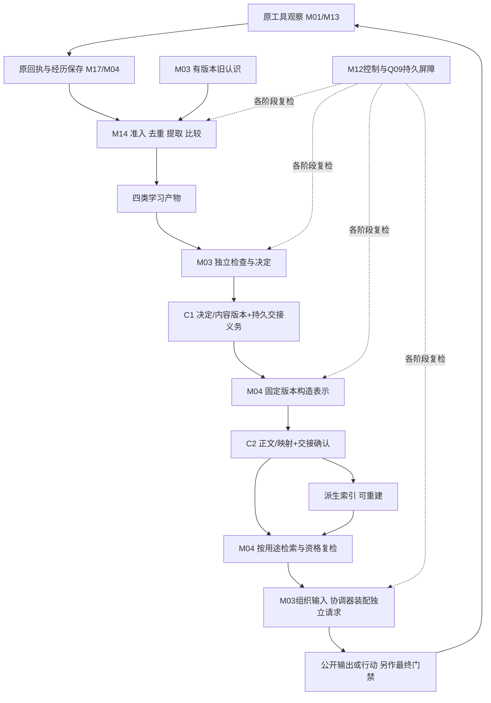

# Q12 并行预整理：工具观察学习闭环的架构与接口总稿

> 历史预整理稿：后续Q11已交接，当前首版设计以[TL-LOOP-0.1精确契约](tool-observation-learning-contract-v0.1.md)及freeze记录为准。本稿的“待合并/未冻结”描述仅指预整理时点，不覆盖新规范。

日期：2026-11-09（Asia/Shanghai）；版本V0.1；状态：分析中／预整理，**未冻结**。执行者：主agent，无委派。

本稿依据Q01—Q10已有裁决，提前完成可独立开展的架构汇总、接口责任、状态关系、兼容和实现差距核对。Q11正在其他工作中推进，本稿不代写其实验设计，不提前确认其样本、材料、预算、功效或通过结论。不修改业务代码、SQL、提示、配置或实例，不运行业务测试、模型调用或24小时实验。Q12设计整理不等于T12自更新工程，也不等于T13长期验收完成。

## 1 依据及来源状态

Q01—Q10逐项裁决的完整来源与文件摘要见同目录 `tool-observation-learning-q12-source-manifest-v0.1.json`；可追溯关系见本文第9节。精确接口仍须在Q11交接后整体核对。本文接口ID和状态名称是设计索引，不是现有方法、表名或已注册枚举。

旧主线T01—T12的局部工程通过可以证明相关已有能力，不能证明本条工具学习闭环已经贯通；T13仍在验证中。旧TODO中“T10完成、T11—T13待处理”是当时读取快照，不能作为当前机器状态。当前业务状态应读 `docs/plan/task-status.json`，但本轮不更改该文件。

## 2 保留的对象与唯一所有者

| 对象 | 业务所有者 | 写入及读取边界 |
| --- | --- | --- |
| 原观察、工具执行回执、证据定位 | M01/M13生产；M04保存经历 | 保留原来源与执行结果，不用解释覆盖；失败或未知也是原记录 |
| 提取、比较、更新提案、效果评估 | M14学习 | 分别对应Q05四类产物；可以调用认知推理，不能自行写M03接纳或M04发布成功 |
| 认知决定、内容版本及当前使用资格 | M03认知 | 按Q06处理类型、支持、范围、基线和冲突；不把工具成功、gain或模型信心当事实许可 |
| 绑定认知版本的召回正文、表示映射与检索记录 | M04记忆 | 不新建第二套权威经验；纯表示不扩展语义，增加解释须重新走提案 |
| 权限决定及有效主体/用途 | M12权限 | 当前许可优于历史快照，控制者批准也不能跳过业务所有者 |
| 主库、制品、事务、派生索引载体 | M17存储 | 物理执行不取得业务判断权；SQLite同库不等于允许任意服务跨域修改 |
| 调用关联、租约、预算与持久工作协调 | 协调器／既有运行控制 | 组织原所有者操作，不成为新的内容所有者；停止与恢复锁优先 |
| 题目、标签、组别及正式验收结论 | 外部评测流程／独立评审 | 不把待测学习的输出回流成自己的真值；Q11确定实验登记 |

原文字记忆直接编码和合法修订保留，T04/T10路径不能因为本链引入而废除。原工具正文可在授权来源核对用途下读取，但不能无标注地顶替已接纳经验。

## 3 调用图与正常闭环

调用箭头不表示每步必须调用LLM。已知声明格式先确定性解析；没有变化、冲突、不足、待条件和拒绝均为合法终点，但不能以全部拒绝规避合格学习覆盖。

C1主库事务同时提交M03决定/版本与持久交接义务，提交前不派发；C2主库事务同时发布M04表示/映射与消费确认。blob先保证可用再引用，独立索引不是同一个原子事务。索引失败不是接纳失败；C2缺失不是“可通过认知临时直读假装就绪”。重启只恢复未完成阶段，不重跑工具或模型来猜结果。

## 4 接口字典：设计级装配索引

各项共同携带实例、授权主体/读取接收者、用途、契约/工作身份、预期版本、来源依赖、期限/总预算、控制代次及允许返回的诊断范围；不强制把一切压成一个重复的大对象。字段精确必需性和序列化仍按各类型定义，待整体冻结。

| ID／交接 | 所有者、输入与前置条件 | 输出、持久化与失败语义 | 关联验收 |
| --- | --- | --- | --- |
| Q12-I01 观察→准入 | M14；不可变回执/证据、定位、用途、控制许可及剩余预算 | 有理由的处理/复用/等待/拒绝/停止；分交付、出处、内容和处理身份去重；未知副作用先对账 | TL01/08/09/15；Q03 |
| Q12-I02 准入→提取比较 | M14组织，按需调用M03；固定输入和有覆盖说明的旧认知版本 | ObservationExtract、ComparisonAssessment；声明格式解析、解释和事实核验分开；无法比较不造冲突 | TL02/03/07；Q04—Q05 |
| Q12-I03 学习→认知 | M14提交、M03接受；UpdateProposal、目标/基线、支持与实际范围；提交前复检 | 按Q06八层检查，决定/候选/暂缓/拒绝/复用/冲突分别记录；版本冲突重评，不覆盖 | TL01—04/08/12；Q06 |
| Q12-I04 C1→表示任务 | M03产生义务，M04领取；已提交的决定、固定内容版本、用途、表示方法和依赖 | 短租约构造；同键不同指纹拒绝；失败保留原义务与同一总预算，不刷新ID续命 | TL01/08/12；Q07 |
| Q12-I05 表示→C2 | M04提交，M17执行；当前租约/代次、内容与权限仍适用、正文制品可用 | 表示、映射、消费确认一起提交；晚到工作不覆写新映射；互依赖组必需整组就绪 | TL01/02/08/12；Q07 |
| Q12-I06 召回→输入 | M04检索、M03组织、协调器装配；用途/范围/时间轴、当前主体/版本和有限预算 | 实际正文+来源加工性质+Scope/ValueSlot+独立资格轴；无匹配/覆盖不足/未就绪/阻断/损坏/停止不同；不得用未接纳正文兜底 | TL02/05/06/07/09；Q08 |
| Q12-I07 失效→传播 | 变更合法所有者发起，M12/M03/M04/M14各自处理，M17持久化 | F1屏障与义务原子提交；F2逐域确认；F3核验/继续阻断；删除清理另作逐目标验证 | TL09—12/16；Q09 |
| Q12-I08 测量→效果提案 | M14评估、独立测量/评审供证据；固定材料、组/版本、范围、标签封存和实际使用量 | EffectAssessment或缺测说明；认知内容资格、表示就绪、数值收益分开；旧gain含义不改 | TL13—16；Q05/Q10，实验待Q11 |
| Q12-I09 恢复→原工作 | 既有授权恢复入口与原业务所有者；停机归属、持久提交事实、剩余预算/屏障及原业务键 | 确认已完成/有限续处理/保持阻断/损坏/待人工；failed job不会自动成为可领取工作 | TL08/09/12/15；Q07/Q09 |

M14四类产物共同字段沿Q05，不重命名成“直接写入记忆的学习结果”。既有对象引用优先，接口不能接受自由字符串owner来授予业务写权。

## 5 状态机不是一个success字段

| 轴 | 要区分的语义 | 不允许的推论 |
| --- | --- | --- |
| 原执行 | 尝试、成功、失败、部分或未知及实际回执 | 成功不证明解释为真；未知不作为失败样本任意强化 |
| 学习工作 | 准入、处理、复用、等待条件、拒绝、停止和有界失败 | 等待不无限调用；换ID不是新机会 |
| M03处理 | 接受、候选、暂缓、拒绝、无变更复用、冲突；内容状态另记 | 接受一条不代表整组成功或现实已证实 |
| M04表示工作 | 待处理、持租约构造、已发布、可重试失败、需条件解除、永久失败、过时 | 发布不等于当前可用或已命中 |
| 索引/检索 | 索引水位及损坏，返回完成度和覆盖，各项当前/历史用途 | 有索引不等于内容合格；无命中不证明没有旧认识 |
| 资格/失效 | 来源支持、读取用途、删除内容关系及每个生效原因 | 一个原因解除不清除其他屏障；重授权不恢复旧语义 |
| 效果 | Q10测量状态及原始计数/区间；内容ValueSlot独立 | unknown不填零；多份表示不增加独立样本 |

F1先建立当前使用的屏障及持久传播义务；F2按域处理认知、表示、请求、索引/缓存、测量与登记副本；F3以逐项确认决定恢复或保持阻断。缺边、环、超限须明示覆盖不足，不能以“当前对象没查到”报全域清理完成。

真实回调与G1最终复检继续互斥：回调先进入，F1可能等待其结束；F1先提交，之后入口应拒绝。账本sent/资源预留不是回调或远端已接收证明。输出接收、接纳、发布、动作也分别重检；删除涵盖晚到响应时，在持久化正文前检查保留资格，不能先重存秘密再声称清理完成。

## 6 输入入口与派生关系清单草稿

当前装配核对点是Engine.prepare，不只selected_memories。未来全链依赖清单须覆盖：

- task/observation、conversation_context、selected_memories、cognition_sources/cognition_snapshot；
- task_loop的回执/观察/后续输入，exploration的recent_memories、共享回执、历史问题及来源守卫；
- personality/values及personality_growth、habit_suggestions/habit_learning、relationships、states/goal_regulation、behavior_policy特征及引用；
- memory_quality、self_maintenance、autonomy_agenda及其可能嵌入的正文/派生内容；
- ExperienceMeasurement的common_context、题目、预测调用及评测输入；工具原文、学习中间产物及表示构造若参与模型输入，同样必须登记；
- 接收后的所有响应（包括不被接纳/迟到结果）、公开回复记忆、缓存/索引、受管备份、审计/日志，以及对外已交付结果的已知依赖。

不是所有字段都必然依赖某条源。冻结时按生产者/字段、来源类别、用途、接收者、复检位置、清理及兼容策略逐项确认；漏项不能用“这些字段只是元数据”默认豁免。旧input_manifest_hash主要基于选中记忆，不能单凭它认定所有上述入口已覆盖。

每次独立思考仍为干净LLM调用；必要连续性材料由当前合法输入清单显式装配。不修改已准备请求正文后复用其身份。已经远端交付的内容不能假装召回，远端保留与删除能力未知时如实记录，不自动向第三方发消息。

## 7 版本兼容与主线关系

| 基线 | 保留的能力 | 本设计不得声称的变化 |
| --- | --- | --- |
| 旧文字记忆/T04/T10 | 原编码、受控反馈、来源依赖、摘录、索引/擦除 | 不把所有旧记忆迁移成新认知经验，不废除合法直接召回 |
| SelfFeedback、COGNITIVE-EXPERIENCE-SHADOW-0.2/0.3 | 影子机会、认知版本与只读投影；旧记录不静默采纳 | 不改为当前世界事实，不直接进入选择；旧unknown保留 |
| EXPERIENCE-MEASUREMENT-0.1 | 已实现受控分类封存对照和测得收益的shadow接纳 | 分类收益不等于本链内容忠实/TL13改善，不能套用旧报告宣称本链通过 |
| CognitiveUpdates/V3 | 有来源候选、版本/CAS及显式确认 | 不把confirm直接当作Q06全类型自动接纳政策 |
| G1停止/派发、Recovery、Deployment | 停止和运行归属、未知不重放、版本回退 | 不放松最终门禁、自动解锁、自动重启或回滚世界 |
| T11/T12/T13 | 有界承诺/探索、健康维护/源码候选、受控验收设施 | T12不是Q12，T13短跑不是Q11真实语义实验，全部局部回归也不等于本链实现 |

版本处理建议：新链独立、显式启用，未知契约/类型拒绝或隔离而非按旧字符串默认为可用；旧记录保持原资格，仅经明确迁移/重评才进入新链。新增持久对象和迁移必须有停止条件、备份、兼容范围和退回方案；代码退回不撤销C1已提交内容、更正、删除屏障或外部副作用。此处为迁移要求，不是数据库升级方案已获批准。

## 8 Q11并行合并槽位

| 槽位 | Q12现在能准备 | 等Q11提供后才能关闭 |
| --- | --- | --- |
| M01 | 接口/状态/故障与TL01—16的关系 | 正式case/trial标识、材料与预期终点 |
| M02 | 原经历核对、内容经验使用、未参与学习的新问题分别走链 | 组别和信息隔离、盲评、标签封存及污染检查 |
| M03 | Q10机制/质量/改善三门及原数值不改 | 样本数、重复、精度/功效、最小关注效果与预算登记 |
| M04 | 持久事实与真实入口的证据责任 | 故障注入点、真实派发探针、停止/恢复竞争时序 |
| M05 | 保留原case、失败/未知/取消及实际成本分母 | 中断策略、迟到结果和缺评审的统计处理实例 |
| M06 | 旧能力保持独立于目标改善；历史证据范围受限 | 保留任务集、基线材料及非劣判断流程 |

Q10的既定指标/分母、机制零违规、质量门和改善/非劣门继续适用；不在本稿另定更宽阈值。每类至少20个独立case只是Q10最低解释门，不是替Q11解决功效；repeat不能冒充独立case。

## 9 裁决追溯与当前结论

| 来源 | 本稿落点 | 尚未关闭的内容 |
| --- | --- | --- |
| Q01全部对象裁决 | §2、§7区分经历/经验/统计 | 精确对象序列化 |
| Q02-D01—D10 | §2、§4所有者/授权/存储分离 | 强制入口与写入限制实现 |
| Q03-D01—D12 | I01、§5有限工作与分层去重 | 字段约束及Q11机会材料 |
| Q04-D01—D12 | I02/I03、比较覆盖与解释门控 | 具体提取器与支持核验范围 |
| Q05-D01—D12 | 四类产物、Slot/Scope/资格轴 | 精确schema与兼容解析规则 |
| Q06-D01—D12 | I03、C1与类型接纳 | 各类型许可政策和确认路径 |
| Q07-D01—D12 | I04/I05/I09及组边界 | 持久化映射、租约/恢复细则 |
| Q08-D01—D14 | I06及全部输入入口 | 完整返回契约/全链清单 |
| Q09-D01—D16 | I07、F1/F2/F3和晚到正文 | 依赖闭包、受管清理映射及迁移 |
| Q10-D01—D06 | I08、§8及三门 | 指标载体与Q11实验引用 |
| Q11在途 | §8占位；本轮不引用未交接结论 | Q11全部正式裁决与预登记 |

当前结论：可并行整理部分已形成，Q12仍为分析中，不能标设计已解决/冻结。尚有精确契约、存储映射、跨阶段写入/恢复门禁及Q11合并事项，见配套差距与冻结清单。没有因本稿获得编码、模型测试或部署授权。
