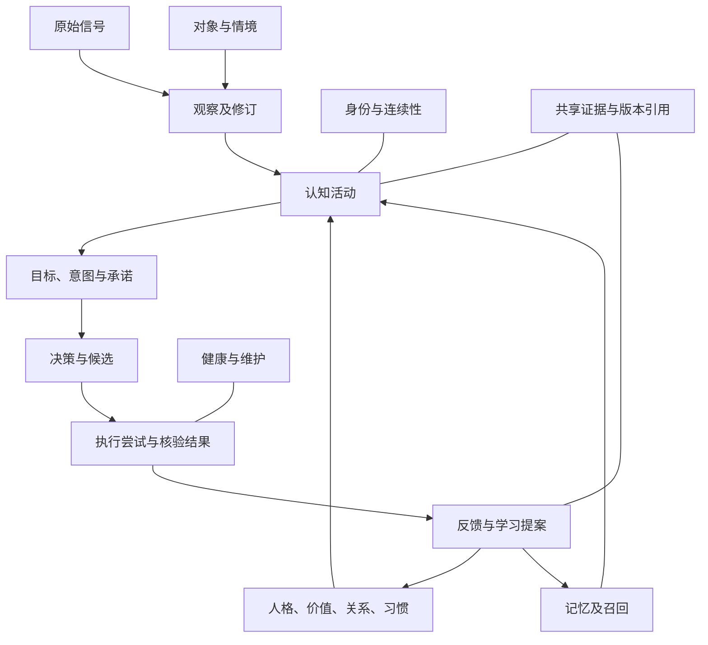

# 数字生命数据库架构设计报告

| 属性 | 内容 |
| --- | --- |
| 版本 | V1.0 |
| 状态 | 逻辑架构基线 / 待 DDL 实现与实验验证 |
| 日期 | 2026-11-08 |
| 上游 | 第一阶段概念基线 V1.0、第二阶段实现层架构 V0.1 |
| 范围 | 单机、单个数字生命的活动实例；支持复制与迁移谱系记录 |
| 存储 | Runtime SQLite；Supervisor 独立控制数据库；附件对象目录 |

本报告的可执行展开见 [数据库实现目录](../../database/README.md)，包含完整字段字典、两库 SQL 和验证报告。展开阶段补充了规则／能力／工具字典、概念修订、目标激活批次、长期配置稳定根对象和状态转换序号，具体差异见验证报告。

## 1 设计结论

数据库按生命工程模块组织状态所有权，以共同事件、情境、对象和证据连接各模块。每个模块分别保存其当前状态、变化历史和测量证据。数据库承担持续记忆和生命痕迹的持久载体；认知、学习、执行及维护逻辑由应用服务实现。

本报告完整规定逻辑表、核心字段、关系、更新事务、查询索引方向与验证责任。字段列是核心字段清单，不等同于已经执行的建表 SQL。精确 SQL、全部索引、迁移脚本和性能参数在 DDL 阶段落实；本报告不声称数据库已经安装或通过测试。

## 2 科学依据与工程取舍

| 模块 | 研究依据 | 本设计的取舍 |
| --- | --- | --- |
| 感知 | 感知与认知的边界存在争论：[预测加工](https://www.fil.ion.ucl.ac.uk/~karl/NRN.pdf)、[认知渗透批评](https://pubmed.ncbi.nlm.nih.gov/26189677/) | 信号、观察、解释分层；观察也保留修订、方法与不确定性，不宣称其绝对真实 |
| 人格 | [Whole Trait Theory](https://pubmed.ncbi.nlm.nih.gov/26097268/) 区分状态分布及情境机制 | 特质、状态、情境效应和行为测量分开；数字参数不是人类人格真值 |
| 工作记忆 | [Cowan 模型](https://memory.psych.missouri.edu/assets/doc/articles/1999/cowan-1999-miyake-book.pdf) 联系激活记忆与注意 | 保存当前激活的引用及临时新内容，不只引用长期记忆 |
| 长期记忆 | [多记忆系统](https://pmc.ncbi.nlm.nih.gov/articles/33639/)、[前瞻提取](https://pubmed.ncbi.nlm.nih.gov/16131267/)、[重构记忆](https://pmc.ncbi.nlm.nih.gov/articles/PMC3341652/) | 六类不做互斥枚举；分类、特有结构、召回产物及原始记录分离 |
| 价值 | [Schwartz 理论](https://doi.org/10.9707/2307-0919.1116) 描述价值及相容冲突关系 | 长期权重、价值关系、情境激活和行为效度分别记录 |
| 动机 | [Deci 与 Ryan](https://www.selfdeterminationtheory.org/SDT/documents/2000_DeciRyan_PIWhatWhy.pdf) 区分目标内容与调节方式 | 不只保存强度，还保存来源与调节方式；不预设数字生命具有人的生物需要 |
| 习惯 | [Wood 与 Neal](https://dornsife.usc.edu/wendy-wood/wp-content/uploads/sites/183/2023/10/wood.neal_.2007psychrev_a_new_look_at_habits_and_the_interface_between_habits_and_goals.pdf) 区分线索反应和目标控制 | 保存线索机会、未行动、抑制和习惯反应，频繁行动不自动等于习惯 |
| 关系 | [信任模型](https://makinggood.ac.nz/media/1270/mayeretal_1995_organizationaltrust.pdf) 区分能力、善意、正直等 | 信任分域、带证据；信任、可信特征和授权分开 |
| 承诺 | [意图](https://www.sciencedirect.com/science/article/pii/0004370290900555)、[社会承诺](https://www.csc2.ncsu.edu/faculty/mpsingh/papers/databases/maamaw-97.pdf) | 内部行动意图与对他者承担的责任分别保存，支持达成型与维持型承诺 |
| 行为／学习 | [多种控制方式](https://www.gatsby.ucl.ac.uk/~dayan/papers/dayber14.pdf)、[奖励预测误差](https://pubmed.ncbi.nlm.nih.gov/9054347/) | 不把 softmax 或单一奖励误差固定为所有行为和学习的唯一算法 |
| 自我／健康 | [自我层次](https://pubmed.ncbi.nlm.nih.gov/10637618/)、[系统韧性](https://csrc.nist.gov/glossary/term/information_system_resilience) | 实例谱系、自我模型、叙事及健康功能证据分别保存，不推断意识 |

表结构是本项目工程推导，不是上述作者提出的数据库模式。关系型存储也不模拟脑内信息的物理存储方式。

## 3 物理边界和逻辑分层

Runtime 使用 runtime.sqlite 保存生命业务状态与运行调度。Supervisor 独占 control.sqlite，保存部署、启动、停止和回退状态。二者不能通过跨库外键建立一致性保证，而通过 deployment_id、release_id、instance_id 和显式交接协议关联。

较大的原始输入、附件和模型材料保存到受控 blobs 目录，数据库保存哈希、大小、媒体类型、位置和访问范围。全文和未来向量索引属于派生设施，可以重建，不是权威来源。

## 4 公共字段与类型规则

以下规则适用于各业务表；表目录不重复列出全部公共字段。

| 字段 | 规则 |
| --- | --- |
| `id` | 应用生成的稳定 TEXT 标识；对象身份不随内容修订变化 |
| `instance_id` | 所属数字生命，引用 identity_instances；系统共享字典除外 |
| `created_at`、`recorded_at` | 创建及入库时间，UTC；含义一致时可只保留 recorded_at |
| `occurred_at`、`received_at` | 事件发生和接收时间，未知时允许为空且标明原因 |
| `valid_from`、`valid_to` | 状态或判断的有效时间；未知结束时间为空 |
| `revision_no` | 当前对象的单调修订号，用于乐观并发检查 |
| `activity_id`、`caused_by_event_id` | 关联活动和变化起因；后台维护允许独立活动 |
| `schema_version` | JSON 结构版本，不等同数据库迁移版本 |
| `status` | 按表定义的有限状态，不使用全库通用且无语义的状态枚举 |

连续值用 REAL，有范围时增加 CHECK；布尔用 INTEGER 并约束 0/1；金额、计数与必要的精确量使用整数单位。时间统一使用规范 UTC 格式与固定精度。JSON 必须经应用模型校验，可用数据库 JSON 校验能力辅助；关键外键、期限、状态、概率和查询字段不能全部藏入 JSON。

概率分开定义为选择概率、结果发生概率、判断正确概率。测量不确定性可用区间、分布参数或有序等级，保存表示类型与方法；不要求所有对象都有一个伪精确 confidence 数字。

## 5 共同对象、情境、来源和活动

| 表 | 核心字段 | 关系与用途 |
| --- | --- | --- |
| `object_registry` | id、kind、instance_id、registered_at | 可被跨模块引用的稳定对象登记；登记不代替具体业务表 |
| `object_revision_registry` | id、object_id、revision_no、kind | 需要精确引用的版本登记，UNIQUE(object_id, revision_no) |
| `world_entities` | id、entity_type、canonical_name、resolution_status | 人、文件、设备、服务、地点等；身份不明时允许未解析对象 |
| `world_entity_aliases` | entity_id、alias、source_ref | 对象别名与来源，支持歧义，不按名称直接合并 |
| `world_entity_relations` | subject_id、relation_type、object_id、valid_time、evidence_id | 对象关系；推断关系需要状态与依据 |
| `context_snapshots` | id、activity_id、task_ref、location_ref、context_schema、attributes_json | 不可覆盖的情境快照；供所有模块共同引用 |
| `context_entity_links` | context_id、entity_id、role | 参与者、作用对象、资源与环境对象 |
| `artifacts` | id、hash、size、media_type、storage_ref、retention_class | 内容载体；数据访问权限须随引用核验 |
| `evidence_items` | id、origin_object_id、origin_revision_id、artifact_id、source_actor_id、method | 标明来源对象或材料，不保存统一绝对可信度 |
| `evidence_derivations` | derived_evidence_id、parent_evidence_id、operation、version | 同源、摘要与推导链；禁止形成派生环 |
| `activities` | id、trigger_event_id、state、budget_json、checkpoint_ref、release_id | 一次活动与恢复位置 |
| `activity_steps` | activity_id、step_no、step_type、state、input_ref、output_ref、attempt | 持久步骤，重试不覆盖前次尝试 |
| `activity_context_refs` | activity_id、object_revision_id、role | 记录本轮真正读取的版本，而不是事后读取最新状态 |

多态引用通过登记表获得外键目标，具体类型匹配由 Repository 检查；可枚举的业务关系优先使用明确关联表。删除不级联清空所有历史，按删除策略移除内容、保留必要脱敏墓碑。

本报告中的 `inbox` 是输入接收职责，由 perception_signals 与 jobs 实现，不另外维护一份相同输入表。表内用“／”表示可替代引用的字段，DDL 必须拆成具体外键列并用 CHECK 约束允许的组合，不能直接用斜杠字段名。版本登记及具体修订行与当前版本指针在同一事务中提交；类型配对和派生无环检查作为 Repository 的必需验证。

## 6 感知模块

| 表 | 核心字段 | 规则 |
| --- | --- | --- |
| `perception_channels` | id、kind、capabilities、verification_method、state | 通道定义和可用性 |
| `perception_signals` | id、channel_id、source_actor_id、external_id、artifact_id、occurred_at、received_at | 原始载荷不由认知覆盖；通道与外部 ID 构成去重范围 |
| `perception_observations` | id、signal_id、context_id、current_revision_id、state | 观察的稳定对象 |
| `perception_observation_revisions` | observation_id、revision_no、content、entity_ref、locator_json、uncertainty_json、extractor_version | 保存文本范围、图像区域等定位及提取方法 |
| `perception_observation_sources` | observation_revision_id、signal_id、locator_json | 多信号支持一个观察 |
| `perception_quality_checks` | signal_id／observation_revision_id、check_type、result、evidence_id | 缺失、重复、乱序、验证失败等质量证据 |

观察可能冲突或被修订，不按“感知层”标签自动提升为真值。认知假设引用观察版本，不改写信号。

## 7 人格模块

| 表 | 核心字段 | 规则 |
| --- | --- | --- |
| `personality_dimensions` | id、parent_id、name、definition、scale_min、scale_max、direction、theory_version | 特质与侧面层级，第一版以 Big Five 起步 |
| `personality_profiles` | id、instance_id、version、effective_at、previous_profile_id、update_commit_id | 长期人格版本 |
| `personality_trait_values` | profile_id、dimension_id、central_value、uncertainty_json | UNIQUE(profile_id, dimension_id) |
| `personality_states` | id、activity_id、context_id、dimension_id、value、value_origin、method_version | 区分配置、推导、模型估计与测量 |
| `personality_context_effects` | profile_id、dimension_id、context_rule_id、effect_parameters | 情境调节机制版本化 |
| `personality_behavior_measurements` | evaluation_run_id、dimension_id、behavior_ref、score、rater_method | 独立行为测量，不能直接使用自述替代 |
| `personality_change_records` | old_profile_id、new_profile_id、proposal_id、reason、reversal_of | 形成依据及撤销 |

分布由状态或测量样本按来源分别计算；摘要保存样本范围和计算版本，不把不同来源直接混合。

## 8 认知与世界模型模块

| 表 | 核心字段 | 规则 |
| --- | --- | --- |
| `cognition_episodes` | id、activity_id、question、context_id、method_version、state | 一次认知问题与处理结果 |
| `cognition_concepts` | id、name、definition、current_revision_id | 概念对象，不假定固定词汇即完整表征 |
| `cognition_concept_relations` | subject_concept_id、relation_type、object_concept_id、evidence_id、valid_time | 分类、组成及其他关系 |
| `cognition_beliefs` | id、subject_ref、predicate、object_ref／literal、scope、current_revision_id | 当前信念权威入口 |
| `cognition_belief_revisions` | belief_id、revision_no、content、acceptance_state、uncertainty_json、method_version | 接受、保留、否定和失效，不只二值真假 |
| `cognition_hypotheses` | id、episode_id、content、state、uncertainty_json | 竞争解释，保留未选择解释 |
| `cognition_evidence_links` | target_revision_id、evidence_id、stance、strength_method、assessment | 支持、反对、中性与来源依赖 |
| `cognition_predictions` | id、episode_id、target_ref、predicted_outcome、probability_kind、probability、due_at、verification_rule | 结果发生前固定预测 |
| `cognition_plans` | id、goal_id、version、state、previous_plan_id | 计划版本 |
| `cognition_plan_steps` | id、plan_id、step_no、action_template、preconditions、expected_outcome | 具体执行引用步骤，不能将步骤直接记为完成 |
| `cognition_plan_dependencies` | step_id、depends_on_step_id、condition | 支持分支与依赖，禁止无说明的依赖环 |
| `cognition_assessments` | id、episode_id、assessment_type、estimate、information_gap、recommended_control | 能力判断、冲突与元认知 |
| `cognition_assessment_outcomes` | assessment_id／prediction_id、outcome_ref、scoring_method、score | 预测和元认知的独立核验 |
| `cognition_attention_allocations` | episode_id、target_revision_id、weight、allocation_stage、method | 行为前的关注记录；不当作模型隐藏注意的直接测量 |

概念与对象不同：杯子这一类别是概念，桌上的某个杯子是对象。证据本身、接受证据的判断、信念强度分开保存。

## 9 记忆与工作记忆模块

| 表 | 核心字段 | 规则 |
| --- | --- | --- |
| `memory_items` | id、instance_id、current_revision_id、state、salience、access_policy_ref | 稳定记忆对象，不使用互斥六分类 |
| `memory_classifications` | memory_id、axis、label、method_version | 区分内容类型、自我关联、未来用途等分类轴 |
| `memory_revisions` | memory_id、revision_no、content、valid_time、encoding_method、correction_reason | 内容版本与修订依据 |
| `memory_source_links` | memory_revision_id、evidence_id、role | 原始、推断、概括、恢复来源 |
| `memory_relations` | from_memory_id、relation_type、to_memory_id、evidence_id | 关联、概括、反例和自传联系 |
| `memory_episode_details` | memory_revision_id、event_ref、time_range、place_ref、outcome_ref | 情景结构；参与者用关联表，不使用逗号字符串 |
| `memory_participants` | memory_revision_id、entity_id、role | 参与者与角色 |
| `memory_semantic_details` | memory_revision_id、belief_revision_id、scope | 检索知识引用认知信念版本，不形成第二个信念真值 |
| `memory_procedure_details` | memory_revision_id、skill_ref、applicability_rule、procedure_version | 技能描述不等于可执行代码；执行仍受门禁 |
| `memory_autobiographical_details` | memory_revision_id、life_period、self_relevance、identity_significance | 可与情景和语义分类重叠 |
| `memory_prospective_details` | memory_revision_id、intention_id、cue_rule_id、target_time | 意图权威状态在目标模块；此处用于检索与提醒 |
| `memory_retrieval_runs` | id、activity_id、query、context_id、retriever_version | 检索请求 |
| `memory_retrieval_results` | run_id、memory_revision_id、rank、score、selection_reason | 保存候选和实际读取版本 |
| `memory_recall_products` | id、run_id、reconstructed_content、method_version | 本次召回产物，不覆盖原记忆 |
| `memory_recall_sources` | recall_id、memory_revision_id、evidence_id | 重构内容来源 |
| `memory_access_records` | memory_revision_id、activity_id、operation、used_in_ref、outcome_ref | 区分检索、读到和实际使用 |
| `memory_retention_rules` | scope、action、trigger、policy_version | 保留、降权、归档和删除 |
| `working_memory_items` | id、activity_id、content／object_revision_ref、expires_at、item_kind | 引用已有对象或保存本轮临时新内容 |
| `working_memory_activations` | item_id、activity_step_id、activation、attention_state、recorded_at | 激活变化与失效 |

全文检索建立在可访问的有效版本上，旧版索引保留与否依检索用途确定。索引不绕过记忆访问和删除规则。

## 10 价值模块

| 表 | 核心字段 | 规则 |
| --- | --- | --- |
| `value_dimensions` | id、definition、scale、theory_version | 维度定义 |
| `value_dimension_relations` | from_id、to_id、relation_type、method、evidence_id | 相容与冲突结构；不是外部权限 |
| `value_profiles` | id、version、previous_id、effective_at、update_commit_id | 长期版本 |
| `value_weights` | profile_id、dimension_id、weight、uncertainty_json | 相对优先关系，归一化规则随模型保存 |
| `value_activations` | profile_id、activity_id、context_id、dimension_id、activation | 情境表达 |
| `value_conflicts` | id、activity_id、resolution_ref、state | 冲突实例 |
| `value_conflict_members` | conflict_id、dimension_id、role | 可涉及多个价值 |
| `value_behavior_measurements` | evaluation_run_id、decision_ref、dimension_id、score | 行为与声称价值的一致性 |
| `value_change_records` | old_profile_id、new_profile_id、proposal_id、reason | 更新与撤销依据 |

## 11 目标、意图与动机模块

| 表 | 核心字段 | 规则 |
| --- | --- | --- |
| `goal_items` | id、source_ref、content、target_ref、state、success_rule、stop_rule、due_at | 候选、接受与终止条件 |
| `goal_relations` | from_goal_id、to_goal_id、relation_type | 子目标、依赖、互斥和支持 |
| `goal_evaluations` | id、goal_id、activity_id、value_alignment、expectancy、cost、risk、urgency、model_version | 评估时点和依据，不能冒充结果真值 |
| `goal_evaluation_factors` | evaluation_id、source_revision_id、factor_type、contribution | 各因素路径可追踪 |
| `goal_activation_records` | decision_batch_id、goal_id、score、probability、selected、strategy_version | 保存完整候选集与选择策略 |
| `goal_transitions` | goal_id、from_state、to_state、event_id、reason | 接受后不能因概率下降静默消失 |
| `intention_items` | id、goal_id、plan_id、trigger_rule、state、abandonment_rule | 系统自己决定执行的持续意图 |
| `intention_transitions` | intention_id、from_state、to_state、reason_ref | 意图重排与解除 |
| `motivation_states` | goal_id、activity_id、intensity、source_type、regulation_type、persistence、satiation、budget | 强度、来源及调节方式，不另造价值奖励 |

候选目标尚未接受时没有有效行动授权。目标与意图均不自动生成对他者的社会承诺。

## 12 习惯模块

| 表 | 核心字段 | 规则 |
| --- | --- | --- |
| `habit_items` | id、response_template、state、procedure_memory_ref | 反应与技能可关联，当前目标可为空 |
| `habit_cues` | id、habit_id、context_rule_id、match_method | 情境线索与匹配规则 |
| `habit_associations` | habit_id、cue_id、strength、uncertainty_json、learning_version | 当前线索—反应联系 |
| `habit_opportunities` | id、cue_id、activity_id、match_score、action_taken、control_mode | 保存线索出现但未行动的机会 |
| `habit_activations` | opportunity_id、candidate_id、triggered、inhibited、inhibition_reason | 触发、候选进入和抑制 |
| `habit_learning_records` | association_ref、before_value、after_value、feedback_id、update_commit_id | 强化、消退或纠正 |

频率、自动性和结果敏感性分别评估；不能只用反复次数证明习惯成立。

## 13 关系模块

| 表 | 核心字段 | 规则 |
| --- | --- | --- |
| `social_actors` | entity_id、actor_type、identity_status | 引用共同世界对象，避免重复人物身份 |
| `social_relationships` | id、instance_id、actor_id、state、current_revision | 自身与对象的有向关系 |
| `social_relationship_dimensions` | id、definition、scale、method | 可扩展维度字典 |
| `social_relationship_values` | relationship_id、dimension_id、value、valid_time、evidence_id | 熟悉程度等当前值 |
| `social_trust_assessments` | id、relationship_id、domain、condition_rule、dimension、estimate、uncertainty_json | 能力、善意、正直等可选维度，均保留适用条件 |
| `social_trust_evidence` | assessment_id、evidence_id、stance、attribution_ref | 证据与归因 |
| `social_expectations` | relationship_id、expected_action、context_rule、probability、outcome_ref | 对方行为预期与实际表现 |
| `social_interactions` | relationship_id、event_id、activity_id、interaction_role | 引用共同经历 |
| `social_relationship_changes` | relationship_id、dimension_id、old_value、new_value、reason_ref、reversal_of | 更新与撤销 |

关系对授权和承诺只引用权威对象，不拥有另一份授权真值。关系可信特征不等于实际承担风险的行为。

## 14 社会承诺模块

| 表 | 核心字段 | 规则 |
| --- | --- | --- |
| `commitment_items` | id、debtor_actor_id、creditor_actor_id、kind、antecedent_rule、consequent_rule、state、due_at | kind 区分达成型和维持型；对方可以是用户或其他主体 |
| `commitment_confirmations` | commitment_id、actor_id、event_id、confirmation_type、grant_ref | 明确形成依据与确认关系 |
| `commitment_transitions` | commitment_id、from_state、to_state、event_id、reason | 生效、履行、重谈、完成、解除、到期、违约 |
| `commitment_goal_links` | commitment_id、goal_id、role | 履行方式和子目标 |
| `commitment_conflicts` | id、state、resolution_ref、detected_at | 冲突对象 |
| `commitment_conflict_members` | conflict_id、commitment_id／policy_ref／resource_ref | 用约束保证具体成员类型唯一 |
| `commitment_compliance_checks` | commitment_id、observed_interval、result、evidence_id | 维持型承诺需要按时间区间核验 |

社会承诺不因重新采样而消失。撤权可能使执行不可行，但不能自动抹掉承诺事实；应进入重谈或无法履行状态。

## 15 内部状态模块

| 表 | 核心字段 | 规则 |
| --- | --- | --- |
| `state_definitions` | id、name、unit、direction、measurement_kind、ttl、range_rule | 状态字典与时效 |
| `state_observations` | id、definition_id、value、observed_at、source_ref、quality | 直接测量 |
| `state_estimates` | id、definition_id、estimate、uncertainty_json、method_version、expires_at | 派生估计 |
| `state_estimate_sources` | estimate_id、source_revision_id、role | 可重算依据 |
| `state_activity_snapshots` | activity_id、state_observation_id／state_estimate_id | 活动采用的状态版本 |

第一版可使用已有七维起点，但字典允许增加维度。条件信任引用关系模块在当前任务的投影，不另行独立学习。

## 16 决策与行动执行模块

| 表 | 核心字段 | 规则 |
| --- | --- | --- |
| `decision_records` | id、activity_id、goal_id、context_id、strategy_type、strategy_version、seed | 决策方法可替换 |
| `decision_candidates` | id、decision_id、action_template、eligible、blocked_reason、score、selection_probability、selected | 唯一候选集内的归一化检查由应用验证 |
| `decision_factor_contributions` | candidate_id、factor_type、source_revision_id、effect_path、contribution | 区分目标中介与行为直接效应，防重复计分 |
| `action_intents` | id、candidate_id、plan_step_id、tool_id、arguments_json、grant_version、idempotency_key、verification_rule | 被选动作与预期核验 |
| `action_attempts` | id、intent_id、attempt_no、started_at、finished_at、runner_ref、state | 每次尝试独立，不覆盖 |
| `action_results` | attempt_id、state、receipt_artifact_id、outcome_ref、error_type | succeeded、failed、partial、unknown |
| `action_effects` | intent_id、entity_ref、effect_description、observed_at、evidence_id | 真实环境变化及延迟副作用 |
| `action_verifications` | intent_id、method_version、result、evidence_id | 回执与环境验证分别保存 |
| `action_attributions` | action_id、initiator_actor_id、authorizer_actor_id、executor_ref、evidence_id | 记录谁决定、授权、执行，支撑自我行动归属 |

无回执不等于失败；不知道结果必须是 unknown。幂等键范围至少包含工具、实例和操作语义，参数变化不能偷偷复用同一键。

## 17 学习与自适应标准模块

| 表 | 核心字段 | 规则 |
| --- | --- | --- |
| `learning_feedback` | id、prediction_ref、result_ref、signal_type、error_value／description、source_ref | 区分事实、任务、成本、风险与评价 |
| `learning_attributions` | feedback_id、target_revision_id、cause_type、estimate、evidence_id | 关联性与因果证据级别分别标明 |
| `learning_update_proposals` | id、owner_module、target_object_id、mechanism_version、proposed_change、scope、risk、state | 所有者审批，不直接跨模块覆盖 |
| `learning_proposal_evidence` | proposal_id、evidence_id、role | 多证据支持 |
| `learning_update_trials` | proposal_id、baseline_ref、trial_version、scope、started_at、ended_at | 试用与对照 |
| `learning_update_evaluations` | trial_id、evaluation_run_id、benefit、regression、decision | 独立评价 |
| `learning_update_commits` | proposal_id、old_revision_id、new_revision_id、committed_at、reversal_of | 记录所有者提交与撤销 |
| `adaptation_standard_versions` | id、level、scope、criteria_json、previous_id、authority_ref | 外部、核心、情境、任务四层 |
| `adaptation_standard_changes` | old_id、new_id、proposal_id、independent_evaluation_ref | 新标准不得独自证明自身成功 |

学习机制包括事实纠错、策略更新和概率校准等，不能统一压为奖励误差。长期模型参数可位于版本化文件中，数据库保存参数工件引用与更新谱系。

## 18 身份、自我模型与连续性模块

| 表 | 核心字段 | 规则 |
| --- | --- | --- |
| `identity_instances` | id、created_event_id、state、generation、controller_ref | 实例根记录 |
| `identity_lineage` | parent_instance_id、child_instance_id、operation、common_checkpoint_ref、event_id | 复制、分叉和继承关系；禁止谱系环 |
| `identity_anchors` | instance_id、version、anchor_data、previous_id、authority_ref | 受保护身份锚点 |
| `identity_continuity_checks` | instance_id、checkpoint_ref、dimension、result、evidence_id | 实例、因果、功能、关系承诺、叙事分别检查 |
| `identity_continuity_incidents` | check_id、damage_type、severity、recovery_ref、state | 失忆、冲突、回退 |
| `self_capability_models` | id、capability、conditions、estimated_performance、uncertainty_json、valid_time | 自身能力和限制 |
| `self_capability_evaluations` | model_id、evaluation_run_id、actual_performance、calibration | 自我预测与实际表现 |
| `self_narrative_versions` | id、period、summary、previous_id、generator_version | 自传叙述，不能替代原始经历 |
| `self_narrative_sources` | narrative_id、memory_revision_id、evidence_id | 叙述依据 |

单一活动身份的并行写入限制由 Supervisor 进程锁与部署协议保证，不仅依靠一行 identity_instances。副本获得新实例标识；迁移须受控单一继承，数据库只能保存协议证据，不能自行证明主观同一性。

## 19 数字健康与维护模块

| 表 | 核心字段 | 规则 |
| --- | --- | --- |
| `health_requirements` | id、capability_ref、criticality、acceptable_rule、policy_version | 必要功能与允许范围 |
| `health_check_definitions` | requirement_id、method_version、schedule、independence_class | 检测方法及独立程度 |
| `health_observations` | check_id、source_revision_ref、result、observed_at、expires_at | 引用底层证据，避免重复复制 |
| `health_assessments` | id、dimension、state、evidence_window、method_version | 健康、受压、降级、危急、恢复中、未知 |
| `health_incidents` | id、requirement_id、severity、state、detected_at、impact_description | 故障与影响 |
| `health_capability_impacts` | incident_id、capability_ref、availability、restriction | 降级和剩余能力 |
| `maintenance_plans` | incident_id、strategy、grant_ref、expected_recovery、state | 修复、隔离、回退、求助或停止 |
| `maintenance_attempts` | plan_id、action_intent_id、started_at、result_ref | 实际维护行为 |
| `maintenance_verifications` | attempt_id、check_id、result、residual_damage、verifier_ref | 独立检查与剩余损伤 |

用户选择停止不作为故障自动修复。健康未知与健康不同，恢复中不能提前转为健康。

## 20 权限、调度、实验与删除

| 表 | 核心字段 | 规则 |
| --- | --- | --- |
| `grants`、`grant_changes` | subject、capability、resource_scope、expiry、revoked_at、version | 权威授权及变更 |
| `policy_versions` | version、mode、scope、effective_at、authority | 用户授权模式与开放模式均有明确范围 |
| `approval_requests` | action_ref、requested_scope、decision、decision_event_id | 明确确认记录 |
| `jobs` | kind、target_ref、due_at、state、lease_owner、lease_expiry、attempt | 持久调度，过期租约不直接重做未知外部动作 |
| `outbox` | intent_id、dispatch_state、next_attempt_at | 与动作意图同事务创建 |
| `checkpoints` | activity_id、state_version、schema_version、release_id、snapshot_ref | 恢复点与兼容信息 |
| `evaluation_runs` | dataset_version、baseline_ref、model_version、seed、conditions、state | 可重复实验 |
| `metric_definitions` | name、formula_version、unit、denominator_rule、missing_rule、stratification | 指标字典 |
| `metric_samples` | run_id、definition_id、source_ref、numerator、denominator、value、uncertainty | 零分母为不可计算，不记满分 |
| `model_versions`、`configuration_versions` | version、artifact_ref、hash、compatibility | 模型与运行配置 |
| `schema_migrations` | version、checksum、applied_at、release_id | 数据库迁移 |
| `deletion_requests` | subject_scope、requested_at、authority_ref、state | 删除请求 |
| `deletion_effects` | request_id、object_ref、artifact_ref、operation、result、verified_at | 原始、派生、索引和备份保留处理 |

以上运行表不解释为新增生命器官。指标、审计、附件与向量索引同样受删除规则影响。

## 21 Supervisor 控制库

| 表 | 内容 |
| --- | --- |
| `deployments` | release、构建哈希、schema 兼容范围、部署状态 |
| `process_runs` | PID、实例、启动／退出、用户停止标记 |
| `wake_checks` | 唤醒请求、基本活动验证、超时与结果 |
| `release_switches` | 旧新版本、交接阶段和切换证据 |
| `rollback_runs` | 原因、目标版本、数据兼容检查与恢复结果 |
| `backup_manifests` | 快照、校验、恢复范围、产生时间 |

控制库与 Runtime 库不做跨库原子假设。切换阶段持久化后逐步执行，重启先核对实际进程和部署清单。主程序失败或数据库不可读时，控制库仍能提供恢复依据。

## 22 关键事务与一致性

| 场景 | 同一事务提交 | 事务之外及恢复行为 |
| --- | --- | --- |
| 接收事件 | 信号／inbox 记录、活动创建、job | 重复请求返回原接收结果 |
| 信念修订 | 修订、证据链接、当前版本指针 | 依赖信念失效通过后续持久任务传播 |
| 形成承诺 | 确认依据、承诺状态、状态转换、期限 job | 外部通知经 outbox 发送 |
| 行为选择 | 决策、候选、动作意图、outbox | 执行前读取最新权限；工具调用不在事务内 |
| 执行结果 | 回执、结果、下一阶段 job | 未知动作先核验，不能盲目重试 |
| 学习提交 | 模块新版本、变化记录、commit、当前指针 | 长事务计算在提交前完成；旧版本冲突则重新评估 |
| 健康恢复 | 核验结果、事件状态、健康评估 | 检测器失效不得由同一自述证明恢复 |
| 删除 | 请求、访问阻断、派生清理任务 | 文件和备份逐项处理，完成前不能声称全量删除 |

Runtime 采用单写入器和短事务，长模型／工具调用不持有数据库锁。通过 expected_revision 更新并检查受影响行数防止旧状态覆盖。写失败时不把内存成功当作持久成功。

内部事务不等于外部恰好一次执行。工具支持幂等键时复用；可查询时核验；不可查询且不可幂等的高影响未知动作进入人工处理。

## 23 索引、查询与增长控制

索引围绕实际路径：对象与当前版本、实例与时间、活动与步骤、有效目标与期限、承诺状态与期限、job 状态与到期、动作幂等键、证据来源、关系对象与领域。频繁过滤字段用列和复合索引，JSON 不承担主要检索路径。

常用查询包括：本轮可访问记忆、某判断的完整依据、某参数的变化链、未完成承诺、unknown 动作、过期状态、当前健康损伤、某反馈影响的下游对象。

采样不要求逐 token 或每毫秒写入。内部状态按变化／窗口采样，临时工作记忆按活动保留期清理，原始实验样本按明确策略归档。规模增长后先测量索引、查询与写入瓶颈，再决定是否迁移数据库。

## 24 恢复、迁移和复制

备份必须是数据库与附件清单的一致性恢复点，使用 SQLite 备份接口或受控停写方案。恢复检查覆盖 schema、身份锚点、承诺、job、未知动作和附件哈希。

版本升级采用兼容 schema 优先；代码回退前检查 schema 可读写范围。若恢复旧数据，标明历史缺口，重新核对外部动作与承诺，避免重复行动。

复制时保留来源实例与共同过去，副本写入新实例归属；不得仅复制文件后继续共用原身份。权限、承诺和外部工具身份按继承规则重新处理。详细迁移协议将在实现阶段另列。

## 25 模块与指标验证映射

| 模块 | 主要证据表 | 必测内容 |
| --- | --- | --- |
| 感知 | signals、observation_revisions、quality_checks | 来源、定位、重复、延迟、修订与冲突 |
| 人格 | profiles、states、behavior_measurements | 配置与测量区分、情境差异、跨时稳定 |
| 认知 | belief_revisions、predictions、assessment_outcomes | 反证、来源独立性、预测校准、可逆修订 |
| 记忆 | revisions、retrieval_results、recall_sources | 捕获、检索、忠实度、分类重叠、删除传播 |
| 价值／目标 | weights、activations、evaluations、transitions | 情境激活、目标切换、价值慢变、完成停止 |
| 习惯 | opportunities、activations、learning_records | 形成、消退、未行动机会、抑制和结果敏感性 |
| 关系 | trust_evidence、expectations、changes | 分域、对象准确、错误归因撤销、授权分离 |
| 承诺 | confirmations、transitions、compliance_checks | 接受、重谈、维持型核验、重启恢复 |
| 状态 | observations、estimates、snapshots | 新鲜度、测量来源、过期与缺失 |
| 决策／行动 | factors、attempts、results、verifications | 因子路径、未知结果、重试、归属与实际作用 |
| 学习 | proposals、trials、evaluations、commits | 因果证据、不同学习机制、旧能力与撤销 |
| 自我 | anchors、continuity_checks、capability_evaluations | 谱系、损伤、自我能力校准和行动归属 |
| 健康 | incidents、capability_impacts、verifications | 异常、降级、独立恢复与剩余损伤 |

以上规定数据库必须提供的证据能力，不表示相应指标已通过实验。

## 26 实现顺序与交付边界

第一批建立身份、对象与版本登记、活动、输入、证据、授权、任务、动作意图与结果，以及最小记忆、目标和承诺。以可恢复的纵向活动验证共同基础。

第二批扩展认知、工作记忆、检索与召回、人格和价值、习惯与关系，使每个模块的参数、状态和测量分开。

第三批完善学习试用、自适应标准、健康维护、指标实验、删除传播、复制迁移与版本故障恢复。

本报告的逻辑架构可以作为逐表 DDL 设计依据。下一步产物为：完整字段字典、关系图、建表 SQL、索引、迁移与约束测试。生命功能是否成立仍须接入实际程序并通过实验判定。
