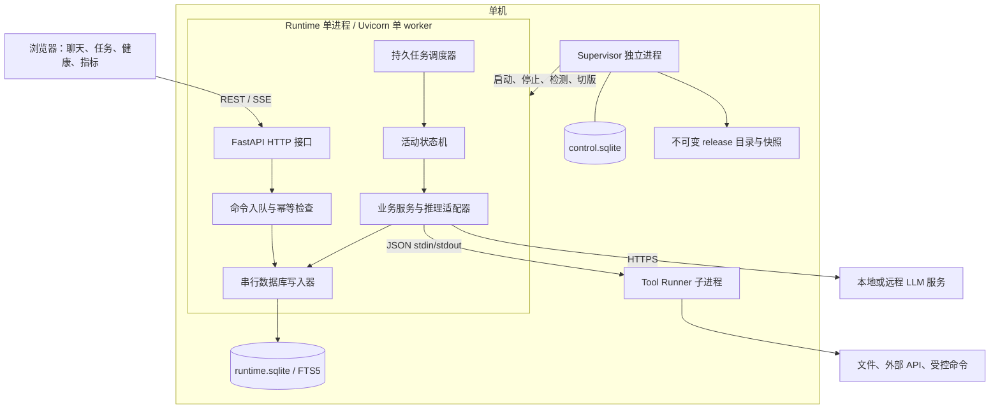

# 数字生命实现层系统架构

| 属性 | 内容 |
| --- | --- |
| 版本 | V0.2 |
| 状态 | 架构、运行契约和接口字段已形成 / 待SQL同步与程序实现 |
| 依据 | 第一阶段 V1.0 与功能模块架构 |
| 部署假设 | 第一版单机、单个数字生命、一个活动部署；浏览器访问本机服务 |

运行协议以[系统运行契约 V1.0](phase-2-system-contracts.md)补齐：独立无会话 LLM 请求、模型结果一次接受、待授权动作、休眠唤醒、取消、初始化、事件去重与部署交接。该文列明尚待同步的数据库增量。OpenClaw 与 Hermes 仅作为执行实现参考。

完整设计入口见[工程架构设计基线](phase-2-architecture-design-baseline.md)，新协议的[数据库增量字段](phase-2-database-increments.md)及[各模块接口](phase-2-module-interface-dictionary.md)已展开，本轮不开始框架编码。

## 1 技术决策

第一版选择 Python 3.12+、FastAPI、Uvicorn、Pydantic、标准库 sqlite3、HTTPX；依赖版本在创建代码骨架时锁定。界面先由 FastAPI 提供静态 HTML、CSS 和 JavaScript，通过 REST 提交命令、SSE 读取活动状态和日志。LLM 通过 HTTP 适配器调用远程或本地推理服务，模型与供应商配置化。

采用两个长期运行的 Python 进程：独立 Supervisor 和 Runtime。另设按任务启动的 Tool Runner 子进程。数据库位于本机磁盘；第一版不需要 Redis、消息代理、微服务或向量数据库。记忆先用 SQLite FTS5 与元数据过滤；向量检索通过可替换检索接口后续加入。FTS5 不提供中文语义检索保证，须单独测试中文分词与召回。

这些是第一版可调整的工程决策，未暗示现有项目已安装上述依赖。

## 2 进程与部署拓扑



Supervisor 由操作系统服务管理启动：macOS 使用 launchd，Linux 部署时提供 systemd 配置。第一版按当前单机环境设计，具体操作系统服务文件在部署阶段编写。

Runtime 只启动一个 Uvicorn worker，活动消费者也只运行一个。多 worker 是多进程，若直接复制应用会重复启动调度器；因此不能仅通过增加 worker 扩展本架构。[FastAPI 部署说明](https://fastapi.tiangolo.com/deployment/concepts/)

## 3 代码结构

```text
src/digital_life/
  api/                 # REST、SSE、认证、请求校验
  runtime/             # 活动状态机、调度、取消、恢复、资源预算
  services/
    perception.py      # 外部信号到观察
    cognition.py       # 证据、信念、预测、方案
    memory.py          # 编码、检索、修订、删除
    personality.py     # 特质与情境作用
    goals.py           # 目标、价值与动机
    habits.py          # 情境—反应权重
    relationships.py   # 对象、信任与历史
    commitments.py     # 承诺状态与截止条件
    decisions.py       # 候选、效用与选择
    feedback.py        # 归因与更新提案
    health.py          # 健康聚合、维护请求
    identity.py        # 实例谱系和连续性
  contracts/           # Pydantic 请求、事件、决策和结果模型
  policy/              # 授权、规则、能力令牌与模式切换
  storage/             # 连接、写入队列、Repository、迁移、备份
  adapters/
    llm/               # 供应商协议、超时、结构化结果校验
    tools/             # 工具注册、Runner 通信、结果核验
  telemetry/           # 结构化日志、指标计算、追踪
  web/                 # 静态界面
src/life_supervisor/    # 独立依赖与启动入口
tests/                 # 单元、集成、恢复、故障注入、行为实验
config/                # 非敏感配置和策略模板
migrations/            # 显式版本化数据库迁移
```

服务间使用 Python 类型化接口调用，长任务通过持久事件和任务表驱动。业务服务不直接使用 FastAPI 请求对象；推理、工具和数据库实现均位于适配层。

## 4 线程与异步模型

Runtime 的 asyncio 事件循环处理 HTTP、调度和外部网络等待。SQLite 写操作由专用线程独占一个连接，通过有界队列提交事务；读操作在线程执行，使用独立连接和短读事务。连接不能在多个线程中无序共享。

协调器只串行推进一个实例的业务状态，网络请求允许异步等待，等待期间数据库不持有写事务。模型回复返回后校验活动是否取消、状态版本是否变化、权限是否撤销，再接受结果。工具运行在子进程，设置超时、输出大小和取消处理；Python 提供异步子进程 API，但资源隔离和权限隔离还需要部署层实现。[Python 官方文档](https://docs.python.org/3.12/library/asyncio-subprocess.html)

SQLite WAL 允许读与写并行，但同一数据库仍只有一个写入者；使用短事务、busy timeout 和 checkpoint 管理，不能把 WAL 当作多写入支持。[SQLite WAL](https://www.sqlite.org/wal.html)、[事务隔离](https://www3.sqlite.org/isolation.html)

## 5 数据库设计边界

Runtime 使用一份 runtime.sqlite，表按所有者分组，通过外键、版本号和 Repository 保持边界。已展开的物理设计见[数据库实现目录](../../database/README.md)；下表采用对应名称，新增运行契约表仍按契约报告待同步。

| 表组 | 核心表 | 关键内容 |
| --- | --- | --- |
| 输入 | perception_signals、perception_observations | 来源、去重键、原始载荷引用、事件时间、接收时间 |
| 调度 | jobs、activities、activity_steps | 状态、到期时间、租约、尝试次数、恢复点、取消请求 |
| 身份 | identity_instances、identity_lineage、object_revision_registry | 实例标识、父级、世代、快照、连续性损伤 |
| 认知 | cognition_beliefs、cognition_evidence_links、cognition_predictions | 结论、证据引用、概率类型、期限和模型版本 |
| 记忆 | memory_items、memory_revisions、memory_source_links、memory_search | 类型、内容、来源、对象、时间、权限、修订与删除标记 |
| 个体参数 | personality_profiles、value_profiles、habit_associations | 参数、适用范围、版本与更新依据 |
| 关系 | social_actors、social_relationships、social_trust_evidence | 对象、分域信任、历史与证据 |
| 目标 | goal_items、goal_transitions、commitment_items、commitment_transitions | 来源、条件、期限、状态和解除依据 |
| 决策 | decision_records、decision_candidates、decision_factor_contributions | 候选集、屏蔽、效用、概率、选择方式、随机种子 |
| 执行 | action_intents、action_attempts、action_results、outbox | 幂等键、对象、授权版本、尝试、回执、未知与副作用 |
| 权限 | grants、policy_versions、approval_requests | 主体、能力、资源范围、到期与撤销 |
| 学习 | learning_feedback、learning_update_proposals、learning_update_trials | 误差、归因、更新对象、试用、评估与回退 |
| 健康 | health_observations、health_incidents、maintenance_attempts | 观测、时效、严重度、措施和独立验证 |
| 观测 | activity_steps、metric_samples、evaluation_runs；runtime_events 待新增 | 活动关联、原始样本、计算版本和实验条件 |

Supervisor 单独写 control.sqlite，记录部署版本、启动尝试、心跳观测、升级事务和回退结果，不直接写 Runtime 业务库。大文件与原始附件放入 blobs 目录，数据库保存内容哈希和访问引用；删除流程必须同时处理检索索引、派生内容与备份保留策略。

数据库启用 foreign_keys；启动时检查 schema 兼容范围。快照使用 SQLite 备份接口或停写一致性方案，不能只复制运行中的主 db 文件而忽略 WAL。

## 6 核心契约

共同事件字段：event_id、event_type、schema_version、instance_id、activity_id、correlation_id、causation_id、source、occurred_at、received_at、payload_ref、authorization_ref。

ActivityContext 包含输入观察引用、活动目标、承诺引用、预算、状态快照版本、授权版本和期限。DecisionRecord 包含候选、屏蔽理由、效用因子、分布、选择策略和预测。ActionIntent 包含操作编号、工具名、校验后的参数、资源范围、前置条件、授权引用和预期可验证结果。

工具结果统一为 succeeded、failed、partial、unknown，并保留原始回执。模型结论、工具回执和环境结果使用不同类型，不能隐式转换。模型输出校验失败进入有限重试或求助，不直接作为命令执行。

## 7 请求到行动的实际调用链

```text
POST /v1/events
 → API 校验认证与载荷
 → 一个事务：写 perception_signals、事件信封 + 创建 job
 → 返回 202 与 event_id、activity_id
 → Scheduler 领取到期 job
 → ActivityEngine 恢复快照并推进步骤
 → PerceptionService → MemoryRepository.search
 → CognitionService → LLMAdapter HTTP 请求
 → GoalsService → DecisionService
 → PolicyService 检查
 → 写 decision + action_intent；授权通过后同事务写授权绑定 + outbox
 → Dispatcher 领取 outbox，再检查当前权限
 → Tool Runner 执行
 → 结果进入持久事件入口，经核验写 action_results
 → 更新目标／承诺、反馈和记忆
 → 健康检查、保存恢复点、完成 job
 → SSE 将已持久化事件推送给界面
```

SSE 断线不影响活动；客户端使用事件序号重连并补读。API 的 202 只表示已接收，不能表示外部任务完成。

## 8 持久队列、时钟与恢复

jobs 以 queued、leased、waiting、succeeded、failed、cancelled 管理。领取任务在短事务中完成，保存 lease_owner、lease_expires_at 与 attempt。重启后扫描未完成任务，过期租约先按步骤类型核对状态再重新调度。asyncio 内存队列只是加速通知，数据库是权威来源。

期限保存 UTC 时间；进程内持续时间用单调时钟。定时承诺写入 jobs，外部管理器保持最小调度能力，在 Runtime 停止计算时到期唤醒。重复唤醒依靠持久去重键消除。

活动状态为 pending、running、waiting_input、waiting_tool、paused、completed、failed、cancelled。Runtime 状态另设 starting、ready、degraded、quiescing、stopped；两套状态不混用。

关闭时停止领取新任务、标记中断、保存恢复点并退出；不能等待无期限模型请求。对正在执行的外部动作，取消只终止后续推进，不宣称已撤销外部效果。

## 9 外部副作用的一致性

内部数据采用事务原子性；外部动作采用持久意图、outbox、幂等键和结果核对。它们共同减少重复或丢失，但不能普遍保证外部动作恰好执行一次。

在“工具成功、本地结果尚未提交”时崩溃，恢复后将该尝试视为 unknown。可查询工具按操作编号核验；支持幂等的工具使用原键重试；既不能查询也不能幂等的高影响动作暂停并请求用户处理。不得直接自动重发。

## 10 API 与控制面

| 接口 | 用途 |
| --- | --- |
| POST /v1/events | 提交用户或环境事件 |
| GET /v1/activities/{id} | 查询活动阶段与结果 |
| POST /v1/activities/{id}/cancel | 请求取消后续推进 |
| GET /v1/events/stream | SSE 活动与审计事件 |
| GET /v1/health | 业务健康和证据新鲜度 |
| GET /v1/metrics | 指标与计算口径 |
| POST /v1/approvals/{id}/decision | 批准或拒绝具体请求 |
| GET /v1/commitments | 检查有效承诺与期限 |
| GET /internal/live | 进程响应，不代表业务健康 |
| GET /internal/ready | 状态恢复、数据库和关键能力就绪 |

Supervisor 的 start、stop、deploy、rollback 控制通过独立本机 Unix socket 提供，只有用户控制端或持有明确维护能力的调用方可访问。Runtime 不持有任意升级管理器和取消用户停止指令的能力。

服务默认仅监听 loopback。用户控制令牌与模型密钥不进入模型上下文。敏感凭据通过操作系统凭据存储或部署秘密配置注入；对外开放服务时必须增加认证、传输保护和明确网络部署设计。

## 11 工具执行与权限模式

工具注册表为每项工具定义参数模型、能力名称、资源范围、超时、是否可逆、是否幂等和结果核验方法。PolicyService 校验后签发短期操作凭据，Runner 仅执行对应操作。禁止将 LLM 输出直接拼成 shell 命令。

第一版 Runner 使用显式可执行程序和参数数组，独立工作目录，限制环境变量与输出。单纯子进程不是安全隔离；按授权范围需要使用操作系统账户或容器等实际文件和网络边界。开放模式减少指定范围内的逐项确认，范围仍通过工具和运行环境配置生效。

## 12 部署目录与版本切换

```text
deployment/
  supervisor/          # 独立安装、独立环境
  releases/<release>/  # 主程序代码、依赖环境、构建清单
  active.json          # 当前部署清单，由 Supervisor 写入
  data/runtime.sqlite
  control/control.sqlite
  blobs/
  snapshots/
  logs/
```

候选版本先在独立目录、测试数据库和禁用真实外部副作用的环境中运行。通过 schema 兼容、启动、基本活动和唤醒检查后，Supervisor 暂停旧版领取任务，等待或标记在途动作，停止旧版，备份并切换部署清单，再启动新版。单实例初版接受短暂停机，不采用双活动进程同时写业务状态。

新版本未就绪或观察期失败时，Supervisor 停止新版，核对数据库兼容性后恢复旧版。优先让前后版本支持相同 schema；破坏性迁移必须有单独迁移和恢复方案。若必须回滚数据，明确记录丢失窗口，核对外部动作和承诺，不能只回退代码便宣称恢复成功。

Supervisor 本身的升级不属于普通 Runtime 自更新。用户停止标记持久化，崩溃重启策略不得覆盖该标记。

## 13 观测和指标计算

所有步骤日志关联 event_id、activity_id、decision_id、action_id、release_id、model_id 和 policy_version。指标从持久样本计算，保留公式版本、分母、缺失值和任务分层。

实现层第一批指标为队列延迟、写入失败、模型请求超时、活动完成、动作 unknown、恢复耗时、内存和磁盘余量。生命功能指标另由 evaluation_runs 计算，包含人格干预、认知校准、记忆召回、承诺恢复和五项判据实验。

日志排除密钥，内容按访问规则和保留期处理。审计记录可追踪不等于防恶意篡改；若开放模式允许修改本地所有文件，可信审计与恢复保护必须置于更高权限或独立载体。

## 14 先实现的纵向切片

第一批代码交付以一个可运行链路为目标：Supervisor 启动 Runtime；API 写入事件；持久队列领取；调用可替换的测试推理器；查询记忆；形成目标和行为；执行一个可核验的测试工具；记录结果；重启后恢复承诺与未完成任务。

测试推理器验证编排和恢复，不作为真实人格或认知功能通过证据。接入真实模型后再验证生命指标。关键故障测试覆盖提交后未消费、工具成功后崩溃、模型超时、授权撤销、磁盘写入失败、新版启动与唤醒失败。

架构验收首先要求代码能够安装启动、请求可追踪、状态可恢复、未知执行不盲目重试、版本可回退；各项生命功能有效性则按第一阶段指标独立验收。

## 15 与上一份设计的映射

上一份是生命功能模块划分；本文件确定其实现位置：感知、记忆、人格等落为 Runtime 内部 services；生命活动协调器落为持久状态机和调度器；独立生命周期管理落为 Supervisor；行为执行落为 outbox、Dispatcher 和 Runner；身份与承诺落为版本化表及恢复协议；数字健康落为 Runtime 内部检查与 Supervisor 外部探测。

后续详细设计应从 contracts、数据库迁移和 ActivityEngine 状态转换展开，再创建最小代码骨架。
