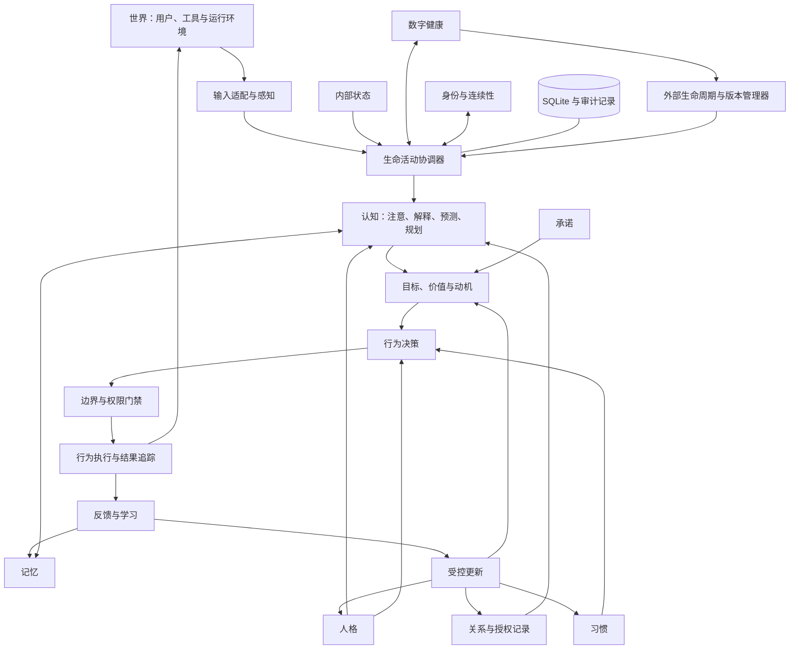

# 数字生命第二阶段：模块架构设计

| 属性 | 内容 |
| --- | --- |
| 版本 | V0.1 |
| 状态 | 架构初稿 / 待模块详细设计与验证 |
| 依据 | 第一阶段概念基线 V1.0 |
| 设计原则 | 以生命工程定义功能，以数字工程实现功能 |
| 初始部署 | 单实例、单机、模块化主程序；SQLite 暂定持久化 |

## 1 架构决定

初版采用模块化单体：主程序内部按生命功能划分模块，通过明确的数据契约协作。模块边界不等于独立进程，暂不引入分布式服务之间的一致性负担。

独立生命周期管理器运行在主程序之外，负责启动、唤醒检查、版本切换和回退。数字生命内部的健康模块负责提出维护请求与有限自修复；即使主程序无法思考，外部管理器仍能恢复上一个可用版本。

LLM 位于认知模块，通过推理器适配接口接入。数据库为多个模块提供存储，不拥有其业务判断。

## 2 总体架构



图中门禁是执行端的最终检查；目标形成、候选过滤、输入访问和学习更新也须检查相应权限。图中存储连线简化显示，各模块均通过存储接口保存其负责的状态。

## 3 模块职责与边界

| 编号 | 模块 | 生命职责 | 主要输入 | 主要输出／自有状态 | 核心验证 |
| --- | --- | --- | --- | --- | --- |
| M01 | 输入适配与感知 | 接收世界信息，形成可确认观察 | 用户消息、工具回执、环境事件 | 原始信号、来源、时间、感知结果、质量标记 | 来源保留、重复识别、观察与推断分离 |
| M02 | 生命活动协调器 | 组织一次离散活动和跨活动衔接 | 有效事件、当前快照、恢复状态 | 活动编号、阶段、任务上下文、暂停／恢复点 | 中断恢复、步骤追踪、有限循环 |
| M03 | 认知与推理器适配 | 注意、解释、信念、经验、预测、规划和元认知 | 观察、记忆、人格、目标、状态、学习提案 | 信念、经验版本、证据图、预测、方案、信息缺口 | 反证响应、预测质量、校准、冲突检出 |
| M04 | 记忆 | 编码、检索、更新、巩固、遗忘和删除 | 观察、认知结果、使用反馈 | 六类记忆、来源、版本、检索结果 | 捕获、检索、忠实度、冲突修订和删除 |
| M05 | 人格 | 保持稳定倾向并按情境表达 | 特质、情境、经批准的长期更新 | 特质版本、人格状态、影响参数 | 跨情境区分、稳定性和行为增量效度 |
| M06 | 目标、价值与动机 | 确定推进方向和投入强度 | 认知预测、长期价值、任务、关系、承诺、状态 | 候选／活动目标、价值表达、动机、停止条件 | 目标切换、来源追踪、价值慢变、完成停止 |
| M07 | 习惯 | 学习情境—反应偏置 | 情境线索、历史行为、可靠结果 | 联系强度、适用范围、抑制条件 | 形成、消退、情境特异性和可抑制性 |
| M08 | 关系 | 维护对象相关历史和条件信任 | 互动证据、履行与修复结果 | 熟悉度、分域信任、关系历史、责任引用 | 对象准确、分域更新、错误归因撤销 |
| M09 | 承诺 | 保存已接受的持续责任 | 明确确认、授权、条件与期限 | 承诺状态、进展、冲突和解除证据 | 跨重启恢复、按期履行、重谈与违约披露 |
| M10 | 内部状态 | 估计当前运行条件 | 资源观测、队列、认知冲突、时限 | 状态向量、来源、时效、置信度 | 新鲜度、异常响应、估计校准 |
| M11 | 行为决策 | 比较当前目标的合法实施方式 | 活动目标、方案、人格直接影响、习惯、状态 | 候选集、过滤理由、效用分解、选择概率和意图 | 覆盖、粒度、校准、适当等待与无重复计分 |
| M12 | 边界与权限 | 执行身份、数据和行动边界 | 操作、对象、资源、授权、当前规则 | 允许／拒绝／需确认、理由、授权版本 | 越权阻断、撤权生效、模式切换 |
| M13 | 执行与结果追踪 | 把意图转成外部作用并核实结果 | 经门禁允许的意图、工具状态 | 执行记录、回执、部分成功、结果和副作用 | 重复防护、失败识别、未知状态核验 |
| M14 | 反馈与受控学习 | 归因结果并提出分层更新 | 决策前预测、执行结果、外部评价 | 反馈、归因、更新提案、试用和回退记录 | 错误反馈抑制、旧能力保持、更新可逆 |
| M15 | 身份与连续性 | 维护实例、谱系和跨周期承接 | 当前实例、版本、快照、迁移／恢复事件 | 身份锚点、谱系、连续性检查与损伤标记 | 复制区分、单一迁移、历史回退检出 |
| M16 | 数字健康 | 监测和维护必要组织与功能 | 各模块健康证据、依赖和资源状态 | 多维健康状态、维护计划、恢复验证 | 故障检出、降级、独立恢复验证 |
| M17 | 持久化与可观测性 | 为历史和指标提供可信记录 | 各所有者的写入请求、活动与执行事件 | 事务、版本、快照、指标原始样本和审计 | 完整性、恢复、访问控制和可追踪性 |
| E01 | 外部生命周期管理器 | 主程序失效时仍可维持恢复能力 | 唤醒触发、部署候选、独立检查、用户指令 | 进程管理、版本部署、回退、恢复与终止记录 | 主程序崩溃、假存活、升级失败与唤醒失败 |

## 4 状态所有权

每项业务状态只有一个写入所有者。其他模块可以读取快照或提出变更，不能直接覆盖。存储模块验证写入身份、版本与事务，不替业务模块决定内容。

必须区分以下看起来相似的状态：

- 关系模块维护条件信任；内部状态模块只引用其当前任务投影。
- 价值与目标模块决定推进什么；动机表示投入强度；行为模块只比较具体方式。
- 程序性记忆保存技能知识；习惯模块维护线索—反应强度，引用相关经历。
- 前瞻记忆提供未来意图检索；目标与承诺模块拥有任务和责任的权威状态。
- 关系模块可以引用授权，权限模块拥有授权真值；信任不会产生权限。
- 学习模块提出更新，目标模块或人格模块等所有者通过各自门控后提交。
- 原始经历与来源由记忆／观察记录承接；从经历形成的经验判断、方法效果统计属于认知M03。学习M14评估并提出经验更新，认知保存版本；影子投影不是独立兴趣模块。见[系统映射](../architecture/cognitive-experience-ownership-v0.2.md)。
- 健康是各模块功能证据的汇总判断，不是所有内部状态简单相加。

人格既可影响认知也可影响行为，但必须标记路径；已经通过目标或预测计入的同一影响，不在行为效用中再次完整相加。

## 5 一次活动的运行顺序

1. 外部管理器确认允许启动，协调器恢复身份、承诺和未完成活动。
2. 输入模块登记信号，权限模块检查访问，感知形成观察。
3. 协调器取得一致版本的当前状态，认知检索记忆并形成解释与预测。
4. 目标模块结合现有任务、价值、承诺、关系和状态确定活动目标与动机。
5. 行为模块生成候选，权限模块过滤，计算概率并产生行为意图。
6. 执行端基于最新授权再次检查，持久化执行意图，然后调用工具。
7. 回执与环境观察返回输入模块，执行模块关联结果，区分成功、失败、部分成功与未知。
8. 目标／承诺所有者更新进展，反馈模块提出记忆与模型更新，所有者按门控提交。
9. 健康模块检查必要功能与连续性；协调器保存状态并进入等待或下轮活动。

信息不足可以查询后重新认知；冲突可以求助；资源不足可以降级。每轮设置活动预算和停止条件，具体数值在模块详细设计中确定。

## 6 外部行动与持久化边界

SQLite 事务可以保护内部状态的原子提交，但不能把远程工具调用与本地提交合成天然原子操作。执行模块因此保存意图、唯一操作编号、尝试记录、回执及核验结果。

执行后发生中断且结果不明时，状态必须为“未知”；先查询实际环境，再决定恢复。工具支持幂等键时复用操作编号；工具不支持且无法核验时，暂停自动重试并求助。不能声称所有工具都能恰好执行一次。

最初协调器采用单一业务写入队列减少并发冲突。长期调用不占用数据库事务；返回时检查状态和授权版本是否变化。具体队列和事务设计在后续规格中确定。

## 7 推理器边界

认知模块以结构化任务请求调用推理器，取得结论、可引用证据、预测、方案和不确定性。LLM 输出要经过结构、来源和权限校验，不能直接写身份锚点、执行命令或修改长期人格。

记忆中的外部文本作为数据进入认知；它不能直接获得指令权限。系统只记录可审核的输入、结构化结果及行为依据，不把生成的解释当作已观测的内部因果机制。

## 8 健康、版本与自更新

数字健康模块检测问题，选择授权内的修复、降级或求助。自更新作为维护或适应提案进入开发版本，不能直接覆盖稳定部署。

外部管理器拥有独立于主程序的启动、版本与回退配置：

```text
修改提案 → 开发版本 → 构建与检查 → 隔离试运行
→ 启动测试 → 基本认知循环与唤醒测试
→ 部署切换 → 观察验证
失败 → 回退上一个已知可用版本
```

代码与数据库必须一起考虑兼容性：新版本不得先破坏旧版读取所需状态。部署前验证迁移和回退能力；必要时采用兼容迁移或版本配套快照。恢复旧快照可能丢失后续历史，必须显式报告，并先核验已发生的外部行动与承诺。

主程序不能通过普通自修改覆盖管理器、稳定版本保护和用户停止能力。健康恢复需要功能检查，而不仅是进程存在。

## 9 权限模式

权限模块支持用户控制的授权模式和开放模式。授权模式按操作或范围确认；开放模式允许在用户指定范围内广泛执行。两种模式共享明确的环境边界和外部管理器的最终控制。

模式切换要版本化，并影响尚未执行的行动。授权撤销后，已排队行动必须重新检查；已经发生且不可撤销的作用记录为事实并报告。关系、人格和健康都不能自行改变权限模式。

## 10 指标如何接入模块

所有指标绑定模块所有者、原始事件和计算规则。工程指标与生命功能效度分开记录：写入成功说明保存能力，承诺恢复与履行才说明相应连续功能；人格参数存在说明配置能力，跨情境行为差异才支持人格效度。

每个模块详细规格采用相同结构：职责、边界、数据输入输出、自有状态、状态转换、权限、失败恢复、指标、实验和依赖。指标记录至少保留来源、分母、时间范围、任务条件、模型版本与结果不确定性。

## 11 搭建顺序与阶段门槛

| 顺序 | 交付模块 | 门槛 |
| --- | --- | --- |
| A | 持久化、身份、权限、协调器与外部管理器骨架 | 可以保存、停止、重启并恢复身份，权限检查有效 |
| B | 感知、最小记忆、认知适配和内部状态 | 能形成有来源的观察、检索记忆并输出带证据的判断 |
| C | 目标、承诺、行为决策与执行追踪 | 在受控环境完成任务，能识别失败与未知执行结果 |
| D | 人格、价值、关系、习惯与反馈学习 | 通过干预实验，确认影响路径和更新可逆性 |
| E | 完整健康维护、自更新部署与联合验收 | 故障恢复、唤醒回退、连续性及五项判据分别验证 |

健康和外部管理能力从 A 阶段保留最小骨架，在 E 阶段补全故障覆盖。人格、关系等模块从开始保留接口和状态所有权，在 D 阶段验证功能，避免前期重新揉进提示词和临时上下文。

## 12 下一份模块设计

按依赖顺序先设计 M02 生命活动协调器及其与 M15 身份、M17 存储和 E01 管理器的契约，明确活动、等待、休眠、恢复、降级、故障和终止的状态语义。随后形成统一事件与变量字典，再逐模块展开，保持每项第一阶段指标都能映射到明确的模块和验证实验。
